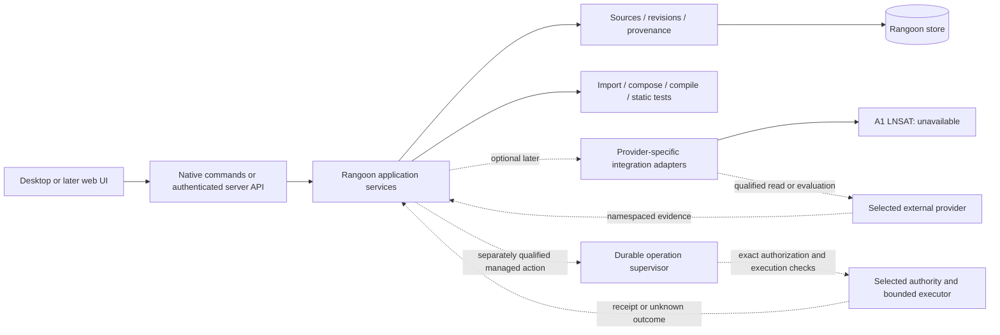

# Rangoon application architecture and optional provider interoperability

Authority: [intent.md](intent.md), October 5 engine architecture and October 7 provider-independent continuations. This preserves the implemented [A1 integration boundary](engine-integration.md) and adds the canonical [optional interoperability direction and I1 packet](provider-interoperability.md). Long-term stages are recommendations, not implementation, release qualification or permission to activate external systems.

Owner: Jeff. Architecture, trust boundaries, schema, integration and release decisions remain with the primary controller. Validation/publication state belongs in [development.md](development.md).

## Purpose and first useful outcome

Rangoon should turn scattered agent instructions into understandable, reusable capabilities, then make the change from an idea to a deployed or executed action inspectable. Its first useful promise is: **know what an agent is configured to do, where those instructions came from, and what a proposed change will preserve or lose.** That is valuable without a running LNSAT engine, a model account or a cloud subscription.

The supplied images describe a connected product lifecycle, not twenty unrelated dashboards. Import, Decompose, Merge/Split, Skills and Workflows should operate on the same versioned records. Command Center summarizes those records and real operation states. Connectors expose precisely available operations and authority boundaries. Test Lab, Compile, Deploy and Audit should show the actual evidence produced by their respective services. Sample numbers and decorative graphs must give way to useful empty, unavailable and recovery states as each real service arrives.

The accepted October 7 [product-value priority](plan.md#delivery-priority-demonstrate-product-value-before-expanding-infrastructure) puts usable local refactoring and export ahead of additional disconnected scaffolding. Preserve current optional-provider/operations contracts, but connect them only through reviewable user outcomes. The source-implemented [export handoff](export-handoff.md) reuses the strict bundle verifier; actual target-loader qualification and attributed model-proposal application remain separate gates. The accepted E1 priority now controls the next implementation slice, as clarified in the [delivery plan](plan.md#delivery-priority-demonstrate-product-value-before-expanding-infrastructure). No new runtime, authority or platform support is inferred.

## Core decisions

1. **One modular application, three desktop operating systems.** Keep the existing Rust domain/services and scoped Tauri host. Evolve the current vanilla-JS workbench into a shared typed UI incrementally when the revision editor needs it; a framework rewrite is not a prerequisite for useful features. No second desktop shell or separate Windows product.
2. **Content management is independent of execution authority.** Rangoon owns source, assets, review, composition, compatibility, jobs and their presentation. LNSAT is a separate product and optional authority/evidence integration. External providers retain their own identity, authorization, enforcement and operational semantics. No absent, disabled or failed integration may block local startup, reading, authoring, decomposition, composition, revisions, comparison, compilation, export or inspection.
3. **One authoritative record per concern.** Immutable source and asset revisions in Rangoon; authority decisions and consequence evidence in LNSAT or another explicitly qualified provider. The graph, counters, search index and UI are derived views. Never use an engine database as a shared application database.
4. **Ports precede integrations.** Format importers, compilers, analysis providers, connectors, execution targets and authority providers have separate interfaces. Their availability and tested capability subsets are explicit. A logo, credential or installed package does not imply an operation is supported or authorized.
5. **Build safe content work now; qualify integrations separately.** A1 provides honest unavailable functions. It does not recreate LNSAT with a permissive mock. The first neutral integration packet uses only offline fixtures; each later adapter has its own product/version/capability and privacy qualification. Provider allow is not Rangoon approval or execution permission. Broad integration coverage is not a local workbench release gate.

The October 13 [scoped support direction](provider-interoperability.md#scoped-support-commitments) qualifies specific adapter operations and deployment paths. Common ownership makes Rangoon plus LNSAT the strongest end-to-end assurance candidate, not a current guarantee; all live adapters remain unqualified. External providers retain their responsibilities. Replacing providers requires a loss-aware preview and refusal when mandatory controls are missing. [Coverage/control-assessment colors](operations-control-plane.md#coverage-and-control-assessment-presentation) explain scoped evidence independently of availability and authorization.

## Approval, telemetry and live operations are core

The October 7 accepted [operations control-plane contract](operations-control-plane.md) adds approval management, redacted correlated telemetry and dynamic graph/timeline/replay as core product surfaces. Rangoon manages configuration and routing; a selected qualified authority engine issues scoped authorization and a trusted execution path checks it at consumption. Human and bounded delegated-agent stages cannot bypass policy or mandatory human duties. Delegation cannot self-expand. Keep per-operation enforcement coverage explicit across systems and engines.

Build inert application records/projections first, then local operations views and bounded read-only ingestion, followed by one qualified enforcement path and cross-system/hosted conformance. The graph and approval inbox are derived projections; they cannot issue authority. Telemetry, verified engine evidence and actual execution outcomes remain distinct. These stages are planned; A1 stays unavailable and no live collector, approval service or executor is introduced by this architecture update.

## What exists and where the application grows

| Component | Responsibility | Current state and next boundary |
| --- | --- | --- |
| `preview/` workbench | Source/section inspector, saved sources, Skills, composition editors, Workspace, Compile inspection, bundle Export/Inspect, local Operations window, integration status and launch; separate synthetic design surfaces | Real saved-content routes and a one-file read-only O2 operator view coexist with clearly separated sample design screens; native GUI qualification remains incomplete |
| `apps/desktop` | Window lifecycle, explicit file selection, trusted app-local path, narrow commands | Implemented host with bounded local/cloud model orchestration, explicit OS credential-editor commands and read-only O2 selected-window custody; no generic shell, renderer-selected host paths or ambient credential access |
| `rangoon-integrations` | Pure optional-provider metadata and immutable offline fixture inspection | I1 source implements eight unavailable candidate entries, pinned synthetic profiles, bounded canonical evidence and fixed no-authority outputs; no native IPC/command wiring or real adapter. Final conformance/source qualification belongs in the ledger |
| `rangoon-domain` | Byte identity, spans, source and fragment report types, capability revision contracts | R2b capability/revision contracts implemented and locally tested; macOS lifecycle checked |
| `rangoon-import` | Deterministic bounded parsing of caller-supplied bytes | Implemented Markdown subset; bounded folder/archive inventory later |
| `rangoon-host` | Safe read/write helpers for explicitly selected local files | Bounded bundle helpers verify before exclusive create; a separate O2 helper reads one explicit operations JSON file up to 2 MiB without retaining it; isolated macOS baseline export/inspect GUI passed, but O2/native and broader GUI qualification remain open |
| `rangoon-store` | Rangoon-local transactional repository | Version-aware schema 4 includes workflow history alongside snapshots, capability revisions/reviews and composition; backup/restore/deletion and read-only compilation remain local; legacy APIs keep their schema refusal gates |
| `rangoon-compose` | Pure recipes, coverage and destination application | Decompose/Merge/Split over pinned inputs; full GUI/release qualification remains in the ledger |
| `rangoon-compile` | Pure instruction artifacts, compatibility diagnostics, candidate identities and portable bundle verification | R4a profiles plus exact-byte bundle encoder/strict verifier; native command/UI source is published and an isolated macOS baseline passed; complete GUI and target-loader qualification remain open |
| `rangoon-workflow` (W1/W2a) | Portable workflow definitions, structural validation and immutable revision candidates | Pure W1 definition inspection implemented under [workflow definitions](workflow-definitions.md): typed ports, bounded strict JSON, graph diagnostics, data dominance and canonical content identities; exact validation/publication evidence belongs in the ledger. Portable immutable draft/validated-intent records and bounded node positions are implemented under the [W2 record contract](workflow-records.md). W2b durable schema-4 storage/recovery, six W2c native authoring commands and W3 real library/canvas/inspector source are published through PR38; native workflow GUI save/restart/failure and all-three-OS qualification remain open; no execution path |
| `rangoon-ops` | Bounded operations observation, relationship inspection and renderer-safe projection | O1a/O1b source decodes closed observations and projects structural, relationship, delegation, approval-duty and lifecycle inspections. O2 builds a privacy-minimized operator view with separate reported decision counts. Authenticity remains unverified, eligibility unknown and authority none; no collector, authenticated approval service, live provider evidence or execution. |
| `rangoon-engine` | Application integration status and engine-dependent port | A1 inert placeholder; no transport, detection or authority |
| `rangoon-model-assistance` | Pure bounded M1a context packing and advisory-response validation | `prepare_pack` and `validate_response` accept bounded JSON, preserve exact selected/protected byte ranges, account for omissions, deduplicate only identical complete blocks with per-input aliases, and validate canonical task payloads and inert proposals; no transport, native/CLI/UI connection, HTTP/provider adapter, tokenizer, credential, consent, or model-call path |
| `rangoon-model-local` | Source-only M1b numeric-loopback transport for prepared advisory requests | `LocalProfile::parse`, `PreparedRequest::new`, and explicit `LocalClient::check`/`analyze` use direct Tokio TCP and Hyper HTTP/1 for `127.0.0.1`/`::1` with an explicit port/model; bounded profiles, request identity, response validation, cancellation, timeout, one-flight guard and strict advisory results are implemented. No proxy, redirect, retry, fallback, credential, model launch or background traffic. A loopback peer may forward or retain data. The library opens connections only when its native application caller invokes an operation; native IPC, consent and renderer/UI wiring now exist, with separate cloud integration and credential custody now implemented in source; model compatibility and runtime qualification remain open. M1b/V1 remain incomplete; no real-model compatibility claim |
| `rangoon-model-session` | Portable session-only profile/request custody and saved-record resolution around the model libraries | `LocalSession` owns one optional profile, one prepared request and one active operation in memory. It packs exact nonempty saved source or capability-revision records as protected full-content selections, rejects empty inputs, issues random single-use handles, checks generation/cancellation, releases matching RAII leases, and exposes pre/post freshness checks. No network or authority behavior; the native host now owns commands, review and consent, while local and cloud qualification remain separate V1 work |
| `rangoon-cli` | Headless use of the same application functions | Source analysis and A1 diagnostics plus bounded stdin-only portable-bundle inspection/exact artifact stdout under [export handoff](export-handoff.md); source acceptance belongs in the ledger. Capability mutations remain native desktop only; no filesystem installer or alternate execution path |
| Future application service | Coordinate revisions, validation, jobs and projections | Extract from host when the second real workflow appears; host and server must call the same use cases |
| Future job supervisor | Durable attempts, cancellation, bounded concurrency and recovery | Required before long-running analysis, real test runs or connectors; not needed for a constant A1 status |
| Future server | Authenticated workspace and worker API | Later self-hosted phase; not an HTTP wrapper around privileged Tauri commands |

Dashed paths are planned and optional. The local content/transform/store path has no provider dependency. No live engine/executor path exists in A1. Each connected provider retains its native decision/evidence semantics; an allow result cannot cross into execution. A governed action needs a separately qualified authority/executor contract, not a generic provider success flag. See [interoperability](provider-interoperability.md) for the current/planned matrix and first packet.

## Records and state transitions

| Record | Identity, ownership and rules |
| --- | --- |
| Source snapshot | Current R2a identity binds basename and exact bytes; immutable, original digest retained. No absolute path is saved. A source digest is not authenticity or permission. |
| Project | Future stable ID grouping source references, target adapters and local preferences. A project is not a filesystem grant or tenant. Root bindings need their own explicit selection and revocation. |
| Proposal | Candidate extraction, split or merge with exact source spans, generator version and unresolved coverage. It can be rejected without losing the source. |
| Capability and revision | Stable capability ID plus immutable revision. Content, dependencies and requirements have independent review state. Review records who accepted a particular revision; it does not approve execution. |
| Provenance edge | Exact input revision/span to output revision, derivation type and tool version. Every edit retains its inputs; deleted/unassigned source is visible. |
| Content composition | Exact source/capability revision ranges, ordered authored/replacement pieces, coverage and explicit skill destinations. Its editable graph projects existing recipe records. |
| Workflow definition | A distinct versioned graph with exact capability revisions, control paths, typed data mappings, branches and human checkpoint declarations. W1 validates structure; later saved workflow identity/revisions remain independent from run state and execution authority. |
| Compatibility report | Target/version/adapter digest, preserved/adapted/unsupported concepts, diagnostics and tests. Unsupported security-sensitive meaning blocks compilation. |
| Bundle / export plan | The implemented bundle holds a canonical manifest, exact artifact bytes, component lengths and a checksum of preceding bytes; local Export re-resolves and recompiles after picker selection before exclusive plaintext creation, and external Inspect opens no workspace. Inspection also reports the whole-file digest. Destination grants and expected existing state belong to future export/installation plans. Export and activation are separate operations; checksum and identities establish internal consistency only. |
| Job / attempt | Stable job ID, input revision, attempt ID, cancellation request, lease, state and result references. The next attempt is a decision, not an automatic consequence of a timeout. |
| Engine evidence reference | Provider identity, exact external ID, contract version, observation time, integrity/freshness status and bounded raw evidence. Do not convert an app cache into an engine-issued receipt. |

Content lifecycle: `source snapshot → proposal → reviewed capability revision → pinned composition → validated bundle → explicit export`. An edit creates a new revision and invalidates dependent validation; it does not mutate the previous reviewed revision in place. A comparison can explain additions, moved spans, exclusions and unresolved conflicts before acceptance.

Execution lifecycle is separate: `planned → awaiting engine decision → awaiting human approval if required → eligible for bounded consumption → submitted → succeeded / failed / outcome unknown`. These are conceptual states until the exact engine contract is bound. “Approved” is never a synonym for “executed.” Unknown effect requires reconciliation; a crash, cancellation or lost response cannot be presented as proof that nothing happened. No automatic retry of consequential work after an uncertain outcome.

## Make the images work as one application

| Surface | Actual user action and application work | External integration dependency | Failure and completion evidence |
| --- | --- | --- | --- |
| Import & Analyze | Select a file now; later choose a bounded project root. Inventory bytes without executing scripts/hooks. | None for local parsing and save | Actual inventory, rejected/unreadable files, exact digests; no silent partial success |
| Decompose | Mark source spans, propose reusable capability boundaries, review missing coverage, accept revisions | None for manual/deterministic work; optional analysis has a separate provider/egress policy | Original text remains accessible; no fabricated confidence percentage |
| Merge & Split | Preview derivation graph, resolve competing constraints, preserve input revisions, accept new revisions | None for content transformation | Coverage ledger plus unresolved conflicts; undo restores references, not destructive history rewrite |
| Skills | Inspect, edit and compare exact capability revisions and usage | None for catalog/review | Review, tests and target compatibility are distinct badges; “published” alone is insufficient |
| Workflows | Compose typed nodes and branch data; validate dependency cycles and missing inputs | None for authoring/static validation; a qualified selected authority is required for advertised governed effects | Static simulation clearly labeled; real runs use durable attempts and engine evidence |
| Connectors | Inspect operation manifests, required credentials by reference, target scope and tested support | Only a qualified selected authority/enforcement path for managed consequential operations; not necessarily LNSAT | Credential presence is not connected/authorized; timeout is unknown when effects are possible |
| Test Lab / Simulations | Static rules, golden fixtures, deterministic replay; later isolated real harness trials | Not required for pure fixtures; required where a trial can have governed effects | Separate static, simulated and actual evidence; show test inputs/version/environment |
| Compile / Deploy | Compile reviewed content, preview output diff and semantic loss, export to selected directory; later explicit activation | Pure compilation does not need engine; activation depends on exact target and managed boundary | Target drift aborts apply; rollback covers declared reversible effects only |
| Command Center / Audit | Summarize real workspace jobs and exact authorized engine evidence | Only provider-derived sections; local workspace inspection remains available | Empty/unknown/stale states instead of sample “98.6% compliant”; every metric has denominator, period and source |

Ease of use comes from progressive disclosure: show the next useful action and why it is blocked; retain context through failure; let users get back to their source. Keep one primary action per stage. Show provenance/conflicts alongside the editor when they matter, not as a required security tutorial on every screen.

## LNSAT findings that change the integration plan

Inspected public source: [`e09a6b02634b04a46f861ed8b092acc2c2e50fe8`](https://github.com/hypler-dev/LNSAT/tree/e09a6b02634b04a46f861ed8b092acc2c2e50fe8). This is a dated source review, not a runtime test or completion assessment. Product 0.1.0, wire `v1_0`, feature surfaces and storage schema must not be collapsed into a “version 1 ready” badge.

| Finding at this commit | Consequence for Rangoon | Source |
| --- | --- | --- |
| Exact `LNSAT-Contract-Version` negotiation, ordered boundary gates, no automatic version downgrade | Pin and reject incompatible responses; version match does not bypass authentication or policy | [Gateway negotiation](https://github.com/hypler-dev/LNSAT/blob/e09a6b02634b04a46f861ed8b092acc2c2e50fe8/docs/architecture/GATEWAY_V1_CONTRACT_NEGOTIATION.md#L12), [versioning](https://github.com/hypler-dev/LNSAT/blob/e09a6b02634b04a46f861ed8b092acc2c2e50fe8/docs/reference/CONTRACT_VERSIONING.md#L20) |
| Browser session token and independent proof headers; ambient cookies withdrawn | Future transport and secret custody need a dedicated native design. Never send tokens/proof through the renderer, content store or logs | [Header boundary](https://github.com/hypler-dev/LNSAT/blob/e09a6b02634b04a46f861ed8b092acc2c2e50fe8/docs/architecture/SECURITY_LOOPBACK_BROWSER_SESSION_HEADER_HARDENING.md#L20) |
| Authenticated Unix socket path withdrawn pending accepted mutual authentication | Do not build on a convenient local bearer socket, same UID or pathname as peer identity | [Local auth withdrawal](https://github.com/hypler-dev/LNSAT/blob/e09a6b02634b04a46f861ed8b092acc2c2e50fe8/docs/architecture/SECURITY_LOCAL_AUTH_AVAILABILITY_AND_UDS_WITHDRAWAL.md#L14) |
| Headless declarations are bounded, closed-schema and narrowing; effective/export remain diagnostic, export non-reimportable | Configuration preview cannot become an “Apply policy” button; own draft editing separately from engine validation/admission | [Configuration specification](https://github.com/hypler-dev/LNSAT/blob/e09a6b02634b04a46f861ed8b092acc2c2e50fe8/docs/architecture/headless-configuration/spec.md#L42) |
| Exact approval-request, decision and audit-event reads; `ReadEvidence`, no search/list/query on these routes | Begin with exact evidence lookup after transport qualification. Do not invent global approval lists or polling endpoints | [Monitoring specification](https://github.com/hypler-dev/LNSAT/blob/e09a6b02634b04a46f861ed8b092acc2c2e50fe8/docs/architecture/headless-monitoring/spec.md#L12) |
| SDK packages are private, unpublished source references; MCP is an adapter | No npm installation claim or embedding a second authority engine; actual adapter needs a pinned supported distribution/interface | [SDK inventory](https://github.com/hypler-dev/LNSAT/blob/e09a6b02634b04a46f861ed8b092acc2c2e50fe8/docs/sdk/README.md#L10), [TypeScript boundary](https://github.com/hypler-dev/LNSAT/blob/e09a6b02634b04a46f861ed8b092acc2c2e50fe8/docs/sdk/typescript-reference.md#L30) |

The source review shows useful existing contracts and several still-gated runtime/control lanes. It does not substantiate a percentage-complete claim. Some diagnostic file-identity paths are Linux/macOS-specific; Windows Rangoon content management remains an initial-release target, while each Windows engine-dependent operation needs independent evidence.

## Build now, replace placeholders deliberately

| Stage | Concrete delivery | Exit gate |
| --- | --- | --- |
| A1 now | Inert `rangoon-engine` port, CLI and real native status, five unavailable seams, integration page and this map | No connection attempted, no grant/success output, bad/future UI status fails closed; tests and native/browser evidence |
| R2b current | Reviewed capability revisions derived from saved snapshots, exact span coverage, compare/revise and local review | Source tests and independent review passed; macOS lifecycle passed. Windows/Linux GUI qualification remains pending. See the development ledger for immutable original, stale-revision rejection, content-bound local review and recovery evidence |
| R3 | Real Decompose and Merge/Split over these revisions | Conflict and excluded-span accounting, version history, reversible edits; no silent policy weakening |
| R4/R5 | R4a pure instruction compiler and stored-revision service, exact-byte bundle encoder/strict verifier, bounded selected-file host helpers, plus native Export/Inspect UI and explicit export implemented in this source | [Compiler contract](compilation.md), [bundle contract](instruction-bundle.md) and [native bundle UI contract](instruction-bundle-ui.md) define initial byte-preserving subset; isolated macOS baseline Compile/Export/Inspect passed, while complete GUI qualification, meaningful loss report, target qualification and drift/collision handling on all three OSs remain distinct gates. Publication evidence belongs in the [development ledger](development.md) |
| A2 | Qualified engine transport and exact compatibility/readiness inspection | Accepted peer authentication, secret custody, no renderer credentials, explicit feature matrix, hostile-response/redirect/origin/version tests |
| A3 | Diagnostic configuration and exact evidence readback | Validated request/response fixtures, exact IDs, redaction, freshness/integrity state; reads never become authorization |
| A4 | One disposable governed operation and reconciliation | Exact request/decision/approval/consumption/receipt chain; crash before/after effect, replay, expiry/revoke and unknown-outcome tests |
| M1 | Optional-to-use local and cloud model assistance, both required V1 capabilities | M1a pure context packing and inert response validation now exists in `rangoon-model-assistance`; source-only M1b local transport exists in `rangoon-model-local`, and the native workbench now supplies session-only custody, narrow IPC and exact-payload OS consent; bounded cloud adapters, credential custody and native cloud consent are source-implemented; proposal application, tokenizer/accounting, real-model compatibility and all-three-OS qualification remain separate gates in [model-assistance.md](model-assistance.md) and [model-local-adapter.md](model-local-adapter.md) |
| R6 | Free desktop alpha for macOS, Windows and Linux | Clean-host GUI/install/update/uninstall, signing and rollback, source/asset backup restore, accessibility and license decision |
| R8+ | Owner-hosted teams, then managed enterprise | Authentication/tenancy/jobs/storage/backup and operational evidence; no automatic inheritance from desktop |

A2–A4 remain the optional LNSAT-specific track. The provider-neutral I1 offline packet and recommended later Cerbos read-only adapter are specified separately in [interoperability](provider-interoperability.md); they do not widen A1. R2b–R6 continue without any live provider. Operations surfaces remain required staged product work, while broad adapter coverage and qualified external execution do not block a useful local release. License adoption, releases and external activation remain separate human decisions.

### LNSAT 1.0 intake checklist

1. Identify the actual signed/reproducible supported artifact, source commit, license, supported OS/architecture and dependency provenance. A tag or README alone is insufficient.
2. Compare product, wire and feature-surface contracts with the pinned reference. Record removed/changed fields, routes, errors, session and consequence semantics. Use exact accepted compatibility, never guess from semver or silently downgrade.
3. Implement one adapter behind the port with operation-specific types. Keep engine-issued opaque IDs and original evidence; do not normalize away authority-critical distinctions. No generic URL/request escape hatch.
4. Qualify peer identity, transport, expiry/rotation/revocation, native secret custody, redaction and unavailable-store behavior. Loopback and a desktop process are not by themselves authentication. Do not reuse withdrawn UDS or ambient cookies.
5. Run contract fixtures and real isolated integration tests per supported operation and OS. An installed engine, healthy endpoint or successful read does not enable writes.
6. Enable exact read-only capabilities first. Require independent end-to-end consequence and recovery evidence before A4. No public/prod target is needed for this qualification.
7. Publish a capability matrix with tested engine artifact, adapter version, target OS and evidence. Show stale or incompatible states explicitly. Keep local content management available during engine outages and upgrades.

## Composition boundary and service extraction

The current composition path is a useful test of the proposed modular monolith. The renderer builds an editable recipe, receives a host preview, and validates its display shape and byte mappings. The native command accepts bounded raw IPC and retains a private, single-attempt preview handle. `rangoon-store::Workspace` resolves saved source/revision references and current destination heads, calls the pure `rangoon-compose` transformation, and checks saveability. At commit it opens an immediate transaction, reloads records, compares the retained state and recomputed preview, writes the resulting revisions, then checks the stored state before returning a receipt. A renderer-provided preview body, original bytes, or filesystem path cannot be substituted at commit. See [native composition](composition-native.md) for the exact wire and failure behavior.

This boundary is sound for the local workbench, but two seams need deliberate maintenance:

| Seam | Current risk | Required control |
| --- | --- | --- |
| Renderer preview checks | JavaScript independently checks materialized text, mappings, coverage shape and reported `saveable`. A future Rust contract change could make the UI reject a valid result or display a stale draft. This is an availability and usability drift risk, not a route around the Rust commit transaction. | A shared independently pinned full core-preview fixture now checks Rust serialization and renderer acceptance, including mappings and coverage. Extend it with distinct invalid and changed-semantic vectors whenever the contract evolves. Keep renderer checks defensive and never promote them into save authority. |
| Desktop-specific orchestration | `Workspace` owns current local use cases while Tauri owns selection, generation fences and retained confirmation. There is no authenticated HTTP service, tenant context or remote job owner today. | Before self-hosting, move retained preview custody and single-attempt confirmation into typed Rust use cases with explicit actor/workspace context and a repository boundary. Bind preview handles to that context; make both Tauri and HTTP adapters call the same use cases. Neither adapter may duplicate composition or commit semantics. Qualify per-workspace authorization, storage isolation, concurrent writes, backup/restore and uncertain responses before a hosted support claim. |

The current renderer test uses the independent [composition vectors](../fixtures/composition/application-v0.json) and [source vectors](../fixtures/composition/decompose-v0.json) for output bytes/identities, full valid core preview, and new/append destinations. The Rust core test checks the serialized preview against the same literal fixture. This proves a named valid example, not all invalid envelopes, arbitrary renderer trust, native GUI qualification or service readiness. Existing native/store tests also reject replacement originals, a forged inspection copy, stale workspace state and reuse of a claimed preview. On a lost or uncertain commit response, the UI marks the preview stale and requests readback; it does not automatically refresh saved records. The operator must read back current records before preparing a new preview, and must not infer failure or retry the same mutation automatically.

Do not introduce a second policy engine, a generic database-path API, or a network wrapper over raw Tauri commands while extracting the service. Pure composition remains provider-independent. Engine authorization and any consequential execution retain their separate qualified boundary.

## Desktop, self-hosted and enterprise evolution

The initial desktop release targets macOS, Windows and Linux together. Current CI proves source/build subsets; manual source-workspace runtime evidence is macOS only. Engine availability is an independent matrix. Do not delay offline Windows editing because a Linux engine executor qualifies first, or call Windows enforcement supported because the UI builds there.

For the self-hosted phase, extract the same application use cases into a Rust service with authenticated API handlers. Introduce actor/workspace/tenant context at the service boundary, per-tenant storage access, authorization tests and job ownership before shared hosting. Tauri local commands and HTTP handlers must both call typed services; HTTP must not expose raw native commands or host paths.

SQLite remains appropriate for the bounded single-user app. A later PostgreSQL/object-store implementation requires explicit transaction, migration, quota, backup and concurrency semantics; it is not a connection-string swap. Local-to-server migration needs an explicit export/import manifest, content digests, ownership mapping and conflict plan. Bidirectional offline sync is deferred until revision conflict semantics exist. Secrets and engine authority records must not ride along with content sync.

Separate control and execution environments. An authenticated remote worker needs a registered identity, bounded operation, cancellation/lease semantics and evidence channel. Network partitions must leave work visibly unknown where effects could have occurred. Hosted multi-tenancy, regional processing, air-gapped delivery and enterprise recovery each need separate qualification. LNSAT's initial headless design does not automatically provide those features to Rangoon.

Keep core provenance, local review, export, safe failures and authority boundaries in the free product. Potential paid value is collaboration, SSO/SCIM, managed operations, fleet coordination, support and retention controls. Entitlement never grants action authority. Specific licensing and enterprise scope remain owner decisions.

## Extension and standards strategy

Use versioned, independently tested adapters instead of claiming universal interchange. Start with deterministic text transforms and pinned Codex/Claude-style fixture subsets; unsupported meaning stays visible. An SDK comes after two real adapters reveal the right abstraction.

| Family | Contract to establish before execution |
| --- | --- |
| Importer | Accepted byte formats, hard bounds, source coverage, no imported execution, deterministic diagnostics |
| Harness compiler | Canonical IR subset, target/version, loss report, reproducibility, golden fixtures and output confinement |
| Analysis provider | Explicit selected payload, egress/retention/cost policy, schema validation, cancellation; suggestions have no authority |
| Connector / runner | Operation schema, declared effects, target scope, credentials by reference, limits, idempotency evidence and reconciliation |
| Authority provider | Exact request/digest binding, identity, expiry, revocation, one-time consumption and verifiable evidence; no fallback provider on failure |
| Deployment adapter | Desired/current state, drift precondition, bounded apply, activation distinction and declared rollback limits |

Future [plugin forms and admission](provider-interoperability.md#plugin-forms-and-admission) reuse these ports and the R9 declarative descriptor. Configuration-only packages remain inert; server middleware and confined adapter workers need separate host/permission/identity qualification. No third-party renderer code, arbitrary native-command bridge or automatic installation is added. A process boundary alone is not confinement; unavailable isolation refuses the profile. Public SDK/registry work remains gated by two real qualified adapters and does not block local release.

### R9 developer path and control matrix

R9 is an SDK and reference-adapter lane, not a plugin runtime hidden inside the current app. Start from contracts already proven in W1, R4a and I1; add a starter only after two real adapters reveal a repeated abstraction. Starter path: inspect bounded input, return typed diagnostics, preserve source/compiler identities, emit inert schema-valid output. Transport, credentials, subprocess execution, approval and persistence never become implicit.

| Surface | Existing evidence | R9 planned boundary |
| --- | --- | --- |
| Workflow input/output | W1 closes six operation kinds and `text`, `json`, `boolean` data ports; structural validation is pure and execution unavailable | Adapter examples consume/produce only declared closed ports; unknown kinds, ports or types fail before worker launch |
| Compiler output | R4a compiler schemas, canonical bytes, profile pins, diagnostics and strict bundle verification exist | `adapter-kit` exposes schema helpers and golden fixtures; no target-loader, semantic-equivalence or activation claim |
| Provider inspection | I1 inventory and private `Inspection` output use eight synthetic pinned profiles, five closed operations, authority `none`, execution `unavailable`, authenticity `unverified` | Adapter evidence stays namespaced/versioned; it cannot widen I1 authority, compatibility or execution fields |
| Plugin descriptor | No shipped descriptor or loader | Declarative descriptor records publisher, artifact/version/digest, contract range, operation/kind set, input/output schemas, data classes, egress, credential refs, side effects, limits, idempotency, evidence/reconciliation, license, update and revocation policy |
| Worker boundary | No third-party in-process UI/native/authority code; subprocess is not sandbox | Reference workers run out of process after host validation; OS containment, signing, update and revocation need separate qualification |
| UI surface | Existing panels render app schemas and honest unavailable states | First extension UI uses schema-rendered panels and fixed host actions; remote executable UI and arbitrary HTML deferred |
| SDK support | No public SDK package or registry claim | Future starter, fixture corpus and conformance command version together only after R9 acceptance; source layout proposals are not package availability |

Descriptor proposal is separate from I1 wire contract. I1 remains exact offline `candidate_inventory`, `fixture_profile` and private `Inspection`; it does not deserialize descriptors, load plugins or discover providers. A descriptor can describe a candidate for review, but installation, observed compatibility, connection, approval and execution remain separate records/gates.

Unknown descriptor version, unsupported operation/kind/port/type, missing or mismatched artifact digest, limit overflow, disconnected worker, corrupt output, stale revision or revoked update produces a visible failed/unsupported/unavailable state with no partial acceptance, fallback or hidden authority change. Preserve original input and exact diagnostic code; untrusted text remains escaped data, never executable markup/commands. A dense scene falls back to complete 2D/Outline inspection rather than rejecting a valid authored graph. An incomplete or structurally invalid workflow stays an inspectable draft; native validation still owns cycles, reachability and qualification. Any future effect-possible uncertainty must block automatic consequential retry. Core local workflows continue when extensions are absent, disabled, disconnected or revoked.

First bounded R9 packet: offline SDK/conformance slice; one declarative descriptor schema, one reference importer/compiler worker over synthetic fixtures, host validation against W1/compiler schemas. No registry, provider account, live transport, credential discovery, native command, persistence migration, execution runner or in-process plugin API. Exact ownership/validators: [plan.md](plan.md#r9-next-bounded-sdk-and-reference-adapter-packet).

MCP is a tool/interface adapter, OpenAPI describes an API, and A2A may support future remote interoperability; none creates permission to act. Adopt them only for a concrete supported integration with pinned versions and tests. Package signatures and SBOMs help distribution provenance, not runtime authorization. Telemetry needs redacted structured events and opt-in content handling; do not export instruction text, tool arguments or session material by default. Standards mappings for government or enterprise claims require actual evidence, not a badge.

The October 6 accepted model-assistance requirement is specified in [model-assistance.md](model-assistance.md), with the implemented M1a pure core frozen in [model-context-core.md](model-context-core.md). M1a provides deterministic context packing, exact/protected selection handling, whole-block deduplication with provenance aliases, omission accounting, versioned task templates, and strict inert proposal validation. The [local adapter contract](model-local-adapter.md) defines a bounded direct numeric-loopback HTTP/1 library seam, while [`rangoon-model-session`](../crates/rangoon-model-session/) provides session-only profile/request custody, saved-ID resolution, protected full-record packing, random single-use handles, lifecycle leases and freshness helpers. The native host now wires these through the actual workbench and exact-payload review flow. Isolated macOS synthetic QA passed 16-record preparation, source-free GET, zero POST through review/OS cancellation, one approved 12,580-byte POST, inert HTML output, and invalid-response rejection; see the [development ledger](development.md). Cloud adapters, OS credential custody and native cloud orchestration are also source-implemented under [model-cloud-native.md](model-cloud-native.md). M1b/V1 remain incomplete: proposal application, tokenizer/quality qualification, real compatibility and full native GUI qualification remain open. The LNSAT port remains separate and unavailable.

The [native session contract](model-native-session.md) specifies request custody; [native workbench](model-native-workbench.md) defines the implemented confirmation/IPC lifecycle.

## Claims, research and next proof

The defensible current statement is that Rangoon source implements selected Markdown intake, explicit local persistence, capability revisions, deterministic composition, typed workflow authoring, instruction compilation/export/inspection and advisory model flows with explicit consent. Local authority references add planning, not provider execution. Each source capability retains its separate native, compatibility and release gates in the [feature matrix](product-experience.md#feature-gap-matrix-current-source-truth). “Governed platform” describes the direction until a qualified operation path exists. The [claim register](claims-and-evidence.md) and [government funding plan](government-funding.md) remain the funding evidence sources; this architecture does not claim certification, eligibility or a submitted application.

Research-worthy proof should measure semantic preservation across target formats, provenance completeness under merge/split, success at preventing consequence bypass in a defined threat model, and recovery of unknown effects. Compare against a documented baseline, retain negative fixtures and report limitations. UI completeness, test counts and a matching wire version cannot substitute for those results.

## Native encryption adoption boundary

[E1](encrypted-workspace.md) separates the optional keyed store and identity-bound native Owner from production mounting. The SourceAccess dispatcher and Gate now cover the ordinary native command families; all 45 ordinary commands use native-issued generation admission. Native close drains counted callbacks before key release, and the renderer has a global purge/acknowledgment path. Source-free protection controls expose explicit setup/unlock orchestration without reading content while closed. These are source and fixture-qualified prerequisites, not an encrypted desktop release. Production still constructs Legacy plaintext storage; Managed construction remains test-only. A disposable Managed factory, actual OS dialog/reload/failure paths, durable recovery and three-OS GUI/vault qualification remain before adoption. An encrypted database will not retroactively encrypt explicit plaintext exports. Gate quiescence, content review, model advice, provider decisions and execution authority remain different facts. The [development ledger](development.md) owns dated validation and adoption status.

### Retained-state audit for lock adoption

| Surface and source | Implemented custody | Remaining adoption proof |
| --- | --- | --- |
| Native source, composition, workflow, data-control and compilation services | Shared dispatcher, generation admission and retained callback custody cover their ordinary commands; close drains before Owner/key release | Exercise actual Managed factory, picker/write failure, restart and OS-specific callbacks with disposable data |
| Native local/cloud model and credential services | Consent, cancellation and callback custody join the same close protocol; late results are fenced | Qualify real OS prompts, transport cancellation and uncertain write/outcome recovery without assuming cancellation undoes an effect |
| Renderer controllers and DOM | Global lock purge invalidates retained content and request generations before acknowledgment; source-free controls are separate | Qualify actual packaged GUI, reload and failure-driven close on macOS, Windows and Linux, including focus and accessibility |
| Explicit file exports and backups | Exported files are separate artifacts, outside database key custody | Disclose plaintext outputs; qualify encrypted archives and retention separately before claiming protected backup coverage |

Native callback quiescence must precede final Owner key/handle release. Cancel alone cannot prove that a blocking OS prompt closed, a provider stopped or a filesystem write did not commit. Renderer/native purge removes retained application references and visible content; it cannot establish secure erasure of allocator, browser/parser, SQLite or OS copies. Source/fixture routing coverage does not prove the real Managed factory, platform vault or interrupted-operation recovery. Rangoon content review, provider authorization, cleanup readiness and execution outcomes keep separate provenance and authority.

### Installation and management adoption direction

The [encrypted setup and management contract](encrypted-workspace.md#installation-first-run-setup-and-management-surfaces) adds the accepted October 8 outcome to E1 without duplicating its behavior here. Install binaries separately from first interactive, per-user encrypted provisioning. Simple, Advanced and eventual CLI share typed managed services, exact custody/state checks and domain receipts; presentation does not grant privileges. A standalone CLI host must contend for the same cooperating-owner lease rather than access SQLite directly or revoke a desktop Owner. Broker transport is a separate future security contract.

Owner preserves creation from a retained selected source and adds distinct empty encrypted provisioning under [E1b-2b8](encrypted-workspace.md#e1b-2b8-empty-encrypted-provisioning), without a fabricated source or new domain schema. Ordinary command routing, callback/renderer purge and source-free consent controls have source/fixture evidence. A qualified Managed factory, durable interrupted-setup recovery, real three-OS vault/GUI and packaged backend proof still precede default adoption. Current mounted desktop database/backups remain plaintext and existing CLI has no workspace persistence commands. Advanced rotation/migration/encrypted archives remain staged, explicitly unavailable features until qualified.

## Authority-module reference surface

The October 9 [catalog packet](provider-interoperability.md#i1b-local-authority-module-catalog) extends the local workbench with stable built-in module references and contextual navigation. It mirrors the eight unavailable I1 product targets without exposing I1 inspection through native IPC or implementing adapters. Descriptive capability maps are separate from actual operation support. Application-area references are design/navigation relationships, not saved-record bindings, authenticated provider instances or runtime telemetry. Existing A1, operations projections, content workflows and the E1 sequence remain unchanged.

## Proposed identity step-up for sensitive human approvals

October 9 question from Jeff: could 2FA strengthen approval authority, and what issues would it introduce? Recommendation, not an implemented/accepted authentication contract: require fresh phishing-resistant authentication through a qualified identity service for selected consequential human approvals. Prefer appropriately verified WebAuthn/passkeys or hardware authenticators, with explicit enrollment, revocation, lost-device/recovery and unavailable-provider handling. [NIST SP 800-63B-4](https://pages.nist.gov/800-63-4/sp800-63b.html) distinguishes authentication assurance and step-up; [WebAuthn](https://www.w3.org/TR/webauthn-3/) supplies public-key authentication primitives. No AAL or certification claim follows from selecting a method.

Authentication verifies the claimant; it does not grant a role, constitute the approval decision or bypass execution checks. A later approval contract must bind authenticated approver identity/session, exact request/material digest, policy revision, scope, expiry and replay-resistant challenge. A WebAuthn assertion is not automatically a signed transaction summary or proof of human understanding; a qualified server-side approval presentation and association is still required. Recovery must not silently weaken mandatory duties or create ambient authority. Agents cannot satisfy a designated human step-up with their own credential. Provider-specific MFA and approval support need separate qualification. Step-up should apply to designated sensitive approval duties, not ordinary local capability authoring, comparison or composition. Core Rangoon workflows must remain usable without an identity provider; an unavailable required authenticator blocks that protected approval only and cannot silently downgrade its assurance. The current local authority planner stores no authenticators and displays no protected/verified badge.
