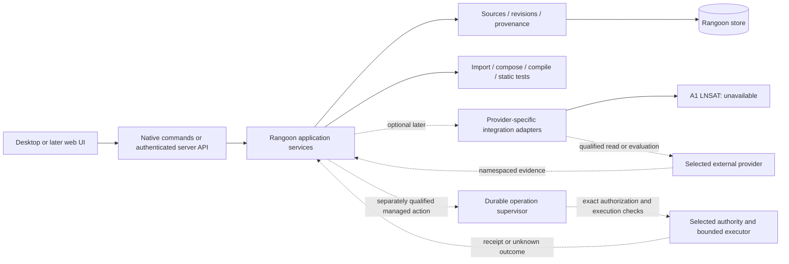

# Rangoon application architecture and optional provider interoperability

Authority: [intent.md](intent.md), October 5 engine architecture and October 7 provider-independent continuations. This preserves the implemented [A1 integration boundary](engine-integration.md) and adds the canonical [optional interoperability direction and I1 packet](provider-interoperability.md). Long-term stages are recommendations, not implementation, release qualification or permission to activate external systems.

Owner: Jeff. Architecture, trust boundaries, schema, integration and release decisions remain with the primary controller. Validation/publication state belongs in [development.md](development.md).

## Internal operations-first boundary — October 22, 2026

The [accepted internal-first direction](intent.md#internal-operations-first-direction--october-22-2026) prioritizes Hypler's own supervised workloads over speculative integration breadth or a funding narrative. It extends the existing operations/fleet and deployment designs below; it does not replace the local capability workbench or create a second control plane.

Jeff's Customer Zero clarification preserves the general product: the same public contracts must work for another operator's projects, workers and providers through private configuration. The [source reconciliation](customer-zero-gap-analysis.md) distinguishes current content/model/inspection components from missing durable task service, runtime execution, MCP, worker and accounting functions. Its proposed distributed source-review pilot refines the next value milestone; the prior finite-read connector work remains independently useful without becoming a mandatory runtime or authorization dependency. A durable task must outlive its initiating Codex/desktop client, while actual scheduling and process isolation remain with a qualified runtime.

| Layer | Responsibility and boundary |
| --- | --- |
| Rangoon workbench and application services | Existing capability authoring/provenance/compilation, plus planned fleet supervision, typed task coordination, model-routing preferences, budget accounting and operator evidence. The same services should serve UI, eventual CLI and authenticated hosted APIs; the renderer owns no authority or database access. |
| Runtime, scheduler and monitoring adapters | Translate an explicitly supported operation to an established runtime's native interface. That runtime owns process placement, isolation and lifecycle; monitoring sources own their observations. A Rangoon placement recommendation is not a scheduler allocation, and a task acknowledgement is not a completed effect. |
| Independent authority integrations | LNSAT and alternative qualified engines retain their own authorization, approval, credential and evidence semantics. An unavailable required control blocks the affected operation, while unrelated local work remains available. OpenShell and LNSAT need not depend on each other. |
| Independent VUSL consumer | Future adoption of a pinned usable VUSL core preserves native identity, provenance, explicit uncertainty and translation loss. Rangoon does not maintain a competing VUSL specification or infer authority from semantic compatibility. |
| Managed application interfaces | IZIOS, Sugarberry and other portfolio systems may later expose versioned, allowlisted health/readback and narrowly scoped operational functions. These are candidates, not connected systems. No generic shell, shared application database or inferred production permission is introduced. |

The proposed orchestration core is an application-service responsibility within the modular architecture, not a mandate for a new daemon or microservice. Reuse the [shared management-state and deployment design](#deployment-tiers-and-distribution) and existing [fleet console](operations-control-plane.md#fleet-management-console-direction). A later server may own durable jobs, leases, outbox, scoped enrollment and task checkpoints; external runtimes still own actual scheduling. Do not build a competing scheduler or copy a desktop SQLite file across hosts. Neither LNSAT's nor VUSL's database becomes Rangoon's shared state.

Model routing and cost control need explicit resource/privacy requirements and provider-specific capabilities. Keep estimated, reserved, observed and finalized usage distinct; missing usage is unknown, not free. Concurrent admission, retries, reservation settlement, cancellation and late provider charges need a reviewed accounting contract before a hard budget limit is claimed. Local CPU/GPU time, memory, energy estimates and external API charges have different measurement bases. No model or tool can expand its own budget or authority.

Proxmox, Nomad and other established infrastructure products are integration candidates, not a required combined stack or current compatibility claim. Select a product/version, supported OS/backend, license and exact operation only when a pilot needs it. The supplied hardware list is not an authenticated inventory; older GPU acceleration and usable capacity require measurement. Keep production hosting outside the experimental worker pool and establish network, identity and resource isolation before enrollment. No inventory scan, provider installation, runtime activation or production access is authorized by this architecture.

The user interface stays layered: searchable inventory/table first, compact task/status bar, then a selected-system inspector; topology remains an alternate view. Show source, freshness, unsupported operations and unknown outcomes at the point of action. Fleet, Tasks, Deployments and Evidence reuse the existing Operations group; budgets appear with their task/project scope rather than as decorative totals. The next delivery sequence is in the [canonical plan](plan.md#internal-operations-first-delivery--october-22-2026).

## Purpose and first useful outcome

Rangoon should turn scattered agent instructions into understandable, reusable capabilities, then make the change from an idea to a deployed or executed action inspectable. Its first useful promise is: **know what an agent is configured to do, where those instructions came from, and what a proposed change will preserve or lose.** That is valuable without a running LNSAT engine, a model account or a cloud subscription.

The supplied images describe a connected product lifecycle, not twenty unrelated dashboards. Import, Decompose, Merge/Split, Skills and Workflows should operate on the same versioned records. Command Center summarizes those records and real operation states. Connectors expose precisely available operations and authority boundaries. Test Lab, Compile, Deploy and Audit should show the actual evidence produced by their respective services. Sample numbers and decorative graphs must give way to useful empty, unavailable and recovery states as each real service arrives.

The accepted October 7 [product-value priority](plan.md#delivery-priority-demonstrate-product-value-before-expanding-infrastructure) puts usable local refactoring and export ahead of additional disconnected scaffolding. Preserve current optional-provider/operations contracts, but connect them only through reviewable user outcomes. The source-implemented [export handoff](export-handoff.md) reuses the strict bundle verifier; actual target-loader qualification and attributed model-proposal application remain separate gates. The accepted E1 priority now controls the next implementation slice, as clarified in the [delivery plan](plan.md#delivery-priority-demonstrate-product-value-before-expanding-infrastructure). No new runtime, authority or platform support is inferred.

## Core decisions

1. **One modular application, three desktop operating systems.** Keep the existing Rust domain/services and scoped Tauri host. Evolve the current vanilla-JS workbench into a shared typed UI incrementally when the revision editor needs it; a framework rewrite is not a prerequisite for useful features. No second desktop shell or separate Windows product.
2. **Content management is independent of execution authority.** Rangoon owns source, assets, review, composition, compatibility, jobs and their presentation. LNSAT is a separate product and optional authority/evidence integration. External providers retain their own identity, authorization, enforcement and operational semantics. No absent, disabled or failed integration may block local startup, reading, authoring, decomposition, composition, revisions, comparison, compilation, export or inspection.
3. **One authoritative record per concern.** Immutable source and asset revisions in Rangoon; authority decisions and consequence evidence in LNSAT or another explicitly qualified provider. The graph, counters, search index and UI are derived views. Never use an engine database as a shared application database.
4. **Ports precede integrations.** Format importers, compilers, analysis providers, connectors, execution targets and authority providers have separate interfaces. Their availability and tested capability subsets are explicit. A logo, credential or installed package does not imply an operation is supported or authorized.
5. **Build safe content work now; qualify integrations separately.** A1 provides honest unavailable functions. It does not recreate LNSAT with a permissive mock. The first neutral integration packet uses only offline fixtures; each later adapter has its own product/version/capability and privacy qualification. Provider allow is not Rangoon approval or execution permission. Broad integration coverage is not a local workbench release gate.

The October 16 [independent-connectors decision](provider-interoperability.md#independent-engine-connectors--october-16-2026) keeps LNSAT and OpenShell as separate optional Rangoon integration targets. OpenShell's native sandbox-policy and execution observations do not inherit LNSAT authority, and LNSAT's request/receipt path does not require OpenShell. The older LNSAT-owned OpenShell middleware candidate is historical research. Existing A1/I1/O0 source is unchanged until a separately reviewed, versioned source packet replaces any combined-path fixture.

The proposed [universal systems language](universal-systems-language.md) is a loss-aware semantic projection **over** these existing ports and records, with an [implementation audit and capability matrix](universal-systems-audit.md). It does not replace provider-native protocols, issue authority, introduce a new store, or move the local release gate. This design is not yet an accepted source contract.

The October 13 [scoped support direction](provider-interoperability.md#scoped-support-commitments) qualifies specific adapter operations and deployment paths. Common ownership makes Rangoon plus LNSAT the strongest end-to-end assurance candidate, not a current guarantee; all live adapters remain unqualified. External providers retain their responsibilities. Replacing providers requires a loss-aware preview and refusal when mandatory controls are missing. [Coverage/control-assessment colors](operations-control-plane.md#coverage-and-control-assessment-presentation) explain scoped evidence independently of availability and authorization.

## Approval, telemetry and live operations are core

The October 7 accepted [operations control-plane contract](operations-control-plane.md) adds approval management, redacted correlated telemetry and dynamic graph/timeline/replay as core product surfaces. Rangoon manages configuration and routing; a selected qualified authority engine issues scoped authorization and a trusted execution path checks it at consumption. Human and bounded delegated-agent stages cannot bypass policy or mandatory human duties. Delegation cannot self-expand. Keep per-operation enforcement coverage explicit across systems and engines.

Build inert application records/projections first, then local operations views and bounded read-only ingestion, followed by one qualified enforcement path and cross-system/hosted conformance. The graph and approval inbox are derived projections; they cannot issue authority. Telemetry, verified engine evidence and actual execution outcomes remain distinct. These stages are planned; A1 stays unavailable and no live collector, approval service or executor is introduced by this architecture update.

## What exists and where the application grows

| Component | Responsibility | Current state and next boundary |
| --- | --- | --- |
| `preview/` workbench | Source/section inspector, saved sources, Skills, composition editors, Workspace, Compile inspection, bundle Export/Inspect, local Operations window, integration status and launch; separate synthetic design surfaces | Real saved-content routes and a one-file read-only O2 operator view coexist with clearly separated sample design screens; native GUI qualification remains incomplete |
| `apps/desktop` | Window lifecycle, explicit file selection, trusted app-local path, narrow commands | Implemented host with bounded local/cloud model orchestration, explicit OS credential-editor commands and read-only O2 selected-window custody; no generic shell, renderer-selected host paths or ambient credential access |
| `rangoon-integrations` | Pure optional-provider metadata and immutable offline fixture inspection | I1 source implements eight unavailable candidate entries, pinned synthetic profiles, bounded canonical evidence and fixed no-authority outputs; no native IPC/command wiring or real adapter. Final conformance/source qualification belongs in the ledger |
| `rangoon-domain` | Byte identity, spans, source and fragment report types, capability revision contracts | R2b capability/revision contracts implemented and locally tested; macOS lifecycle checked |
| `rangoon-import` | Deterministic bounded parsing of caller-supplied bytes | Implemented Markdown subset; bounded folder/archive inventory later |
| `rangoon-host` | Safe read/write helpers for explicitly selected local files | Bounded bundle helpers verify before exclusive create; a separate O2 helper reads one explicit operations JSON file up to 2 MiB without retaining it; isolated macOS baseline export/inspect GUI passed, but O2/native and broader GUI qualification remain open |
| `rangoon-store` | Rangoon-local transactional repository | Version-aware schema 4 includes workflow history alongside snapshots, capability revisions/reviews and composition; backup/restore/deletion and read-only compilation remain local; legacy APIs keep their schema refusal gates |
| `rangoon-compose` | Pure recipes, coverage and destination application | Decompose/Merge/Split over pinned inputs; full GUI/release qualification remains in the ledger |
| `rangoon-compile` | Pure instruction artifacts, compatibility diagnostics, candidate identities and portable bundle verification | R4a profiles plus exact-byte bundle encoder/strict verifier; native command/UI source is published and an isolated macOS baseline passed; complete GUI and target-loader qualification remain open |
| `rangoon-workflow` (W1/W2a) | Portable workflow definitions, structural validation and immutable revision candidates | Pure W1 definition inspection implemented under [workflow definitions](workflow-definitions.md): typed ports, bounded strict JSON, graph diagnostics, data dominance and canonical content identities; exact validation/publication evidence belongs in the ledger. Portable immutable draft/validated-intent records and bounded node positions are implemented under the [W2 record contract](workflow-records.md). W2b durable schema-4 storage/recovery, six W2c native authoring commands and W3 real library/canvas/inspector source are published through PR38; native workflow GUI save/restart/failure and all-three-OS qualification remain open; no execution path |
| `rangoon-ops` | Bounded operations observation, relationship inspection and renderer-safe projection | O1a/O1b source decodes closed observations and projects structural, relationship, delegation, approval-duty and lifecycle inspections. O2 builds a privacy-minimized operator view with separate reported decision counts. Authenticity remains unverified, eligibility unknown and authority none; no collector, authenticated approval service, live provider evidence or execution. |
| `rangoon-engine` | Application integration status and engine-dependent port | A1 inert placeholder; no transport, detection or authority |
| `rangoon-model-assistance` | Pure bounded M1a context packing and advisory-response validation | `prepare_pack` and `validate_response` accept bounded JSON, preserve exact selected/protected byte ranges, account for omissions, deduplicate only identical complete blocks with per-input aliases, and validate canonical task payloads and inert proposals; no transport, native/CLI/UI connection, HTTP/provider adapter, tokenizer, credential, consent, or model-call path |
| `rangoon-model-local` | Source-only M1b numeric-loopback transport for prepared advisory requests | `LocalProfile::parse`, `PreparedRequest::new`, and explicit `LocalClient::check`/`analyze` use direct Tokio TCP and Hyper HTTP/1 for `127.0.0.1`/`::1` with an explicit port/model; bounded profiles, request identity, response validation, cancellation, timeout, one-flight guard and strict advisory results are implemented. No proxy, redirect, retry, fallback, credential, model launch or background traffic. A loopback peer may forward or retain data. The library opens connections only when its native application caller invokes an operation; native IPC, consent and renderer/UI wiring now exist, with separate cloud integration and credential custody now implemented in source; model compatibility and runtime qualification remain open. M1b/V1 remain incomplete; no real-model compatibility claim |
| `rangoon-model-session` | Portable session-only profile/request custody and saved-record resolution around the model libraries | `LocalSession` owns one optional profile, one prepared request and one active operation in memory. It packs exact nonempty saved source or capability-revision records as protected full-content selections, rejects empty inputs, issues random single-use handles, checks generation/cancellation, releases matching RAII leases, and exposes pre/post freshness checks. No network or authority behavior; the native host now owns commands, review and consent, while local and cloud qualification remain separate V1 work |
| `rangoon-cli` | Headless use of the same application functions | Source analysis and A1 diagnostics plus bounded stdin-only portable-bundle inspection/exact artifact stdout under [export handoff](export-handoff.md); source acceptance belongs in the ledger. Capability mutations remain native desktop only; no filesystem installer or alternate execution path |
| Future application service | Coordinate revisions, validation, jobs and projections | Extract from host when the second real workflow appears; host and server must call the same use cases |
| Future job supervisor | Durable attempts, cancellation, bounded concurrency and recovery | Required before long-running analysis, real test runs or connectors; not needed for a constant A1 status |
| Future server | Authenticated workspace and worker API | Later self-hosted phase; not an HTTP wrapper around privileged Tauri commands |

Dashed paths are planned and optional. The local content/transform/store path has no provider dependency. No live engine/executor path exists in A1. Each connected provider retains its native decision/evidence semantics; an allow result cannot cross into execution. A governed action needs a separately qualified authority/executor contract, not a generic provider success flag. See [interoperability](provider-interoperability.md) for the current/planned matrix and first packet.

## Records and state transitions

| Record | Identity, ownership and rules |
| --- | --- |
| Source snapshot | Current R2a identity binds basename and exact bytes; immutable, original digest retained. No absolute path is saved. A source digest is not authenticity or permission. |
| Project | Future stable ID grouping source references, target adapters and local preferences. A project is not a filesystem grant or tenant. Root bindings need their own explicit selection and revocation. |
| Proposal | Candidate extraction, split or merge with exact source spans, generator version and unresolved coverage. It can be rejected without losing the source. |
| Capability and revision | Stable capability ID plus immutable revision. Content, dependencies and requirements have independent review state. Review records who accepted a particular revision; it does not approve execution. |
| Provenance edge | Exact input revision/span to output revision, derivation type and tool version. Every edit retains its inputs; deleted/unassigned source is visible. |
| Content composition | Exact source/capability revision ranges, ordered authored/replacement pieces, coverage and explicit skill destinations. Its editable graph projects existing recipe records. |
| Workflow definition | A distinct versioned graph with exact capability revisions, control paths, typed data mappings, branches and human checkpoint declarations. W1 validates structure; later saved workflow identity/revisions remain independent from run state and execution authority. |
| Compatibility report | Target/version/adapter digest, preserved/adapted/unsupported concepts, diagnostics and tests. Unsupported security-sensitive meaning blocks compilation. |
| Bundle / export plan | The implemented bundle holds a canonical manifest, exact artifact bytes, component lengths and a checksum of preceding bytes; local Export re-resolves and recompiles after picker selection before exclusive plaintext creation, and external Inspect opens no workspace. Inspection also reports the whole-file digest. Destination grants and expected existing state belong to future export/installation plans. Export and activation are separate operations; checksum and identities establish internal consistency only. |
| Job / attempt | Stable job ID, input revision, attempt ID, cancellation request, lease, state and result references. The next attempt is a decision, not an automatic consequence of a timeout. |
| Engine evidence reference | Provider identity, exact external ID, contract version, observation time, integrity/freshness status and bounded raw evidence. Do not convert an app cache into an engine-issued receipt. |

Content lifecycle: `source snapshot → proposal → reviewed capability revision → pinned composition → validated bundle → explicit export`. An edit creates a new revision and invalidates dependent validation; it does not mutate the previous reviewed revision in place. A comparison can explain additions, moved spans, exclusions and unresolved conflicts before acceptance.

Execution lifecycle is separate: `planned → awaiting engine decision → awaiting human approval if required → eligible for bounded consumption → submitted → succeeded / failed / outcome unknown`. These are conceptual states until the exact engine contract is bound. “Approved” is never a synonym for “executed.” Unknown effect requires reconciliation; a crash, cancellation or lost response cannot be presented as proof that nothing happened. No automatic retry of consequential work after an uncertain outcome.

## Make the images work as one application

| Surface | Actual user action and application work | External integration dependency | Failure and completion evidence |
| --- | --- | --- | --- |
| Import & Analyze | Select a file now; later choose a bounded project root. Inventory bytes without executing scripts/hooks. | None for local parsing and save | Actual inventory, rejected/unreadable files, exact digests; no silent partial success |
| Decompose | Mark source spans, propose reusable capability boundaries, review missing coverage, accept revisions | None for manual/deterministic work; optional analysis has a separate provider/egress policy | Original text remains accessible; no fabricated confidence percentage |
| Merge & Split | Preview derivation graph, resolve competing constraints, preserve input revisions, accept new revisions | None for content transformation | Coverage ledger plus unresolved conflicts; undo restores references, not destructive history rewrite |
| Skills | Inspect, edit and compare exact capability revisions and usage | None for catalog/review | Review, tests and target compatibility are distinct badges; “published” alone is insufficient |
| Workflows | Compose typed nodes and branch data; validate dependency cycles and missing inputs | None for authoring/static validation; a qualified selected authority is required for advertised governed effects | Static simulation clearly labeled; real runs use durable attempts and engine evidence |
| Connectors | Inspect operation manifests, required credentials by reference, target scope and tested support | Only a qualified selected authority/enforcement path for managed consequential operations; not necessarily LNSAT | Credential presence is not connected/authorized; timeout is unknown when effects are possible |
| Test Lab / Simulations | Static rules, golden fixtures, deterministic replay; later isolated real harness trials | Not required for pure fixtures; required where a trial can have governed effects | Separate static, simulated and actual evidence; show test inputs/version/environment |
| Compile / Deploy | Compile reviewed content, preview output diff and semantic loss, export to selected directory; later explicit activation | Pure compilation does not need engine; activation depends on exact target and managed boundary | Target drift aborts apply; rollback covers declared reversible effects only |
| Command Center / Audit | Summarize real workspace jobs and exact authorized engine evidence | Only provider-derived sections; local workspace inspection remains available | Empty/unknown/stale states instead of sample “98.6% compliant”; every metric has denominator, period and source |

Ease of use comes from progressive disclosure: show the next useful action and why it is blocked; retain context through failure; let users get back to their source. Keep one primary action per stage. Show provenance/conflicts alongside the editor when they matter, not as a required security tutorial on every screen.

## LNSAT findings that change the integration plan

Inspected public source: [`e09a6b02634b04a46f861ed8b092acc2c2e50fe8`](https://github.com/hypler-dev/LNSAT/tree/e09a6b02634b04a46f861ed8b092acc2c2e50fe8). This is a dated source review, not a runtime test or completion assessment. Product 0.1.0, wire `v1_0`, feature surfaces and storage schema must not be collapsed into a “version 1 ready” badge.

| Finding at this commit | Consequence for Rangoon | Source |
| --- | --- | --- |
| Exact `LNSAT-Contract-Version` negotiation, ordered boundary gates, no automatic version downgrade | Pin and reject incompatible responses; version match does not bypass authentication or policy | [Gateway negotiation](https://github.com/hypler-dev/LNSAT/blob/e09a6b02634b04a46f861ed8b092acc2c2e50fe8/docs/architecture/GATEWAY_V1_CONTRACT_NEGOTIATION.md#L12), [versioning](https://github.com/hypler-dev/LNSAT/blob/e09a6b02634b04a46f861ed8b092acc2c2e50fe8/docs/reference/CONTRACT_VERSIONING.md#L20) |
| Browser session token and independent proof headers; ambient cookies withdrawn | Future transport and secret custody need a dedicated native design. Never send tokens/proof through the renderer, content store or logs | [Header boundary](https://github.com/hypler-dev/LNSAT/blob/e09a6b02634b04a46f861ed8b092acc2c2e50fe8/docs/architecture/SECURITY_LOOPBACK_BROWSER_SESSION_HEADER_HARDENING.md#L20) |
| Authenticated Unix socket path withdrawn pending accepted mutual authentication | Do not build on a convenient local bearer socket, same UID or pathname as peer identity | [Local auth withdrawal](https://github.com/hypler-dev/LNSAT/blob/e09a6b02634b04a46f861ed8b092acc2c2e50fe8/docs/architecture/SECURITY_LOCAL_AUTH_AVAILABILITY_AND_UDS_WITHDRAWAL.md#L14) |
| Headless declarations are bounded, closed-schema and narrowing; effective/export remain diagnostic, export non-reimportable | Configuration preview cannot become an “Apply policy” button; own draft editing separately from engine validation/admission | [Configuration specification](https://github.com/hypler-dev/LNSAT/blob/e09a6b02634b04a46f861ed8b092acc2c2e50fe8/docs/architecture/headless-configuration/spec.md#L42) |
| Exact approval-request, decision and audit-event reads; `ReadEvidence`, no search/list/query on these routes | Begin with exact evidence lookup after transport qualification. Do not invent global approval lists or polling endpoints | [Monitoring specification](https://github.com/hypler-dev/LNSAT/blob/e09a6b02634b04a46f861ed8b092acc2c2e50fe8/docs/architecture/headless-monitoring/spec.md#L12) |
| SDK packages are private, unpublished source references; MCP is an adapter | No npm installation claim or embedding a second authority engine; actual adapter needs a pinned supported distribution/interface | [SDK inventory](https://github.com/hypler-dev/LNSAT/blob/e09a6b02634b04a46f861ed8b092acc2c2e50fe8/docs/sdk/README.md#L10), [TypeScript boundary](https://github.com/hypler-dev/LNSAT/blob/e09a6b02634b04a46f861ed8b092acc2c2e50fe8/docs/sdk/typescript-reference.md#L30) |

The source review shows useful existing contracts and several still-gated runtime/control lanes. It does not substantiate a percentage-complete claim. Some diagnostic file-identity paths are Linux/macOS-specific; Windows Rangoon content management remains an initial-release target, while each Windows engine-dependent operation needs independent evidence.

## Build now, replace placeholders deliberately

| Stage | Concrete delivery | Exit gate |
| --- | --- | --- |
| A1 now | Inert `rangoon-engine` port, CLI and real native status, five unavailable seams, integration page and this map | No connection attempted, no grant/success output, bad/future UI status fails closed; tests and native/browser evidence |
| R2b current | Reviewed capability revisions derived from saved snapshots, exact span coverage, compare/revise and local review | Source tests and independent review passed; macOS lifecycle passed. Windows/Linux GUI qualification remains pending. See the development ledger for immutable original, stale-revision rejection, content-bound local review and recovery evidence |
| R3 | Real Decompose and Merge/Split over these revisions | Conflict and excluded-span accounting, version history, reversible edits; no silent policy weakening |
| R4/R5 | R4a pure instruction compiler and stored-revision service, exact-byte bundle encoder/strict verifier, bounded selected-file host helpers, plus native Export/Inspect UI and explicit export implemented in this source | [Compiler contract](compilation.md), [bundle contract](instruction-bundle.md) and [native bundle UI contract](instruction-bundle-ui.md) define initial byte-preserving subset; isolated macOS baseline Compile/Export/Inspect passed, while complete GUI qualification, meaningful loss report, target qualification and drift/collision handling on all three OSs remain distinct gates. Publication evidence belongs in the [development ledger](development.md) |
| A2 | Qualified engine transport and exact compatibility/readiness inspection | Accepted peer authentication, secret custody, no renderer credentials, explicit feature matrix, hostile-response/redirect/origin/version tests |
| A3 | Diagnostic configuration and exact evidence readback | Validated request/response fixtures, exact IDs, redaction, freshness/integrity state; reads never become authorization |
| A4 | One disposable governed operation and reconciliation | Exact request/decision/approval/consumption/receipt chain; crash before/after effect, replay, expiry/revoke and unknown-outcome tests |
| M1 | Optional-to-use local and cloud model assistance, both required V1 capabilities | M1a pure context packing and inert response validation now exists in `rangoon-model-assistance`; source-only M1b local transport exists in `rangoon-model-local`, and the native workbench now supplies session-only custody, narrow IPC and exact-payload OS consent; bounded cloud adapters, credential custody and native cloud consent are source-implemented; proposal application, tokenizer/accounting, real-model compatibility and all-three-OS qualification remain separate gates in [model-assistance.md](model-assistance.md) and [model-local-adapter.md](model-local-adapter.md) |
| R6 | Free desktop alpha for macOS, Windows and Linux | Clean-host GUI/install/update/uninstall, signing and rollback, source/asset backup restore, accessibility and license decision |
| R8+ | Owner-hosted teams, then managed enterprise | Authentication/tenancy/jobs/storage/backup and operational evidence; no automatic inheritance from desktop |

A2–A4 remain the optional LNSAT-specific track. The provider-neutral I1 offline packet and recommended later Cerbos read-only adapter are specified separately in [interoperability](provider-interoperability.md); they do not widen A1. R2b–R6 continue without any live provider. Operations surfaces remain required staged product work, while broad adapter coverage and qualified external execution do not block a useful local release. License adoption, releases and external activation remain separate human decisions.

### LNSAT 1.0 intake checklist

1. Identify the actual signed/reproducible supported artifact, source commit, license, supported OS/architecture and dependency provenance. A tag or README alone is insufficient.
2. Compare product, wire and feature-surface contracts with the pinned reference. Record removed/changed fields, routes, errors, session and consequence semantics. Use exact accepted compatibility, never guess from semver or silently downgrade.
3. Implement one adapter behind the port with operation-specific types. Keep engine-issued opaque IDs and original evidence; do not normalize away authority-critical distinctions. No generic URL/request escape hatch.
4. Qualify peer identity, transport, expiry/rotation/revocation, native secret custody, redaction and unavailable-store behavior. Loopback and a desktop process are not by themselves authentication. Do not reuse withdrawn UDS or ambient cookies.
5. Run contract fixtures and real isolated integration tests per supported operation and OS. An installed engine, healthy endpoint or successful read does not enable writes.
6. Enable exact read-only capabilities first. Require independent end-to-end consequence and recovery evidence before A4. No public/prod target is needed for this qualification.
7. Publish a capability matrix with tested engine artifact, adapter version, target OS and evidence. Show stale or incompatible states explicitly. Keep local content management available during engine outages and upgrades.

## Composition boundary and service extraction

The current composition path is a useful test of the proposed modular monolith. The renderer builds an editable recipe, receives a host preview, and validates its display shape and byte mappings. The native command accepts bounded raw IPC and retains a private, single-attempt preview handle. `rangoon-store::Workspace` resolves saved source/revision references and current destination heads, calls the pure `rangoon-compose` transformation, and checks saveability. At commit it opens an immediate transaction, reloads records, compares the retained state and recomputed preview, writes the resulting revisions, then checks the stored state before returning a receipt. A renderer-provided preview body, original bytes, or filesystem path cannot be substituted at commit. See [native composition](composition-native.md) for the exact wire and failure behavior.

This boundary is sound for the local workbench, but two seams need deliberate maintenance:

| Seam | Current risk | Required control |
| --- | --- | --- |
| Renderer preview checks | JavaScript independently checks materialized text, mappings, coverage shape and reported `saveable`. A future Rust contract change could make the UI reject a valid result or display a stale draft. This is an availability and usability drift risk, not a route around the Rust commit transaction. | A shared independently pinned full core-preview fixture now checks Rust serialization and renderer acceptance, including mappings and coverage. Extend it with distinct invalid and changed-semantic vectors whenever the contract evolves. Keep renderer checks defensive and never promote them into save authority. |
| Desktop-specific orchestration | `Workspace` owns current local use cases while Tauri owns selection, generation fences and retained confirmation. There is no authenticated HTTP service, tenant context or remote job owner today. | Before self-hosting, move retained preview custody and single-attempt confirmation into typed Rust use cases with explicit actor/workspace context and a repository boundary. Bind preview handles to that context; make both Tauri and HTTP adapters call the same use cases. Neither adapter may duplicate composition or commit semantics. Qualify per-workspace authorization, storage isolation, concurrent writes, backup/restore and uncertain responses before a hosted support claim. |

The current renderer test uses the independent [composition vectors](../fixtures/composition/application-v0.json) and [source vectors](../fixtures/composition/decompose-v0.json) for output bytes/identities, full valid core preview, and new/append destinations. The Rust core test checks the serialized preview against the same literal fixture. This proves a named valid example, not all invalid envelopes, arbitrary renderer trust, native GUI qualification or service readiness. Existing native/store tests also reject replacement originals, a forged inspection copy, stale workspace state and reuse of a claimed preview. On a lost or uncertain commit response, the UI marks the preview stale and requests readback; it does not automatically refresh saved records. The operator must read back current records before preparing a new preview, and must not infer failure or retry the same mutation automatically.

Do not introduce a second policy engine, a generic database-path API, or a network wrapper over raw Tauri commands while extracting the service. Pure composition remains provider-independent. Engine authorization and any consequential execution retain their separate qualified boundary.

## Desktop, self-hosted and enterprise evolution

The initial desktop release targets macOS, Windows and Linux together. Current CI proves source/build subsets; manual source-workspace runtime evidence is macOS only. Engine availability is an independent matrix. Do not delay offline Windows editing because a Linux engine executor qualifies first, or call Windows enforcement supported because the UI builds there.

For the self-hosted phase, extract the same application use cases into a Rust service with authenticated API handlers. Introduce actor/workspace/tenant context at the service boundary, per-tenant storage access, authorization tests and job ownership before shared hosting. Tauri local commands and HTTP handlers must both call typed services; HTTP must not expose raw native commands or host paths.

SQLite remains appropriate for the bounded single-user app. A later PostgreSQL/object-store implementation requires explicit transaction, migration, quota, backup and concurrency semantics; it is not a connection-string swap. Local-to-server migration needs an explicit export/import manifest, content digests, ownership mapping and conflict plan. Bidirectional offline sync is deferred until revision conflict semantics exist. Secrets and engine authority records must not ride along with content sync.

Separate control and execution environments. An authenticated remote worker needs a registered identity, bounded operation, cancellation/lease semantics and evidence channel. Network partitions must leave work visibly unknown where effects could have occurred. Hosted multi-tenancy, regional processing, air-gapped delivery and enterprise recovery each need separate qualification. LNSAT's initial headless design does not automatically provide those features to Rangoon.

Keep core provenance, local review, export, safe failures and authority boundaries in the free product. Potential paid value is collaboration, SSO/SCIM, managed operations, fleet coordination, support and retention controls. Entitlement never grants action authority. Specific licensing and enterprise scope remain owner decisions.

## Capacity model for a 500–1,000-person organization

Capacity must be specified by operation, not by an undifferentiated "request" count. A capability edit or export, a hosted API read, an observed agent action, a telemetry event, an authority-engine decision and a live-graph update have different cost and ownership. Rangoon is not on the execution-time authorization path: an engine must continue to enforce its own rules if Rangoon is slow or unavailable. Rangoon configuration changes become effective only through each target's qualified admission and readback path. Operations views may lag, but must show their source watermarks, lag and gaps rather than imply current completeness.

**Proposed qualification workload, not measured capacity or a release claim:** one large tenant with up to 1 million observed actions per day, a 60-second burst at 1,000 actions/second, and a synthetic planning factor of 10 minimized evidence events per action. That implies 10 million events/day and a 60-second burst at 10,000 events/second. At a *hypothetical* 1 KiB persisted event, raw event bodies alone consume about 9.5 GiB/day and 286 GiB per 30 days, before indexes, native evidence, replicas and backups. Payload-size distribution, tenant count, retention and concurrent readers must be measured before sizing a deployment. Sustained 1,000 actions/second would be 86.4 million actions/day and needs a separate scale tier and proof. A desktop selected-file O1 window, capped at 1,024 events and 2 MiB input, is an inspection unit, not a million-event ingest service.

The hosted path should use admission with authenticated tenant and producer identity; bounded validation and redaction; a durable partitioned event log or equivalent append contract; idempotent, version-pinned projections; and paged query/subscription APIs. Partition by tenant and stable producer/stream identity so causal order has a defined scope; never claim a global total order. Separate immutable native evidence references from minimized searchable fields. Batch writes and projections where safe, but never combine distinct attempts or drop required evidence to improve throughput. Per-tenant quotas and fair scheduling prevent one fleet from exhausting other tenants. Bounded queues, explicit backpressure/retry signals, producer cursor checkpoints and replay make overload observable. On crash, retry or partition, duplicate identity with different bytes is a conflict; missing ranges and retention gaps remain visible. An ingestion acknowledgement means only the stated durability stage, never authority verification or completed execution.

The local desktop remains a bounded single-user workbench. It may inspect paged or sampled *views* of a larger hosted history after a qualified connection, but evidence capture itself cannot be silently sampled. Do not route millions of events through one Tauri IPC response, one SQLite transaction or the renderer's graph state. Keep graph layout and animation downstream of bounded projections, with stable selection and a table/timeline fallback. A future service may scale ingest, projection and query workers independently while reusing domain contracts; that extraction requires explicit tenant context, storage and recovery tests rather than a raw HTTP wrapper over desktop commands.

Before advertising this capacity, run reproducible load tests with pinned hardware, payload distributions, event/action ratios, tenant counts, retention and fault profile. Report sustained and burst throughput separately; p50/p95/p99 ingest acknowledgement, projection lag, API reads and memory; queue depth; storage amplification; retry/duplicate/conflict rates; and lost or unaccounted event ranges. Include 72-hour soak, disk-full, worker crash/restart, slow subscriber, hot tenant, late/out-of-order producer and tenant-isolation cases. Set latency SLOs from a measured pilot and an agreed durability point; no current source or test establishes these targets.

### Deployment tiers and distribution

These are proposed workload classes, not product editions, sizing guarantees or gates on the local release. Headcount is a weak capacity proxy; measured actions, evidence-event fan-out, payload sizes, reads and retention decide tier.

| Class | Planning workload per tenant; burst held for 60 seconds | Shape and qualification |
| --- | --- | --- |
| Local desktop | One operator; bounded files and local workspaces | Current selected-file inspection and SQLite-style local records; no fleet ingest or execution routing claim. |
| Team, single site | 100,000 actions/day, 1 million minimized events/day; 100 actions/second and 1,000 events/second short burst | One authenticated service with durable storage, backup/restore, bounded workers and explicit outage/gap states. Load-test before support. |
| Enterprise, multi-node | 1 million actions/day, 10 million events/day; 1,000 actions/second and 10,000 events/second short burst | Stateless API/ingest replicas behind a load balancer, durable partitioned ingest, independent projection/query workers, tenant quotas, target-affine deployment workers and recovery tests. |
| Large fleet or regional | 10 million actions/day, 100 million events/day; 10,000 actions/second and 100,000 events/second short burst | Research tier requiring partition and regional-residency proofs, replay/retention economics, cross-region failure design and dedicated load evidence. No initial support claim. |

Load balancers may spread stateless Rangoon reads and authenticated ingest requests. They must not invent a common authority identity, reorder a producer stream without detection, or redirect a potentially executed command to a new engine after an uncertain result. Each producer stream has a stable scoped identity, cursor and partition; consumer groups project incrementally from committed offsets. Query nodes serve materialized projections with watermarks and bounded cursor pagination. A client subscription receives a snapshot fence followed by ordered deltas or a visible resync/gap, not an unbounded graph payload. Scale-out must preserve the same reducer semantics and coverage labels as single-node operation.

Multi-node Rangoon needs one **logically shared management state** for tenants, enrolled targets, desired revisions, deployment plans, task ownership and projection checkpoints. Use transactional metadata storage with explicit tenant keys, expected-revision updates, leases/fencing and an outbox; use a durable append contract for higher-volume observations and content-addressed artifact storage where justified. These may be different physical services, but one schema migration, backup/restore, retention and disaster-recovery plan must cover their consistency. An API replica never holds authoritative state only in process memory. Repository ports preserve the local SQLite implementation while a server implementation is qualified; do not copy local database files among nodes or expose any database to browsers, agents or plugins. Encryption, key custody, tenant isolation and access audit must be proven at each store.

Multiple LNSAT instances are separate registered authority endpoints unless LNSAT itself supplies a qualified cluster contract. Rangoon inventory should record each instance's product/version, adapter pin, tenant/system/environment, trust zone, configured endpoint, qualified operations, health, policy/configuration revision, evidence cursor and effective-state readback. Keep a logical target-group label separate from each instance's source-qualified identity. A load-balanced LNSAT pool can be advertised only after LNSAT independently proves shared key custody, policy version, authorization consumption, revocation, replay protection, idempotency, failover and receipt semantics for that exact topology. Until then, pin a consequential attempt to one instance and its native IDs; a timeout or lost response is unknown and cannot trigger silent cross-instance failover. Read-only evidence from several instances can be aggregated with separate provenance and gaps. Rangoon distributes reviewed configuration and observes outcomes through qualified adapters; it does not become a default proxy for agent action traffic or copy engine signing keys among endpoints. Any future managed proxy needs its own accepted mediation and latency contract. The same rules apply to OpenShell or other engines according to each product's native contract; neither engine depends on the other.

Do not confuse Rangoon's shared management storage with LNSAT's authority store. Independent LNSAT nodes keep independent native stores. A future one-service LNSAT cluster might need shared transactional authority state or a qualified consensus design, but that choice belongs to LNSAT and cannot be achieved by pointing today's single-node SQLite daemons at one file. Its design must cover serializable one-time consumption, session/approval/policy/revocation propagation, key custody, leader/fence behavior, crash and partition recovery, exact receipt identity and non-retry of unknown effects. Rangoon records the proven topology and compatibility; it cannot supply these engine invariants from its own database.

### Remote setup and agent-file management — October 26, 2026

Jeff's [accepted remote-management direction](intent.md#remote-setup-management-direction--october-26-2026) extends the existing fleet/deployment design to the everyday file workbench. This is a required product capability with staged implementation, not a statement that remote management works today. Preserve useful local operation and the Customer Zero decision to reuse qualified external runtimes rather than build another scheduler.

**Ownership and topology.** Rangoon owns inventory, source/revision inspection, reviewed configuration and artifact plans, routing and evidence display. A target's runtime owns process execution; a target management adapter owns its admitted filesystem/management operations and readback. An optional authority engine owns its own authorization/evidence semantics. Use Rangoon-to-Rangoon connections for shared agent files: one controlling installation connects to other explicitly enrolled Rangoon installations. Each sharing installation owns a restricted host service over the same application/repository contracts as local use. A later headless Rangoon installation may expose that same service without a GUI; it is a deployment mode of Rangoon, not a second bridge product. Third-party APIs remain separate optional system adapters, not the default access path to Rangoon-shared files. The sharing service is not a generic remote-access agent, engine or scheduler. A future always-on Rangoon service may own durable coordination when desktop disconnect must not stop supervision; reuse the existing service/repository ports and shared-state design. Neither the peer-sharing host service nor always-on coordinator exists in current source.

**Peer sharing model.** The owner of installation B enables Share files, selects registered folders/workspaces and the exact metadata/content operations permitted, reviews installation A's authenticated identity and acting user/service identity, and grants bounded access. Installation A then adds B under Systems and browses only B's granted roots. Sharing is off by default; pairing alone grants no file scope. B enforces every request using its own registered-root resolution, current grant, principal, session and lifecycle state. Renderer selections or A's local administrator status cannot broaden B's scope. Expose a narrowly authenticated application API, never raw Tauri commands, arbitrary paths, a database/key endpoint or general remote shell. Client-side hiding is not enforcement.

Separate peer-machine authentication from user/service authorization; require both identities and a grant bound to the selected host/root/operation. The sharing installation validates the acting principal under its own trust policy; a caller-supplied username, role or actor label is not authentication. Each installation keeps its own encrypted workspace and local keys. Share file records through the service rather than sharing database files or copying database keys to peers. Reading selected source bytes is a distinct grant from listing names/metadata; edit, restore and execution require separately qualified grants and native operations. No permission is transitive: A's access to B grants nothing on C, and B cannot delegate C's access by claiming a relationship. Product forwarding of another host's content needs separate explicit transfer consent; a compromised authorized reader can still copy plaintext already disclosed to it.

Grant expiry/revocation, host sharing disabled, workspace lock and changed peer/root identity close new admissions and fence late results. Default sharing does not reuse a locked GUI's prior unlocked state. An unattended/headless mode needs its own accepted service identity, credential/key custody, permitted content scope and recovery/lifecycle policy; do not silently keep reads alive through desktop lock. Already-disclosed content cannot be recalled by revocation, and cached copies remain subject to the receiving installation's explicit encrypted retention/deletion policy. Peer identifiers, display names and network addresses remain distinct; copied backups or duplicate installation identity need conflict detection/re-enrollment rather than inherited trust. These are proposed source requirements, not implemented sharing behavior.

**Installation and enrollment.** Peer metadata and content require an authenticated encrypted transport with verified peer identity; refuse plaintext, silent downgrade and certificate/key verification bypass. Initial onboarding is explicit and operator-initiated for one host: review the exact endpoint and authenticated host identity, adapter/product/version and allowed roots/operations, then complete a separately qualified enrollment flow. Do not auto-accept an address, discovered name, changed host key/certificate or reverse-DNS identity. Duplicate enrollment with a different host identity needs review; an endpoint/name can change without becoming a new target or inheriting another target's history. A later pairing design needs short-lived single-use material, per-device identity and scoped credential custody, rotation/revocation and no secrets in renderer/logs/URLs. This direction chooses no credential backend or new wire protocol. No ambient SSH agent, key files, environment tokens, proxy configuration, provider profile or network scanning. Optional existing SSH transport must be explicitly selected/pinned and constrained to the reviewed helper/protocol; it never opens a general shell or turns shell output into a trustworthy filesystem API. It is not the first implemented transport by default.

**Allowed data and operations.** Reuse the R9 adapter/version/capability descriptor design and the future BF-2 selected-root application port. These operation names describe use cases, not a released API/schema:

| Operation | Scope and result | Required refusal/limitation |
| --- | --- | --- |
| List registered roots and file metadata | Host-scoped opaque root IDs, cursor-paged allowed relative names, supported file type, size and observed timestamps; optional digest only when actually computed | No arbitrary path, parent escape, symlink/reparse escape, home/network scan, secrets outside selected roots or unbounded directory expansion. Metadata transfer also needs scope/consent. |
| Inspect one source | Explicit selected host/root/file reference, bounded original bytes, native analysis provenance and exact digest | No provider upload, remote command execution, hidden bulk download or save. Preserve BF-1 per-file limits until a reviewed contract changes them. Validate again at the remote read boundary; a stale metadata token is not file custody. |
| Inspect revision/history | Exact host/registered-root/target binding, ordered recorded changes and events, source spans/inputs, before/after hashes, originating and receiving timestamps | No filename-based ancestry or cross-host conflation. Remote self-report is labeled; authenticated transport alone does not prove truthful or complete history. |
| Prepare/apply/restore | Later target-specific retained plan, expected prior digest/revision, encrypted restore point, explicit scoped authorization, durable job/outcome and effective readback | Unavailable until remote target custody, concurrency/replay/revocation, encrypted recovery and unknown-outcome reconciliation qualify. UI approval and provider allow alone never authorize the write. |
| Inspect runtime/configuration | Only each adapter's qualified read subset; configured, installed and effective state remain separate | A reachable host is not a managed runtime. Task execution, restart, upgrade, deployment and secret/key management remain separately qualified capabilities. |

A bridge must independently enforce its root/operation scope using the host OS's verified boundary; it cannot trust renderer-supplied absolute paths or imported instructions. Deny traversal, ambiguous encodings, unsupported file kinds, oversized reports, archive expansion and stale/changed root identity. Listing returns bounded metadata rather than retaining every original in the renderer. Cancellation stops admission of subsequent reads and drains admitted work; disconnect/session-generation fencing prevents late results repopulating a locked or reconnected view. No arbitrary plugin code or provider-returned HTML executes in the desktop.

**Privacy, storage and revision provenance.** Source content may move from the chosen host into Rangoon memory only for explicit inspection; saving it needs a separate explicit encrypted-workspace action. Connection approval must show destination, selected roots, operation, metadata/content sent and returned, retention and egress. A granted metadata scope is not consent for source text, mutation or a model call. Cache only permitted records in encrypted application storage with scoped identity, expiry/retention/deletion and recovery; the persistent inventory/cache schema is not implemented. Do not use the 128 archived snapshots as a fleet index or silently raise their bound. Reuse existing encrypted history through a host/root/target binding and repository port; any schema extension needs migration and complete backup/restore tests. Never network-share or synchronize a live SQLite file. Engine stores and keys remain independent. Encryption cannot protect data from a fully compromised unlocked host; minimize exposure and rely on separately qualified runtime/OS confinement.

Keep remote observed time, Rangoon received time, local saved time and successful check time distinct. Filesystem mtime is observed metadata, not proof of freshness, authenticity or parentage. Preserve clock-skew/unavailable-time markers, content hashes, the source's native revision and local record identity separately. A transport epoch/freshness label cannot conceal producer resets or history gaps. Cache/offline observations show their timestamp and stale/unknown status; reconnect does not erase gaps or convert an earlier requested write into confirmed state.

**Security and error boundary.** Separate transport/session state (`unconfigured`, `disconnected`, `connecting`, `connected`, `identity_changed`, `revoked`, `error`) from each operation's supported/unsupported/unassessed coverage, synchronization freshness and task outcomes. A connected host may have no file or write permission. Use structured bounded codes and safe human messages for identity mismatch, scope denial, unsupported version/operation, unavailable root, stale reference, conflict, timeout/cancellation, capacity and uncertain outcome. No diagnostic includes credentials or original content by default. Failed checks do not weaken peer identity or silently fall back to another host/transport. Writes remain pinned to one exact target/attempt; a lost response pauses for reconciliation, not automatic retry. Local work continues during remote failures.

**Staging and source evidence.** Current BF-1 `select_and_inspect_sources` in `apps/desktop/src/source_collection.rs` accepts only a native local picker; `crates/rangoon-host/src/source_collection.rs` is a local bounded reader, not remote transport. Existing saved-source reads are local workspace operations. The I1 integration crate provides offline metadata/evidence inspection, not a remote file API. OpenShell finite-read Host/client work is product-specific and does not authorize generic file management; neither it nor a logo supplies a running bridge. Existing AR-1/AR-2 history is encrypted store source, not mounted target-write or remote history UI.

| Stage | Useful deliverable | Gate and relationship to existing work |
| --- | --- | --- |
| RM-0 direction (this record) | Reconcile remote agent-file management with fleet inventory, history and SDK architecture | Documentation only; no source, connection or installation. Local native qualification stays on its release path. |
| RM-1 offline remote inventory contract | Typed installation/principal/grant/root/file identity, paged metadata, separate reported metadata consent, freshness/provenance and honest states with hostile fixtures | RM-1 source implemented below; unmounted offline contract only. Reuse the BF-2 application-port design and R9 descriptor vocabulary; no public protocol or remote backend. |
| RM-2 two read-only lab installations | One controlling Rangoon installation and one sharing Rangoon installation, authenticated enrollment and explicitly consented bounded inventory/content read | Freeze peer transport, machine plus actor identity, grants/credential custody and root-confined host-service implementation first. Use one disposable lab endpoint; prove actual OS/transport scope and cancellation/refusal. No auto-connect, normal source or remote writes. |
| RM-3 reviewed remote file changes | Draft/diff, exact encrypted restore point, target-pinned apply/restore and recorded reconciliation | Reuse AR-3 retained previews/custody and existing S3 staged deployment semantics. Prove crash/partition, drift, replay, lease/fence, partial batch, wrong-host and unknown-response behavior before any real instruction file. |
| RM-4 durable multi-host operations | Multi-host inventory, scoped task supervision and controlled rollout views | Reuse the Customer Zero runtime-adapter direction plus S1–S3 service/shared-state plans only when the workload needs durable background coordination. No parallel scheduler or mandatory cluster for one remote host. |

**RM-1 internal offline contract — October 27, 2026.** Jeff's request to implement the direction accepts the [seven-path source packet](intent.md#rm-1-offline-inventory-implementation--october-27-2026). Root owns the new `preview/remote-inventory-model.mjs`, `tests/remote-inventory-model.test.mjs`, `tests/fixtures/remote-inventory.v1.json` plus this architecture, intent, continue and development records. It is an unmounted, in-memory metadata reader; no filesystem, native command, service, credential, transport, cache or UI connection is mounted. The internal `rangoon.remote-inventory.offline.v1` name is neither a public wire protocol nor a VUSL replacement. It reuses R9's adapter/product/version/operation vocabulary and the BF-2 root/reference direction without claiming runtime interoperability.

The model accepts bounded JSON text for one reported scope: pinned adapter ID/product/version and operation list; exact installation ID/enrollment epoch, principal, grant and root; session and snapshot IDs; separate grant operation scope, metadata consent identity/operation and grant/consent deadlines. These fields are unverified producer assertions. Their structural agreement never authenticates a host/user, validates a real grant, proves consent, or grants access. `inventory.metadata` is the only implemented operation, even if another operation appears in reported capabilities. Source-content inspection remains a separate unimplemented operation/consent boundary. A successful scope replacement clears prior records; invalid replacement preserves the previous scope.

`beginPage` returns an instance-bound request with local generation/serial and exact scope/snapshot/cursor. `acceptPage` consumes only that exact request object, requires matching report adapter pin, access scope/deadlines, identity and expected cursor, and atomically validates every row before adding any. A rejected current response consumes that attempt but preserves accepted pages; a new attempt uses a new serial. Stale/foreign request objects cannot consume a pending current request. Cursor replay/self-loops and changes in reported snapshot coverage fail. Installation/session/snapshot replacement fences prior callbacks; copied installation identities cannot be detected or authenticated by this offline reader and remain an enrollment-layer requirement.

Limits: 128 KiB UTF-8 per descriptor/page, maximum JSON depth 16, 50 entries/page, 1000 records and 64 accepted pages per working view, including empty pages. Duplicate JSON keys (including escaped aliases), unknown fields at each object, role/trust assertions, source-text payload fields, duplicate file IDs/paths, invalid numbers and nonconforming digests are rejected. A cap is a bounded desktop inspection window, not a fleet-storage limit. Backend indexing/paging remains separate; do not raise encrypted source-archive caps or hold a million originals in the renderer.

File rows carry an opaque file ID, relative Markdown path, byte length, optional observed mtime, optional lowercase SHA-256 and optional native revision ID. None establishes ancestry, integrity against a malicious producer or a restorable original. Paths use `/`, end in `.md` case-insensitively, have at most 1024 UTF-16 units and 255 units/segment, and reject empty/dot/parent segments, absolute/drive/UNC forms, backslashes, percent/colon/query/fragment syntax, controls/format characters/unpaired surrogates, trailing dot/space, reserved device names and `.git`/`.ssh`/`.aws`/`node_modules` segments. `.claude`/`.cursor` and Unicode names remain possible. Preserve exact case and Unicode sequence; do not normalize names into filesystem identity. This grammar validates report data only; native resolution must separately enforce actual roots, symlinks/reparse points, file kinds and platform alias behavior. No path reaches a filesystem API here.

Producer-observed, locally received and file-modified times remain separate. Page freshness is `unknown`, `clock_skew`, `stale` or `recent_report` (never live/verified); receiver age expires after five minutes independently of producer time, and any producer time ahead of its receipt or current local time is flagged. A backwards/invalid local clock clears scope; reported grant/consent expiry clears retained metadata at admission, result acceptance or state inspection. There is no timer or background task in this model, and these reported deadlines are not authorization leases. `reportedCoverage` is complete/partial/unknown, stable within the snapshot. `window` independently records not_started/partial/capacity/complete: reaching a terminal cursor completes pagination only, even when reported coverage is partial or unknown. Host completeness, missing events and truthful observations still require independent evidence.

Lock, disconnect, revocation, identity change and cancellation clear scope, records, pages, cursors and pending work; late results cannot revive the view. Dispose is terminal. The only mode is `offline_unverified`; no connection/authentication/approval/execution outcome is synthesized. Public state is copied defensively. Fixed structured diagnostics do not echo report/source content. No persistence or native content API is added.

Validators: `node --test tests/remote-inventory-model.test.mjs`, `npm run build:check`, `node scripts/validate-review.mjs`, the intent artifact validator, exact owned-delta whitespace/hash preservation, finite working-window measurement and fresh independent read-only review. The [development receipt](development.md#rm-1-offline-inventory-contract--october-27-2026) records actual results. Fixture validation does not prove peer authentication, OS confinement, consent presentation, encrypted caching or remote revision/restore behavior.

**BF-2a retained-root source — October 27, 2026.** The host crate now implements unmounted Unix metadata traversal in `source_inventory.rs`, using the already locked/cached `rustix =1.1.5` safe filesystem API. `rangoon-host` retains `#![forbid(unsafe_code)]`. This direct dependency edge and fs feature are new; no package version/checksum changes or downloads occur. The pinned crate has the existing Apache-2.0 WITH LLVM-exception OR Apache-2.0 OR MIT license expression; dependency checksum/lock evidence is in the development receipt, not a security certification.

A caller must supply a fresh native-selected absolute root, never renderer paths. The backend walks from `/` with retained directory descriptors, `statat(SYMLINK_NOFOLLOW)`, `openat(DIRECTORY|NOFOLLOW|NONBLOCK|CLOEXEC)` and pre/post device/inode checks. It refuses root `/`, relative/parent paths, symlink ancestors/final roots and excessive root-component depth. Root ownership means the opened directory object: renaming its pathname and replacing that pathname with a symlink does not redirect the existing owner. There is no canonicalization, `/proc` reopening or path-string containment test in production. This is an unmounted host API, not enforcement that a frontend request came from a picker.

Enumeration stays relative to owned directory handles. Only directories are opened; regular/special files receive no-follow metadata inspection only. Child identity is checked after opening; cross-device/repeated directories and detected replacements are refused and reported. Same-device mount aliases and a compromised kernel/privileged host are not isolated by this API; tests use no real mounts. Metadata may change immediately and directory iteration is not an atomic snapshot. Previously returned pages remain copies held by callers; a later native admission/renderer owner must purge/fence those copies on lock or revocation.

Pages return at most 50 rows after at most 512 visited entries; a session stops at 10,000 visited entries or 1000 emitted rows, with depth at most 16 below the chosen root. Directory handles are bounded by traversal depth and identity/path sets by the session budgets. Exact relative Markdown names, byte lengths, whole-second filesystem mtime in milliseconds and session-local observation ordinals are returned. Ordinals are neither durable file references nor revision ancestry. There is no file content, hash, native absolute path, device/inode, key or original in serialized rows. Reading a selected row later still needs retained native content custody; a display path must never become an arbitrary read endpoint.

The initial discovery policy excludes dot entries other than `.claude`, `.cursor`, `.windsurf`, `.github`, `.codex`, `.agents`, plus `node_modules`, `target`, `vendor`, `dist` and `build`. It rejects invalid UTF-8 names, unsafe separators/control/format/reserved names, overlong segments/paths and non-ASCII characters outside the initial alphanumeric subset. Unicode sequences are never normalized; this backend is deliberately narrower than RM-1's offline path grammar, and unsupported names produce an explicit partial reason. Other file types, symlinks and special files are excluded without reading them. Future configurable ignore rules need a reviewed policy contract, not ambient shell/git execution.

`exhausted` means traversal stopped, not complete coverage: cumulative partial reasons separately retain read/replacement/device/loop/name/depth/entry/record problems. Work-limited short/empty pages remain resumable. Duplicate relative observations are refused. Cancellation before/through/after a page drops traversal handles and discards the whole current page; explicit close is terminal. The current callback can stop subsequent work, but cannot promise interruption of a blocked kernel call or a hard elapsed-time limit, especially on a selected network filesystem.

BF-2a changes no Tauri command, picker, IPC capability, renderer screen, database, source archive, engine or network service. Unix source now has pinned Rust 1.99.1 disposable macOS x86_64 test evidence through BF-2b; Windows explicitly returns `unsupported_platform` without fallback. BF-2a originally closed with required Rust 1.99.1 unavailable; its 1.98.0 diagnostics used `--ignore-rust-version` and never satisfied that gate. BF-2b installs the exact official 1.99.1 x86_64 Apple toolchain and passes formatting, 705 portable workspace tests and warnings-denied Clippy over unchanged source with the pinned validator; the [qualification receipt](development.md#bf-2b-pinned-toolchain-qualification--october-27-2026) owns current results. Linux/Windows source/GUI and OS custody qualification remain open. Fixed `/usr/bin/mkfifo` is a macOS test-fixture prerequisite, not production behavior; APFS cannot create the non-UTF-8 filename fixture, which is Linux-only. See [BF-2a evidence](development.md#bf-2a-retained-root-inventory-backend--october-27-2026).

**BF-2c native folder metadata workbench — October 27, 2026.** `select_and_list_sources` now opens a fresh native folder picker through existing SourceAccess exclusive admission, then runs BF-2a traversal in a blocking worker. The renderer passes no path, limits or observation reference. Workspace generation is checked before selection/opening, through every page and at final delivery. Root handles are explicitly closed before constructing the success or budget-failure result; read-only completion retains callback counting and discards stale results. The command never changes native source-analysis selection or writes a source/database. Windows reports unsupported before displaying a folder picker.

`rangoon.folder-collection.v1` returns one transient window: root display label, at most 1000 relative Markdown metadata rows, cumulative visited/excluded counts, traversal-exhausted flag and bounded partial reasons. No absolute root, source ID, hash, content, native handle, device/inode, cursor or durable revision reference is serialized. Each observation ordinal is session-local; the renderer replaces it with its own selection serial/row key. A conservative JSON upper bound rejects windows over 2 MiB before IPC, while the renderer independently checks actual UTF-8 JSON size and exact fields/types/path grammar/counters/ordinals. Record/entry-limit reasons must agree with their counters. Oversized or malformed replacements preserve the previous accepted window. Native mtime is nullable whole-second observed filesystem time, not authenticity, freshness or ancestry.

Agent files now merges folder-origin metadata rows with saved/explicitly selected records in its existing library/inspector hierarchy. New folder observations appear first; one folder window replaces only prior folder rows. Search includes relative paths; paging renders 50 rows without native calls. Metadata gets a separate count and filter, not an actionable unchecked or checked verdict. Folder rows cannot be bulk-marked/checked or opened through saved-source commands. Their inspector offers **Choose files to inspect**, which opens the existing explicit native multi-file picker; no filename/digest match silently links those newly chosen contents to a folder observation. Clear folder removes only these memory records. Saved refresh and individual-file selection retain folder context. Cancel/failure preserves prior state; Lock/dispose purge metadata and fence late callbacks. Ordinary unlocked navigation retains workspace context; it does not keep root capabilities alive.

This mounts metadata discovery only. Native folder-picker GUI, current-artifact encrypted lifecycle and Linux/Windows qualification remain open. The [BF-2c receipt](development.md#bf-2c-native-folder-metadata-workbench--october-27-2026) records source tests, synthetic browser evidence and the canonical disposable-test-root correction, without changing production storage/encryption or no-follow behavior. No persistent index/tag store, remote service, copy/apply/restore, hash-backed external revision chain or authority grant is added.

**Next gates:** qualify this exact native picker/Lock flow using a fresh isolated disposable artifact before personal folders, then add retained, target-bound native row-inspection custody. A relative display path or observation ordinal must never become a generic read endpoint. After those gates, qualify two disposable installations with authenticated transport, machine plus actor identity, grants, explicit sharing and encrypted retention. Reviewed copy/apply/restore and durable multi-host rollout remain RM-3/RM-4; metadata discovery qualifies none of those effects.

### Deployment management as a control-plane workflow

Separate three deployment objects: a Rangoon service version, a compiled capability/artifact revision sent to a target harness, and an authority-engine configuration revision. One successful deployment does not establish the other two. A proposed managed target has an enrolled identity, owner, environment, adapter/product/version pin, allowed operation subset, current observed/effective revision, health and rollback capability. An imported or qualified discovery result creates only an unverified review candidate, not registered inventory or deployment permission. Active discovery requires explicit consent, an allowlisted destination and scope, bounded rate and egress, recorded provenance and a separately qualified adapter; authenticated enrollment and operator review precede managed status.

The operator path is **draft -> compile and loss report -> target-specific validation -> review/required human approval -> staged plan -> canary -> wave rollout -> target-native readback -> observed effective state -> monitor/reconcile or rollback**. Rangoon's deployment approval authorizes only its own orchestrator under its own qualified identity/role rules; it is not an engine authorization, execution receipt or proof of effect. A deployment plan pins exact artifact bytes/digest, target set, expected prior revision, approval and expiration, rollout order, concurrency/failure budget, health/evidence criteria and rollback artifact. Target workers use least-privilege outbound enrollment or a separately qualified authenticated adapter. A durable job and transactional outbox preserve intent across restart; per-target leases and expected-revision checks prevent competing rollouts. Automatic retry is limited to proved idempotent preparation/read operations; an uncertain consequential write pauses for native readback or human reconciliation. Rollback is a new explicit operation, not proof that previous effects vanished.

Show `planned`, `queued`, `admitted`, `sent`, `acknowledged`, `installed`, `effective`, `partially effective`, `failed`, `unknown`, `rolled back` and `unmanaged` at **each target**, with native evidence and freshness. A healthy endpoint or transport ACK is not effective configuration. A wave with one failed or unobserved target remains partial; dashboards must not compress it into a green fleet state. Initially, these are architecture and UI contracts over absent deployment adapters. No current Rangoon source deploys capability or authority revisions to live remote endpoints.

Keep default Deploy screen task-focused: selected artifact and target group, compatibility/loss summary, next wave, per-target status and one clear action or recovery path. Open advanced details for exact digests, native receipts, cursors, retries, leases, routing and storage diagnostics; expose equivalent scoped CLI/API operations for operators. Fleet topology can add a graph, but the table and target inspector remain authoritative for precise state and keyboard use. An unavailable adapter or unqualified deployment operation stays disabled with a reason, while local compile/export remains usable.

The [Fleet management console](operations-control-plane.md#fleet-management-console-direction) supplies the vSphere-like inventory, task and per-instance inspection direction without replacing the local capability workbench. Rangoon may manage only operations proved by each adapter and target contract; a shared fleet view is not a shared authority engine.

## Extension and standards strategy

Use versioned, independently tested adapters instead of claiming universal interchange. Start with deterministic text transforms and pinned Codex/Claude-style fixture subsets; unsupported meaning stays visible. An SDK comes after two real adapters reveal the right abstraction.

| Family | Contract to establish before execution |
| --- | --- |
| Importer | Accepted byte formats, hard bounds, source coverage, no imported execution, deterministic diagnostics |
| Harness compiler | Canonical IR subset, target/version, loss report, reproducibility, golden fixtures and output confinement |
| Analysis provider | Explicit selected payload, egress/retention/cost policy, schema validation, cancellation; suggestions have no authority |
| Connector / runner | Operation schema, declared effects, target scope, credentials by reference, limits, idempotency evidence and reconciliation |
| Authority provider | Exact request/digest binding, identity, expiry, revocation, one-time consumption and verifiable evidence; no fallback provider on failure |
| Deployment adapter | Desired/current state, drift precondition, bounded apply, activation distinction and declared rollback limits |

Future [plugin forms and admission](provider-interoperability.md#plugin-forms-and-admission) reuse these ports and the R9 declarative descriptor. Configuration-only packages remain inert; server middleware and confined adapter workers need separate host/permission/identity qualification. No third-party renderer code, arbitrary native-command bridge or automatic installation is added. A process boundary alone is not confinement; unavailable isolation refuses the profile. Public SDK/registry work remains gated by two real qualified adapters and does not block local release.

### R9 developer path and control matrix

R9 is an SDK and reference-adapter lane, not a plugin runtime hidden inside the current app. Start from contracts already proven in W1, R4a and I1; add a starter only after two real adapters reveal a repeated abstraction. Starter path: inspect bounded input, return typed diagnostics, preserve source/compiler identities, emit inert schema-valid output. Transport, credentials, subprocess execution, approval and persistence never become implicit.

| Surface | Existing evidence | R9 planned boundary |
| --- | --- | --- |
| Workflow input/output | W1 closes six operation kinds and `text`, `json`, `boolean` data ports; structural validation is pure and execution unavailable | Adapter examples consume/produce only declared closed ports; unknown kinds, ports or types fail before worker launch |
| Compiler output | R4a compiler schemas, canonical bytes, profile pins, diagnostics and strict bundle verification exist | `adapter-kit` exposes schema helpers and golden fixtures; no target-loader, semantic-equivalence or activation claim |
| Provider inspection | I1 inventory and private `Inspection` output use eight synthetic pinned profiles, five closed operations, authority `none`, execution `unavailable`, authenticity `unverified` | Adapter evidence stays namespaced/versioned; it cannot widen I1 authority, compatibility or execution fields |
| Plugin descriptor | No shipped descriptor or loader | Declarative descriptor records publisher, artifact/version/digest, contract range, operation/kind set, input/output schemas, data classes, egress, credential refs, side effects, limits, idempotency, evidence/reconciliation, license, update and revocation policy |
| Worker boundary | No third-party in-process UI/native/authority code; subprocess is not sandbox | Reference workers run out of process after host validation; OS containment, signing, update and revocation need separate qualification |
| UI surface | Existing panels render app schemas and honest unavailable states | First extension UI uses schema-rendered panels and fixed host actions; remote executable UI and arbitrary HTML deferred |
| SDK support | No public SDK package or registry claim | Future starter, fixture corpus and conformance command version together only after R9 acceptance; source layout proposals are not package availability |

Descriptor proposal is separate from I1 wire contract. I1 remains exact offline `candidate_inventory`, `fixture_profile` and private `Inspection`; it does not deserialize descriptors, load plugins or discover providers. A descriptor can describe a candidate for review, but installation, observed compatibility, connection, approval and execution remain separate records/gates.

Unknown descriptor version, unsupported operation/kind/port/type, missing or mismatched artifact digest, limit overflow, disconnected worker, corrupt output, stale revision or revoked update produces a visible failed/unsupported/unavailable state with no partial acceptance, fallback or hidden authority change. Preserve original input and exact diagnostic code; untrusted text remains escaped data, never executable markup/commands. A dense scene falls back to complete 2D/Outline inspection rather than rejecting a valid authored graph. An incomplete or structurally invalid workflow stays an inspectable draft; native validation still owns cycles, reachability and qualification. Any future effect-possible uncertainty must block automatic consequential retry. Core local workflows continue when extensions are absent, disabled, disconnected or revoked.

First bounded R9 packet: offline SDK/conformance slice; one declarative descriptor schema, one reference importer/compiler worker over synthetic fixtures, host validation against W1/compiler schemas. No registry, provider account, live transport, credential discovery, native command, persistence migration, execution runner or in-process plugin API. Exact ownership/validators: [plan.md](plan.md#r9-next-bounded-sdk-and-reference-adapter-packet).

MCP is a tool/interface adapter, OpenAPI describes an API, and A2A may support future remote interoperability; none creates permission to act. Adopt them only for a concrete supported integration with pinned versions and tests. Package signatures and SBOMs help distribution provenance, not runtime authorization. Telemetry needs redacted structured events and opt-in content handling; do not export instruction text, tool arguments or session material by default. Standards mappings for government or enterprise claims require actual evidence, not a badge.

The October 6 accepted model-assistance requirement is specified in [model-assistance.md](model-assistance.md), with the implemented M1a pure core frozen in [model-context-core.md](model-context-core.md). M1a provides deterministic context packing, exact/protected selection handling, whole-block deduplication with provenance aliases, omission accounting, versioned task templates, and strict inert proposal validation. The [local adapter contract](model-local-adapter.md) defines a bounded direct numeric-loopback HTTP/1 library seam, while [`rangoon-model-session`](../crates/rangoon-model-session/) provides session-only profile/request custody, saved-ID resolution, protected full-record packing, random single-use handles, lifecycle leases and freshness helpers. The native host now wires these through the actual workbench and exact-payload review flow. Isolated macOS synthetic QA passed 16-record preparation, source-free GET, zero POST through review/OS cancellation, one approved 12,580-byte POST, inert HTML output, and invalid-response rejection; see the [development ledger](development.md). Cloud adapters, OS credential custody and native cloud orchestration are also source-implemented under [model-cloud-native.md](model-cloud-native.md). M1b/V1 remain incomplete: proposal application, tokenizer/quality qualification, real compatibility and full native GUI qualification remain open. The LNSAT port remains separate and unavailable.

The [native session contract](model-native-session.md) specifies request custody; [native workbench](model-native-workbench.md) defines the implemented confirmation/IPC lifecycle.

## Model and harness changes must preserve product evidence

The [October 18 harness assessment](harness-research-20261018.md) adds a completion requirement: capability revisions, evaluation cases, native provenance and review history must remain inspectable when a model or runtime changes. Reuse existing M1 context identities, W1 revisions, R3/R4 export contracts, O1/O3 observations and R9 extensions. Do not add a parallel state model or move enforcement into the renderer.

Keep five concepts distinct: immutable capability/workflow definition, runtime-owned task progress/checkpoint, per-call model context, reusable knowledge with uncertainty, and actual execution evidence. A context summary cannot upgrade a hypothesis to verified fact; a checkpoint cannot renew an approval; an imported trace cannot prove an effect. Rangoon may retain and compare appropriately consented artifacts and inspect runtime state; providers still own execution, scheduling, identity, secrets and enforcement. The [ordered completion track](plan.md#harness-value-and-portability-completion-track) starts with offline evaluation evidence rather than a new agent runtime. Generated tools remain untrusted proposals until a separately qualified provider lifecycle accepts them.

## Claims, research and next proof

The defensible current statement is that Rangoon source implements selected Markdown intake, explicit local persistence, capability revisions, deterministic composition, typed workflow authoring, instruction compilation/export/inspection and advisory model flows with explicit consent. Local authority references add planning, not provider execution. Each source capability retains its separate native, compatibility and release gates in the [feature matrix](product-experience.md#feature-gap-matrix-current-source-truth). “Governed platform” describes the direction until a qualified operation path exists. The [claim register](claims-and-evidence.md) and [government funding plan](government-funding.md) remain the funding evidence sources; this architecture does not claim certification, eligibility or a submitted application.

Research-worthy proof should measure semantic preservation across target formats, provenance completeness under merge/split, success at preventing consequence bypass in a defined threat model, and recovery of unknown effects. Compare against a documented baseline, retain negative fixtures and report limitations. UI completeness, test counts and a matching wire version cannot substitute for those results.

## Native encryption adoption boundary

Ordinary desktop source enables `encrypted-workspace` by default. `workspace_native_bootstrap::install_workbench_state` installs deferred Managed services under the native OS app-local anchor; absent backend/anchor stays unavailable. `workspace_startup` separates `managed-workspace` from the older `source-workspace` location and requires explicit setup, unlock or verified Legacy copy. It does not automatically fall back to plaintext or migrate existing files. The portable store feature remains optional for other callers, and Legacy source remains for explicit compatibility/regression paths.

SourceAccess and Gate bind ordinary operations to native-issued generation admission. Close drains actual callback custody before Owner/key release and requires the matching renderer purge acknowledgment before a completed UI Lock claim. Source-free setup/protection controls use the same lifecycle boundary. Native mounting is implemented; dated disposable macOS receipts are narrower than qualification of the current artifact, normal profile or all desktop platforms. Windows startup and encrypted key-file recovery are currently unsupported; Linux GUI/custody and package qualification remain open. [E1 contract](encrypted-workspace.md), [E1d-2 recovery](encrypted-workspace.md#e1d-2-native-sqlcipher-recovery-copy--october-25-2026) and the [development ledger](development.md) own the precise mechanics and evidence.

### Retained-state audit for lock adoption

| Surface and source | Implemented custody | Remaining qualification |
| --- | --- | --- |
| Source, composition, workflow, data-control and compilation services | Managed dispatcher, generation admission and retained callbacks; close drains before Owner/key release | Current-artifact picker/write failure, restart, recovery and platform-specific callback proof |
| Local/cloud model and credential services | Explicit consent, cancellation and callback custody; late results fenced | Applicable real OS prompt and transport behavior; cancellation must not imply that an effect was undone |
| Renderer controllers and DOM | Global lock purge invalidates retained content/generations; source-free controls remain separate | Current rendered interaction, packaged GUI, focus/accessibility and OS-specific lifecycle checks |
| Encrypted recovery | Canonical SQLCipher image, separately selected key, verified output reread, retained exact restore plan; selected disposable macOS evidence | Current artifact, normal-data adoption, Windows implementation and Linux/Windows qualification |
| Readable instruction exports and original files | Explicit selected output/input; outside workspace/recovery key custody | Honest disclosure and target-specific handling; no claim that database encryption protects delivered content |

Cancel is not callback quiescence, successful rollback or secure memory erasure. Application purge removes retained references and visible content; it does not prove erasure from allocator, browser/parser, SQLite or OS copies. Content review, provider authorization, cleanup readiness and execution outcomes keep separate provenance and authority.

### Installation and management adoption direction

Install binaries separately from first interactive per-user provisioning. Simple, Advanced and eventual CLI surfaces must share typed native services, exact custody/state checks and domain receipts; presentation never grants privileges. Empty encrypted setup, explicit Legacy copy/recovery, source-free unlock and encrypted recovery backup/restore are implemented source. October 25 macOS disposable evidence demonstrates recovery after original test-key removal into an independently keyed fresh workspace and a separate-process reopen. That receipt does not qualify later source changes or normal-profile adoption.

The existing CLI has no workspace persistence commands. A future CLI must acquire the same cooperating-owner lease rather than access SQLite directly or revoke a desktop Owner. Rotation, broader retention tools and remote brokers remain separate work. The Managed host refuses plaintext whole-workspace export; older plaintext import is explicit, and ordinary instruction exports remain readable. The recovery key file is itself unencrypted and must be protected separately from the ciphertext. Neither recovery nor encryption authenticates authorship, establishes freshness against rollback or grants engine authority.

## Saved-revision navigation boundary

CW-1 adds one read-only Skills-to-Compile handoff. The renderer passes exact capability/revision selectors to the existing native `open_capability` command, validates the returned detail and binds completion to the unchanged selection, navigation epoch and workspace lifecycle. A historical revision is never silently upgraded to current head. A dirty draft for the selected skill blocks both current and historical handoff; other drafts remain retained. Native reads own record validation, while eligibility hints only govern navigation. Successful handoff clears a stale compilation context only after an exact fresh read. First use also attempts the bounded native library under the same guard; failed summaries remain visible but do not block an independently validated exact revision. Controller-owned route entry preserves that selection without an automatic duplicate read; explicit Refresh retries the library. It does not compile, save, review, export or grant authority. [Experience and qualification status](product-experience.md#cw-1-saved-revision-continuation--october-29-2026).

## Authority-module reference surface

The October 9 [catalog packet](provider-interoperability.md#i1b-local-authority-module-catalog) extends the local workbench with stable built-in module references and contextual navigation. It mirrors the eight unavailable I1 product targets without exposing I1 inspection through native IPC or implementing adapters. Descriptive capability maps are separate from actual operation support. Application-area references are design/navigation relationships, not saved-record bindings, authenticated provider instances or runtime telemetry. Existing A1, operations projections, content workflows and the E1 sequence remain unchanged.

## Proposed identity step-up for sensitive human approvals

October 9 question from Jeff: could 2FA strengthen approval authority, and what issues would it introduce? Recommendation, not an implemented/accepted authentication contract: require fresh phishing-resistant authentication through a qualified identity service for selected consequential human approvals. Prefer appropriately verified WebAuthn/passkeys or hardware authenticators, with explicit enrollment, revocation, lost-device/recovery and unavailable-provider handling. [NIST SP 800-63B-4](https://pages.nist.gov/800-63-4/sp800-63b.html) distinguishes authentication assurance and step-up; [WebAuthn](https://www.w3.org/TR/webauthn-3/) supplies public-key authentication primitives. No AAL or certification claim follows from selecting a method.

Authentication verifies the claimant; it does not grant a role, constitute the approval decision or bypass execution checks. A later approval contract must bind authenticated approver identity/session, exact request/material digest, policy revision, scope, expiry and replay-resistant challenge. A WebAuthn assertion is not automatically a signed transaction summary or proof of human understanding; a qualified server-side approval presentation and association is still required. Recovery must not silently weaken mandatory duties or create ambient authority. Agents cannot satisfy a designated human step-up with their own credential. Provider-specific MFA and approval support need separate qualification. Step-up should apply to designated sensitive approval duties, not ordinary local capability authoring, comparison or composition. Core Rangoon workflows must remain usable without an identity provider; an unavailable required authenticator blocks that protected approval only and cannot silently downgrade its assurance. The current local authority planner stores no authenticators and displays no protected/verified badge.
