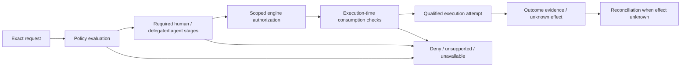

# Approval, telemetry and live operations control plane

Authority: Jeff's accepted October 7 continuation in [intent.md](intent.md). Canonical implementation, review and publication evidence: [development.md](development.md). Owner: Jeff. Root owns architecture, privacy, enforcement boundaries and release judgment.

Status: accepted product direction and proposed implementation contract. This document adds no runtime approvals, grants, policy evaluator, telemetry ingestion, live subscriptions, execution adapter or authority engine. Current `rangoon-engine` remains unavailable. The W3 editor authors inert definitions and checkpoints; its saved `validated` intent is structural inspection, not an execution approval.

## Product outcome

An operator can answer who requested an action, what exact action and resources were covered, which rules and versions applied, who could approve, who approved or denied, which authority issued a bounded authorization, where enforcement occurred and what outcome evidence exists. Each answer retains its source, time and verification state. Missing evidence and unknown effects remain visible. These are essential free-product safety and inspection surfaces; enterprise hosting adds organizational administration and scale rather than permission bypasses.

Preserve the original workbench shell: grouped navigation, stable themed header, central working surface and right inspector. Approvals gets an inbox and request timeline; Rules gets scoped configuration and change comparison; Agents gets inventory and assignments; Telemetry gets an event explorer; Command Center gets a dynamic topology and alerts; Audit gets evidence selection and exports. Distinct routes use shared records, rather than disconnected fixtures. Decorative graphics and live animation never imply authorization or readiness. Add keyboard and table equivalents to graph interactions.

## Responsibility boundary

| Concern | Rangoon responsibility | Authoritative source / limitation |
| --- | --- | --- |
| Configuration | Draft, compare and route versioned gateway/rule/assignment changes; show admission results | Selected authority must admit configurations where enforcement requires it; a locally saved draft is not active policy |
| Identity | Present verified human/workload identity and its source; separate observed labels | Authentication and workload attestation belong to qualified host/identity adapters; names and inventory rows prove nothing |
| Approval routing | Route exact requests to named human/agent stages, preserve decisions and deadlines | Authority validates approver eligibility, delegated scope and mandatory human duties before issuing authorization |
| Authorization | Request and display exact engine-issued references and limits | Rangoon cannot manufacture grants or reinterpret an approval badge as permission |
| Execution | Coordinate a qualified attempt through the declared mediated path | Trusted gateway/executor checks current scope, expiry, policy and revocation at consumption; unmanaged paths remain advisory |
| Observability | Collect minimized observations; correlate, project, search and export with provenance | Telemetry is not an authoritative receipt or proof of complete interception |
| Suspension | Submit explicit suspension/revocation changes and show acknowledgments and stale peers | Enforced suspension requires reachable qualified enforcement points; a UI toggle cannot stop unmanaged/offline work |

Never access an authority engine database directly. Keep content review, approval decisions, scoped authorizations and execution evidence separate. Multiple engines can coexist, but a request pins its selected engine and contract; no silent fallback, union of partial grants or weakest-engine bypass.

## Shared lifecycle

This is a conceptual flow, not a replacement LNSAT wire protocol. Each adapter preserves its engine's actual states and opaque evidence. Separate request, approval-stage, authorization and attempt state machines; do not compress all into a single `approved` flag. Every policy evaluation has an immutable application observation record linked to the exact input/context snapshot and its engine evidence. Approval plans, decisions and authorization observations bind that evaluation as well as the request; request identity plus a policy revision alone is insufficient. Reevaluation creates a successor evaluation, preserves history and supersedes prior approval eligibility; a new approval/authorization path must follow the selected engine’s admitted revalidation semantics. A denied or unknown evaluation cannot be overridden merely by collecting additional approvals. An expired/changed request needs reevaluation, not a silently rebound approval. Timeout or cancellation is not proof of no effect; retries after an unknown outcome require reconciliation and an explicit new attempt decision.

Evaluation succession is a bounded single-predecessor chain per request and selected engine, not latest-timestamp-wins. An initial evaluation expects no prior effective selector; a successor names the exact expected effective predecessor and superseded evaluation. Apply observed succession only when trusted-source lineage/fence and expected selector match the current projection; missing predecessors, branches, cycles or competing successors produce an explicit conflict/unknown effective state. Duplicate identical records are idempotent. The O1 contract must pin chain/resource limits before code. A decision or authorization can contribute to current eligibility only when it binds the exact effective evaluation and unchanged request/context under the selected engine’s contract; late decisions against a superseded evaluation remain historical and cannot satisfy the current plan. No automatic carry-forward occurs. Effective-selector observations do not authorize consumption: the authority/enforcer must perform its own current evaluation/freshness checks at execution time.

Required state distinctions include pending evaluation, awaiting approval, approved/denied stage, expired, escalated, revoked, suspended, authorization unavailable/refused/issued, execution check refused, attempt accepted, active, completed, failed, cancelled and outcome unknown. Engine-issued state is retained alongside its normalized display projection. Unrecognized states remain unsupported/unknown rather than default-allow.

### Cross-runtime operator-record acceptance target

This section makes the accepted outcome above testable for **separate** optional OpenShell and LNSAT connectors. It is a design target, not a live adapter or permission to operate either engine. A record can be complete **for its stated evidence scope** even when one engine is absent; “complete” never means universal coverage. Use the proposed [RUSL source-qualified reference and loss rules](universal-systems-language.md#envelope-and-provenance) only after its D0 wire freeze. Existing O1/O2 records and source contracts stay unchanged.

For `OR-02` and `OR-03`, the proposed D2b-1 gateway gRPC subset supplies policy revision/load and finite stream status, **not** structured per-action decisions. OpenShell's opt-in structured OCSF network activity is a separate candidate decision source requiring its own read, authenticity and loss qualification. Until then, D2a synthetic allow/deny fixtures test mapper behavior only; the operator view must leave native decision status unassessed. LNSAT approval and authorization evidence, any mediated cross-engine edge and external effect remain separate gates.

One selected operator record has a Rangoon-local `requestId` and immutable authored revision references, selected environment/resource/action commitment, optional authority-engine and runtime-system references, and an ordered set of **separately sourced facts**. Every external fact retains `{systemId, contractVersion, nativeId}` plus environment/engine scope where applicable, provider product/protocol/adapter pins, native payload or redacted digest/reference, source and receipt time, sequence/fence, authenticity/freshness, and qualification/coverage reference. The graph joins facts only on qualified references and an explicit `declared`, `reported`, or `verified` relation; matching strings, timestamps, trace IDs or UI selection are insufficient. In a voluntarily combined deployment, a bridge relation must bind the exact action/context and both independently qualified sides. Neither connector creates the other's approval, authorization or receipt.

The operator view should answer, in order: **What was authored? What exact action was requested? Which system evaluated it? Which human/agent duties were required and actually satisfied? Which engine, if any, issued and consumed action authorization? Which runtime path attempted it? What was reported, independently observed, and later reconciled?** Each answer shows its source and confidence state. A stage with no native equivalent says `not supported by this system` or `not observed`, not a synthetic success. A top-level result is `reported only`, `verified for named path`, `incomplete`, `conflicted`, or `unknown effect`; no single green “approved” or “complete” badge substitutes for the stage facts. Coverage stays a separate named operation/path/OS/artifact assessment. The side inspector exposes exact native IDs and redacted evidence; a table/timeline mirrors graph facts for keyboard and screen-reader use.

| Scenario fixture (future; no fixture run here) | Required evidence and operator result |
| --- | --- |
| `OR-01` no engines | Local capability/workflow revision, export and source review remain usable. Runtime/authority stages show unavailable; no empty “all clear” trace. |
| `OR-02` OpenShell native denial | Show gateway policy/version, sandbox/path and denied native event if the qualified read API supplies them. No LNSAT grant required. An absent attempt is not proof against an unqualified direct bypass. |
| `OR-03` OpenShell native policy/access-rule allow decision | Show provider-decision evidence under the OpenShell policy stage only, with its exact native meaning and scope. It is not approval-stage evidence, a LNSAT exact-action authorization, or a Rangoon verified-human approval. A separate OpenShell policy-change review, if reported, remains its own native event. |
| `OR-04` LNSAT denial or human-approved grant | Preserve exact LNSAT request, effective evaluation, human/agent plan and decisions, authorization state, one-time consumption, attempt, receipt and reconciliation refs where supported. No OpenShell event required. A granted authorization alone is not an effect. |
| `OR-05` changed action, target, actor, context or policy | Break exact binding and mark related former approvals/grants historical or invalid for the changed attempt. Keep the changed event visible; outcome remains unknown until trusted readback. |
| `OR-06` repeated or replayed attempt | Keep separate attempt IDs and same-ID conflicts. Only LNSAT's qualified one-time consumption path may claim replay refusal; do not project that guarantee onto OpenShell. |
| `OR-07` timeout or lost result after possible effect | Show unknown effect, source and last verified stage. No automatic resubmit. Exact-object readback/reconciliation appends evidence or leaves unknown; it never rewrites the original attempt. |
| `OR-08` out-of-order, duplicate, stale or conflicting reports | Preserve original events and provenance; deterministic projection exposes gap/conflict/staleness and cannot select a favorable winner. |
| `OR-09` identical native IDs in OpenShell and LNSAT | Keep separate source-qualified facts; reject cross-engine join without a separately proven bridge relation. |
| `OR-10` adapter/product/policy drift or direct bypass | Invalidate named qualification and its coverage badge; retain historical facts while current compatibility/mediation becomes unassessed or partial. |
| `OR-11` same trace string or action digest in both engines, without a qualified bridge | Preserve both native records and show a side-by-side correlation suggestion only. Do not draw a verified execution/authorization edge, even when times and names match. |
| `OR-12` qualified bridge for one mediated attempt | Require a uniquely identified attempt and a separately qualified mediator record binding the exact LNSAT consumed authorization, OpenShell runtime path/event, action/context commitment and pinned identities. Show the bridge evidence and its limits; a provider report or matching digest alone is insufficient. |

#### Cross-system relation proof gate

The existing O1 `ExternalRef` and `FlowContext` remain the local record vocabulary. A future bridge profile must reuse them and the proposed RUSL source-qualified reference rules rather than create a second generic trace ID or mutable joined status. Each relation names two immutable endpoint references, its source and native evidence reference, relation basis (`declared`, `reported` or `verified`), exact product/adapter/contract pins, environment and execution-path scope, observation and receipt times, freshness/invalidation state, and field-level loss. A relation is a separately inspectable fact; it never overwrites either endpoint. No new bridge wire profile or renderer-computed proof is accepted here.

| Relation sought | Minimum proof before a `verified` edge | Otherwise show |
| --- | --- | --- |
| Reviewed source revision → exported artifact | Exact source-range/recipe lineage plus deterministic compiled bytes and target-specific manifest/loss report under pinned compiler identity. | A declared mapping or unassessed export; never target load. |
| Exported artifact → installed or effective target | Target-native artifact identity and readback of installed bytes; separately identify effective loaded configuration and any layered instructions. Matching installed bytes alone do not prove effective load. | Installed-only, reported load, or unassessed effective configuration. |
| LNSAT authorization/consumption → OpenShell runtime attempt | One qualified mediated path with a unique attempt binding, exact action/context commitment, authenticated native LNSAT consumption evidence, authenticated OpenShell path/event evidence, and a trusted mediator's independently identified bridge record. The bridge must pin actor, target, policy/configuration versions, temporal fence and direct-path coverage for that attempt. | Separate engine records with `reported` correlation at most; no claim that LNSAT authorized an OpenShell action or that OpenShell enforced an LNSAT grant. |
| Runtime attempt → external effect | Independently observed pre/post state or an equally qualified target-native effect check, with target, attempt and time window bound. A success response, receipt or missing denial alone is not effect proof. | Reported outcome or unknown effect, followed by exact-object reconciliation where available. |

Equal display names, user-supplied trace IDs, timestamps, action digests, model summaries or UI graph links never satisfy a bridge. Repeated identical actions need distinct attempt identities; a changed action, context, actor, target, policy, installation or runtime path invalidates the affected relation without erasing history. If OpenShell and LNSAT operate independently without a qualified mediator, the operator can inspect and compare both, but the cross-engine edge remains unverified. Neither engine needs the other for its native workflow or for Rangoon's provider-free capability work. A future bridge packet must freeze exact bytes, algorithms, source and mediator custody, replay/timeout semantics, redaction, version negotiation and negative fixtures before any consequential relation or coverage badge is implemented.

Acceptance requires offline fixture conformance first, then authenticated, consented exact-object reads against one pinned OpenShell release and independently one pinned LNSAT release after each product's own gates. For any claim of verified consequence, use a disposable target, independently observed pre/post state, native decision/consumption/attempt evidence, fail/restart/readback cases, and bypass tests for the declared path. Compare against current OpenShell and other products on the **same sanitized task** with setup time, denied/changed/repeated/uncertain behavior and evidence completeness; do not claim a competitor lacks a feature without a pinned test. The [goal-specific adapter order](universal-systems-audit.md#staged-implementation-plan-not-authorized-by-this-design-packet) starts with read-only OpenShell observations. Cerbos remains a separate low-risk policy-adapter candidate. This target cannot close LNSAT's own Phase 10/11 gates, Rangoon O3/O4, or any release gate by documentation alone.

#### Operator-record evidence checkpoint — October 18, 2026

The scenario target above remains unchanged. The following inventory distinguishes tests of local parsing, consent and transport from evidence of an engine's action lifecycle. It is based on current Rangoon source at the `9c0cecf` worktree plus its inspected uncommitted connector and inspection sources; it does not re-pin either external product. Exact commands, results and scope are in the [evidence receipt](development.md#operator-record-scenario-evidence-audit--october-18-2026).

Source references used below:

- **D2a:** [offline OpenShell mapper tests](../crates/rangoon-integrations/tests/openshell_observation.rs). Inputs are typed synthetic reports, not native decision messages.
- **D2b:** [OpenShell read-client tests](../crates/rangoon-openshell-client/src/lib.rs) and [native host tests](../apps/desktop/src/openshell_host_tests.rs). Real client transport is exercised only against synthetic TLS peers; production Start remains unavailable.
- **D3a:** [offline LNSAT decoder tests](../crates/rangoon-integrations/tests/lnsat_evidence.rs) and [invented pinned-envelope cases](../fixtures/lnsat-evidence/phase8-public-main-f669181a.json). Supplied authorization/operation/attempt bodies are unverified reports.
- **O2:** [operator view projection](../crates/rangoon-ops/src/operator_view.rs) and [Rust-to-renderer fixture parity](../tests/operations-parity.test.mjs). The v1 projection deliberately omits native IDs, sets authenticity to unverified, authority to none, execution to unavailable, and outcome/coverage to unknown. It is not a provider-native detail view or an adapter mount.

| Target | Current source/test evidence | Evidence still required for the target |
| --- | --- | --- |
| `OR-01` no engines | O2 fixture parity inspects a local window without a provider. Existing local capability/export behavior remains separate, as recorded in its own receipts. | Requalify the complete local authoring/export journey when adapters are mounted; this audit's O2 fixture is not that full journey. |
| `OR-02` native denial | D2a `maps_reported_allow_deny_and_never_grants_authority` preserves an explicitly supplied synthetic denial. D2b `real_client_public_health_never_substitutes_for_protected_access` tests refused read access. | A qualified native per-action decision source. Refused observation access is not denial of an agent action. |
| `OR-03` native allow | The same D2a test preserves a supplied synthetic allow without authority. D2b `watch_projection_never_classifies_log_text_as_decision` deliberately discards text containing allowed/denied claims. | Structured, source-qualified action-policy evidence with its native meaning. Healthy transport, loaded policy and free-text logs cannot supply an allow decision or human approval. |
| `OR-04` LNSAT denial or human-approved grant | D3a `authorization_issued_no_operation` and `consumed_without_attempt` retain supplied native state and approval/policy references. | Independently pinned authorized reads for the actual evaluation, approval duties/decisions and denial evidence. A reference to an approval is not an inspected approval chain or verified human identity. |
| `OR-05` changed action/context | D2b rejects changed target, scope, leaf pin and reported version. D3a rejects contradictory selected IDs and cross-envelope scope/reference joins. | Exact original-versus-changed action/context evidence and the engine's resulting eligibility/consumption decision. Configuration/consent refusal and contradictory-envelope rejection do not test changed-action invalidation. |
| `OR-06` repeated/replayed action | D2a `detects_repeated_conflicting_and_mixed_producer_events` classifies repeated reports. D2b `real_client_changed_target_and_replayed_consent_never_dispatch_twice` rejects reused local read consent. D3a can report a consumed authorization. | Qualified native one-time consumption/replay-refusal evidence for the consequential attempt. Repeated telemetry, read-consent replay and action replay are three different behaviors. |
| `OR-07` unknown effect/reconciliation | D3a cases `outcome_unknown` and `already_recorded_reconciliation` retain supplied uncertainty and recorded reconciliation. A receipt remains reported evidence. D2b expiry/disconnect/cancellation tests refuse a completed observation. | Exact-object connected readback, provenance and qualified effect evidence where supported. A failed observation does not mean the observed action failed or had no effect; this inspector must not resubmit it. |
| `OR-08` ordering/conflicts/gaps | D2a tests repeated/conflicting reports, warnings, cursor-space changes and truncation losses. D3a rejects duplicate JSON fields and unequal nested/separate attempts. | A persistent source-qualified collector's sequence, freshness, reconnect, gap and recovery semantics. Duplicate JSON fields are not duplicate events, and a finite window is not continuous history. |
| `OR-09` equal native IDs | D3a's `same_native_id_openshell_lnsat_no_join` case retains `cross_engine_join=not_observed`; the decoder emits that value for every input and accepts no OpenShell body. D2a separately distinguishes installation/replica/cursor scope. | A two-provider fixture through the future host-owned detail/correlation boundary. The current case name does not establish that such a boundary exists or has been tested. |
| `OR-10` drift/direct bypass | D2a records policy-load/version mismatch; D2b rejects changed reported product version and TLS pin before protected dispatch. | Qualified compatibility invalidation for the named deployment/path, effective-policy readback and direct-bypass testing. Matching a version or certificate does not prove mediation or effect coverage. |
| `OR-11` equal trace/action digest | The contracts forbid inference; D3a reports no join and O2 has no provider-native detail surface. No exact two-provider equal-trace/equal-action-digest fixture exists in these adapter tests. | A negative fixture at the future correlation boundary proving that equality produces no verified edge, including repeated identical actions and different installation scopes. |
| `OR-12` verified mediated bridge | Neither D2b, D3a nor O2 implements or qualifies a cross-engine mediator. | The separate proof gate above, only for an explicitly selected combined deployment. Independent engine operation and side-by-side inspection must remain usable without that bridge. |

**Engineering consequence.** Completing native exit/credential/storage/UI gates can deliver a useful qualified OpenShell policy/runtime inspector, but cannot by itself complete the per-action operator record. That record also needs a separately qualified OpenShell structured-decision source where available, LNSAT's additional authorized evaluation/approval/audit evidence where available, and O3's host-owned source/provenance/detail boundary. Preserve missing stages when a provider cannot supply them. Keep action consumption/effect guarantees with their qualified engine/executor paths; do not manufacture them in Rangoon to fill the matrix. An optional verified bridge is additional scope, not a dependency between the two engines or a prerequisite for the local workbench release.

The immediate source sequence stays unchanged: native exit/admission correction after its pending acceptance, separate native event qualification, then the existing D2b-2b credential/encrypted-retention/UI and D2b-3 product/OS gates. This audit adds no mapper, wire contract, provider call, execution path or source acceptance. Do not describe the current denied/allowed/changed/repeated/unknown fixture vocabulary as end-to-end engine support.

## Scoped gateways and rules

A gateway configuration pins workspace/environment, authenticated caller classes, allowed operation classes, target/resource scopes, applicable policy revision, approval duties and enforcement adapter/version. Wildcard expansion, audience substitution and target changes are explicit configuration changes. Strict rule changes have a reviewable diff, expected prior revision, test fixtures, admission outcome, activation acknowledgment and rollback/suspension plan. Saving a rule draft cannot activate it.

Decision input binds the requesting actor, exact operation identity/digest, selected target/resources, environment, relevant capability/workflow revision and policy version. Digest computation and canonicalization must be specified per adapter and independently tested; a renderer-supplied digest is not proof of the action actually consumed. Execution checks bind the same operation and resource identity and reject substitution, replay and out-of-scope use. Policy changes between evaluation and consumption require the selected engine's revalidation semantics; Rangoon never invents a permissive compatibility exception.

Emergency suspension has its own operator authorization, reason, scope and receipt. Show requested, acknowledged, partially acknowledged and unknown coverage separately. Revocation cannot undo an already completed effect. In-flight and offline behavior must be documented and tested per executor; resource credentials and alternative write paths must not escape the promised mediation boundary.

## Human and delegated agent approvals

Approval plans support humans, agents or both, with explicit ordered or parallel stages and `all`/quorum requirements, separation of duties, designated human-only duties, absolute expiry and escalation destinations. Do not implement these modes as supported until the exact selected adapter can enforce them. Escalation changes routing within admitted scope; it does not renew expiry, drop a human stage or enlarge authority automatically.

An agent approver needs an explicitly admitted delegation from an authenticated authorized principal. Its record identifies delegator, delegate, engine/contract, permitted request classes, resources, environments, policy bounds, expiry, revocation and evidence. Agent inventory membership and model competence confer no permission. Defaults forbid self-approval, self-delegation and subdelegation; any future subdelegation must be explicitly supported and strictly narrowing. An agent cannot authorize, admit or activate any rule, gateway configuration, approval plan, authority assignment or delegation that directly or indirectly expands its own authority, extends its effective expiry or removes a required human duty. Resolve aliases and transitive delegation/assignment paths before admission; using a second agent or system identity cannot bypass this guard. Editing is limited to independently authorized inert drafts and cannot change active state; an inert expansion proposal, if supported, requires independent eligible review and authority admission. Mandatory human duties remain mandatory even when agent stages succeed.

Approval plans and approver decisions bind the exact request, immutable evaluation ID and policy revision, stage, authenticated actor, decision, reason and time. Preserve rejected or superseded decisions as history. The service verifies role/delegation eligibility again before accepting a decision; the authority verifies required decisions again before authorization/consumption. Human UI confirmation alone is not authentication, and an agent model's generated rationale is not authority evidence. Pending requests remain inspectable when an engine is unavailable, while consequential writes fail closed.

## Application contracts and adapter coverage

Freeze application records before transport. O1a now implements the inert `rangoon.ops.window.v1` observation vocabulary and bounded decoder under the [records contract](operations-records.md); O1b-1 adds bounded structural timeline/declared-graph projection and exact full-window replay under the [projection contract](operations-projection.md). Semantic evaluation/delegation/approval/outcome relationships (O1b-2), ingestion and runtime operations remain open. These application schemas are not a declared engine protocol. Initial records:

| Record | Minimum meaning |
| --- | --- |
| Actor reference | System/workspace, stable subject reference, human/agent/service kind, identity source and verification state |
| Gateway/rule revision | Immutable configuration revision, expected predecessor, bounded scopes/duties and separate admission/activation evidence |
| Request envelope | Application request/trace IDs, actor, exact operation/target references, policy and workflow revision references, selected engine and source provenance |
| Evaluation observation | Immutable application evaluation ID, exact request, initial/successor kind, one exact predecessor/superseded evaluation ID, expected effective evaluation selector and trusted-source lineage fence, canonical input/context snapshot references, canonicalization version and permitted digest, gateway/rule/evaluator artifact versions, allow/deny/unknown result, context freshness/expiry, diagnostics and original engine evidence reference |
| Approval plan / decision | Exact request, evaluation and stage, required identities/delegations, modes/deadlines, decision and supersession/revocation references |
| Delegation observation | Exact external delegation reference, scope, expiry, verification/freshness and evidence; observation is not an app-issued grant |
| Authorization reference | Opaque engine-issued identity, exact request/evaluation/required decision references, audience/operation binding and observed constraints; never a reusable generic app permission |
| Execution attempt | Request/authorization reference, attempt ID, selected executor, start/end observations, outcome and reconciliation state |
| Event envelope | Application event ID, application trace/span and causal/predecessor references, trusted producer identity plus external event selector, source sequence/time, kind, exact request/evaluation/attempt/policy references, redacted attributes and provenance |
| Projection snapshot | Immutable snapshot ID, projection/reducer schema versions, included input/workspace scope, topology/policy/coverage revisions, per-producer cursors/watermarks, source lineage and explicit missing/conflicting ranges |
| Evidence reference | Producer/engine, exact external ID and contract version, verification/freshness, bounded original artifact reference and missing reason |
| Coverage report | System/operation/target/OS, adapter/engine artifact versions, conformance evidence, freshness and operation-specific coverage |

Coverage is explicit: unavailable, advisory, partial mediation, or fully mediated for a named tested operation path. Record supported approval modes, delegation, expiry/revocation, execution-time checks, alternative write paths, outcome evidence and reconciliation independently. “Fully mediated” requires actual end-to-end enforcement tests for the advertised path and current artifact versions; it is not a global safety/compliance claim. Unknown or stale coverage prevents a governed execution offer. Advisory systems may supply observations, but cannot inherit the badge or permission of a different qualified route.

LNSAT is one independent authority adapter. Other policy/authority systems require their own closed typed mapping and conformance tests. A policy evaluator that produces an allow decision may still lack authorization consumption, replay protection or execution mediation; show those gaps. Discovery and read access cannot enable writes. An adapter upgrade or operation change invalidates previous coverage until requalified.

### Coverage and control-assessment presentation

Authority: [Jeff's October 13 continuation](intent.md#scoped-interoperability-coverage-and-plugins--october-13-2026). This is the planned semantic presentation contract, not implemented telemetry, a new wire schema or a standards assessment. Availability, connection, qualification, enforcement coverage, policy outcomes and standards control evidence remain distinct signals.

| Coverage color and label | Evidence required / meaning |
| --- | --- |
| Green — fully mediated for this path | Current independent end-to-end qualification for the named operation, artifact/configuration versions and resource path, including the advertised mediation boundary. No global safety/compliance claim |
| Amber — partial mediation | Known enforcement subset or missing controls; enumerate affected operations/resources and gaps. Missing mandatory controls block governed actions |
| Blue — advisory / observation only | Configuration, decisions or evidence without qualified action enforcement. It cannot inherit an authorization or enforcement badge |
| Gray — unavailable / unsupported / unqualified / unknown / stale | Preserve the exact reason as text; missing evidence and disconnected/stale observations cannot look healthy or idle |

Red is a separate readiness/outcome signal for a known failed required control, revocation, blocked action or recorded failure. It does not mean an entire provider is insecure and does not manufacture an observed policy denial. Approval, active execution and outcomes keep their own labels/trace evidence; a green coverage badge never says an action is allowed, approved or completed.

The separate **Control assessment** surface may use green **Met for assessed scope**, amber **Partially met**, red **Unmet**, and gray **Not assessed / evidence unknown or stale**. Display **Not applicable** neutrally only with a scoped applicability rationale. Each row names the pinned framework/control or guidance reference, assessed scope, owner/assessor, evidence and date, gap and remediation reference under the [single standards-readiness track](plan.md#security-and-standards-readiness). NIST architecture guidance, organizational ISO assessment, OpenSSF repository controls and SLSA artifact provenance have different scopes; plugin presence, connectivity, tests and coverage do not establish any of them. This surface is not a certification badge or a compliance engine.

Always pair color with text and a distinct symbol; preserve readable contrast, dark/light and forced-color modes. Reasons/details work with keyboard and touch, not hover alone. Keep missing/unknown/stale rows visible. Summary counts name the applicable scope and denominator and show unknown/excluded items separately; filtering cannot turn a subset into an overall compliance claim. Do not average coverage into a universal score or infer certification from green control rows. Tooltips explain evidence and limits; they grant no authority. No persisted assessment register or live projection is added by this documentation packet.

## Telemetry and privacy

Capture request creation, evaluation decisions, approval routing/decisions, authorization observations, execution checks/attempts, outcomes, resource-access metadata and failures. Correlate each with application trace/request/attempt IDs and exact policy revisions; preserve engine IDs separately rather than replacing them. Support multiple evaluations and attempts within one trace. Record latency with source and measurement method; distinguish estimated, observed and finalized costs with currency/units. Missing cost or latency is unknown, never zero. Rangoon mints opaque application request, trace, span, evaluation and event IDs at a trusted ingress boundary; renderer/external correlation tokens cannot select or replace these identities. External tokens are separately typed, strictly bounded and allowlisted/redacted or rejected before persistence, indexing, display or export. They cannot establish ownership, trust or cross-workspace joins. Minted IDs provide correlation only, not authorization or proof of authenticity.

Default payload excludes prompts, full source, tool arguments, credentials, private resource contents, raw URLs/paths and approval free text. Use closed allowlists, class-aware redaction before local persistence or remote transfer, bounded fields, safe error codes and opaque resource references. Redaction failure refuses ingestion/export rather than falling back to raw logs. Digests of low-entropy sensitive data may expose information; hashing is not universal anonymization. Secrets must never be retained for replay. Optional richer evidence needs explicit purpose, access/retention policy, owner consent and adapter qualification.

Separate source observation time, receipt time, source sequence and monotonic local ordering. Deduplicate by trusted producer/event identity with conflict detection; do not collapse distinct attempts sharing a request ID. Late, missing, reordered and conflicting events produce visible gaps. A disconnected stream, dropped events or stale snapshot must not look idle or healthy. Search, export and subscriptions apply the same workspace/tenant/read scope as direct evidence access. Bound queues, retention, query pages, graph fan-out and payload size; slow clients must not block enforcement. Audit exports include coverage, redaction and missing-event/verification metadata rather than claiming completeness automatically.

Local-first collection, retention/deletion, disk-full and crash handling need their own repository contract. Existing SQLite workspace is plaintext and has no authenticated telemetry log. Do not label an event chain tamperproof because it has hashes. Signed/checkpointed evidence or external anchoring requires an explicit key/threat/recovery design, including detection of truncation, replacement and rollback. Cloud ingress, authentication, tenancy, encrypted storage, retention and live subscription transport remain separate later stages.

Optional model curation needs distinct trace events for pinned model and
template digests, bounded input digest, risk tags, uncertainty/abstention,
recommendation, human disposition and later correction. Keep deterministic
policy decision, approval-stage decision, authorization consumption and
observed outcome separate. Analytics may measure false positives and negatives
on independently labeled cases, disagreement, abstention, escalation time,
latency, cost and outcome coverage; historical accuracy never becomes an
authorization grant. Preserve unknown outcomes and missing denominators.

### Decision ledger and analytics sequence

The existing nineteen O1 record kinds are the closed source vocabulary for
reported policy, approval, authorization, attempt, metric and evidence facts.
Do not encode a model suggestion as `evaluation`, `approval_decision` or
`authorization`, or add an unreviewed field to `rangoon.ops.window.v1`. O2 may
derive read-only decision views from those records. Model advice needs a
separately versioned advisory record and qualified O3 ingress before it can
join an actual operator trace; until then, keep it in a clearly labeled
offline research/evaluation dataset, not a live decision history.

For each request, retain every applicable event in causal order: input and
policy revision, deterministic evaluation (including deny/unknown), each
model invocation or explicit skip/unavailability, every model recommendation
or abstention, human routing and every approve/deny/abstain/expiry/revocation,
authorization issue/refusal/consumption, each execution attempt, observed
effect or unresolved outcome, reconciliation, and later correction. Each fact
identifies its producer, verification state, source/receipt time, request,
evaluation and attempt IDs where applicable, plus the pinned rule, adapter,
model and prompt versions. A later correction appends a linked record; it does
not rewrite the original judgment or make a superseded recommendation current.
Do not invent a model invocation when none occurred or collapse multiple
attempts, approvals or evaluations into one final status.

O2's first analytics view should answer how many requests entered each stage,
how many were denied, approved, abstained, expired, revoked, attempted,
completed, failed or remain unknown, and why. Count requests, evaluations,
approval decisions and attempts separately with explicit denominators and
scope filters; never add their counts into one success rate. Show policy/model
and human disagreement, escalation and time-to-decision only when both sides
exist. Compute model precision/recall and false-negative rates only from a
pinned independently labeled sample, with label source, sample size and
unlabeled count beside every metric. Operational outcomes do not automatically
label model correctness; permitted effects can still be harmful. Unknown,
missing, stale and disconnected evidence stays in the denominator or in an
explicit excluded bucket, never silently becomes success or zero cost.

O3 must qualify event identity, redaction, access control, encrypted retention,
deletion/export, gap detection and replay before any live analytics claim.
Use the same minimized evidence boundary for local and hosted views. Neither a
dashboard aggregate nor a measured model score changes O4 approval duties,
authority admission or execution-time checks. A possible future model
delegation requires a new accepted authority contract and separate validation.

## Live graph, timelines and historical replay

The October 11 [information-flow visualization continuation](intent.md#information-flow-visualization-continuation--october-11-2026) permits a separate 3D/2D synthetic playback surface under [V3](visual-system.md#v3-bounded-information-flow-playground). It illustrates distinct policy, approval, authorization, consumption and evidence steps using closed local scripts only. Its animation cursor is presentation state, not an admitted event stream, O1 projection or trusted clock. A later actual operations view must consume the existing qualified immutable records/projections and preserve diagnostics, topology/policy pins and lineage fences below. No duplicate telemetry contract or renderer-invented authority is introduced; missing actual integrations remain unavailable.

Project nodes for agents, workflows/revisions, tools, resources, gateways, approval stages/approvers and authority engines. Edges represent request flow, declared dependency, delegated authority observation, control mediation or evidence lineage; their legend and inspector distinguish declared topology from observed activity and verified enforcement. An animation cannot indicate an actual grant.

Show pending approvals, blocked/refused actions, active attempts, failures and unknown outcomes with text and shapes as well as color. Filters include workspace, system, engine, policy revision, actor, resource class, coverage, trace, attempt, time and outcome. Drill-down opens the exact bounded records and evidence. Compare policy/topology snapshots across time. Historical replay uses captured topology/policy versions and marks unavailable snapshots; it neither reevaluates old requests under current policy nor executes anything. Never infer an absent event proves no action happened.

Use a versioned immutable projection snapshot plus bounded incremental events. The snapshot pins its ID, reducer/projection versions, included scope, topology/policy/coverage revisions and each producer’s cursor/watermark and lineage fence. A subscription starts at that exact fence; retain event predecessor/causal lineage and require compatible reducer versions rather than mixing an old snapshot with arbitrary latest events. The reducer is deterministic; live and replay projections use the same pure rules. Out-of-order/late events are applied only under a specified bounded ordering rule or require rebuilding a successor snapshot. Exact duplicate events are idempotent; same producer/event identity with different content produces an explicit conflict. Missing predecessors, cursor jumps, unavailable snapshots and conflicting events produce deterministic incomplete/conflicted projection states; they cannot erase unknown effects or show a complete healthy trace. Keep layout/selection filters as UI state. Keyboard-accessible inbox, tables and timeline convey all critical graph states. Reduced motion disables pulses/automatic movement; screen-reader summaries and focus remain stable while events arrive.

## Operations console

| Surface | Operator outcome | Required honest states |
| --- | --- | --- |
| Approval inbox | View scoped queue, exact action, required stages and eligible approvers; submit decision | Read-only/unavailable, identity unverified, delegation missing, expired, stale policy, denied or superseded |
| Rule editor | Compare immutable drafts, run fixtures, submit admission and activation | Draft is inactive; conflict/refusal; activation unknown or partial |
| Agent inventory / assignments | Inspect actual identity, declared capabilities, delegated scope and mediation coverage | Declared versus observed versus verified; unmanaged or stale systems |
| Telemetry explorer | Filter traces and attempts; view timings/costs/access/failures and missing steps | Estimated/unknown, redacted, delayed, dropped, duplicate/conflicting evidence |
| Live Command Center | Find pending gates, blocked paths, active attempts and unknown effects | Freshness and coverage visible; no fabricated totals/compliance percentage |
| Alerts / emergency controls | Triage expiry/escalation/failures/gaps; request scoped suspension | Requested versus acknowledged; uncovered executors cannot be labeled suspended |
| Audit exports | Export scoped redacted records and original evidence references | Integrity/verification and coverage limits, excluded/missing records, retention window |
| Deployment manager | Compare desired, installed and effective revisions per target; stage canary/waves, inspect receipts and reconcile or request rollback | Unmanaged, unsupported, stale, queued, partial and unknown; an ACK or healthy endpoint is not effective load |

### Fleet management console direction

Rangoon's future fleet view is an operations management surface, not only a live animation. Use one resource inventory for sites/regions, environments, target groups, systems, engine instances, gateways, agents, connectors and their observed relationships. A target group is a Rangoon organizational/rollout unit; it does not imply that its members share authority, state or failover semantics. Each instance row identifies product and pinned version, exact adapter, owner, trust zone, target identity, observed health/freshness, configured and effective revisions, qualified operations and evidence cursor. `Discovered` is an unverified candidate, distinct from `registered`, `connected`, `managed`, `degraded`, `disconnected` and `unsupported`; every state shows source and last observation time. A passive or imported hint carries provenance and cannot become durable authoritative inventory or a managed node without authenticated enrollment and operator review. Active discovery requires a separately qualified adapter, explicit user consent, allowlisted destination and scope, bounded rates and egress, and recorded provenance. No background network scan, ambient credential use or unauthenticated discovery is implied by this view.

Keep a familiar tree and searchable inventory/table as the primary fleet entry. Selection opens an exact target inspector with Overview, Configuration, Deployments, Health, Tasks and Evidence. A compact topology/graph is an alternate view of the same selected records; grouping, zoom and animation cannot hide missing nodes or infer live traffic. The task bar shows active rollout waves, per-target failures, stale observations and unknown outcomes. A novice sees next safe action and recovery path; Advanced opens native IDs, digests, cursors, leases, route/transport diagnostics and export. CLI/API must expose the same scoped read and task states without inheriting browser trust.

Put Fleet, Deployments, Tasks and Evidence under a collapsed Operations navigation group; keep Import, Skills, Workflows and local Compile/Export in their existing task-first paths. Within Fleet, Inventory is the default tab, with Topology and Activity as alternate views. At wide desktop size use tree/table plus a compact right inspector; on tablet use an inspector drawer; on narrow/mobile inspection use a labeled list and full-page detail. Topology always has an equivalent outline/table. A Simple/Advanced disclosure changes detail density only, never permissions or authority. Summary chips state exact scope, denominator, watermark and unknown/stale count; they cannot turn absent events into a healthy fleet.

Management actions are per-adapter capabilities, not generic buttons: inspect, validate draft, prepare, submit staged deployment, pause/drain if natively supported, request rollback, export evidence, and reconcile an uncertain result. Host install/upgrade/restart, backup/restore, key rotation or network/load-balancer change need their own qualified product/orchestrator interface, identity, scope, consent, approval and recovery contract; no raw shell, direct database access or ambient credential use. Show unsupported actions disabled with reason. A Rangoon approval authorizes only the permitted Rangoon task; each engine still evaluates and enforces its own consequential action. A healthy node is not a permission grant. Cross-instance failover cannot automatically replay an uncertain attempt.

Every task records actor, target set, exact artifact/configuration and expected prior revision, adapter/product pins, required approval, dispatch identity, per-target acknowledgement, native installed/effective readback, evidence and explicit incomplete/unknown states. Change history and task log are append-only projections over authoritative records; UI refresh or load balancing cannot forge a completed rollout. Per-tenant scope and rate limits apply to search, subscriptions, bulk selection, exports and deployment jobs. This view may inspect independent LNSAT nodes first. A shared LNSAT cluster or remote management API remains unavailable until LNSAT separately qualifies those native contracts.

## Provider independence and release sequencing

The October 7 [accepted continuation](intent.md) preserves Rangoon ownership of configuration, routing, visibility and evidence while external providers retain their own authorization/enforcement/identity semantics. LNSAT is an optional separate product. Provider allow/no-violations, local content review, approval and execution outcomes never become interchangeable. Reuse the single [provider interoperability contract](provider-interoperability.md) for optional product/version/capability metadata; do not replace or silently remap the frozen operations schemas.

Core local authoring, decomposition, composition, revisions, compilation, export and inspection have no engine dependency. O1–O3 local inspection/console work remains useful with unavailable providers. O4 qualified governed execution and O5 broad/hosted integration require their own evidence but are not prerequisites for shipping the useful qualified local workbench. These remain required staged product aspirations rather than removed scope; release support rows must state unavailable operations and retain all-three-desktop qualification.

## Build sequence and acceptance

1. **O1: inert shared records and projection core.** Closed versioned DTOs, bounded IDs/attributes, request/approval/attempt state separation, explicit coverage and provenance. Implement a deterministic event projector and replay with adversarial synthetic fixtures. No grant issuing, policy evaluation, network, credentials, database or execution. Pin resource bounds, immutable evaluation/decision linkage, generated-versus-external IDs, snapshot fences and relationship validation in a dedicated implementation contract before code. Negative fixtures cover duplicate, conflicting, late and out-of-order events; missing predecessors and scope/version mismatch cannot yield a complete projection. Include competing old/new evaluation successors, a late old-evaluation approval/authorization and a changed effective selector during approval: none can restore eligibility or satisfy the new plan.
2. **O2: actual local operations views.** Approval inbox, agent/assignment list, telemetry explorer, decision analytics and graph/timeline over the O1 repository/service; empty/unavailable states until real collection exists. First show bounded offline counts and drill-down with explicit source, denominator and unknown states; no synthetic event may appear as a live decision. Pointer/keyboard/filter/replay parity and original screenshot shell. Synthetic demonstration remains separate from actual runtime observations.
3. **O3: bounded read-only ingestion.** Qualified identity/read adapters, minimized native observations, persistent event/recovery/retention contract, gap/backpressure handling, audit export and security review. Source events and engine evidence keep separate verification states. No authority write becomes enabled by read access.
4. **O4: one qualified approval/enforcement path.** Exact configured gateway and admitted rules, authenticated human approval, then explicitly delegated agent stages where supported, scoped engine authorization, execution-time consumption and disposable execution/evidence/reconciliation. Test direct and transitive self-escalation through gateways, rules, assignments, approval plans and delegation aliases; requester self-approval; mandatory human omission; changed evaluation/context with unchanged request; quorum/replay/digest substitution; policy drift; expiry/revoke/suspend; offline peers; and crashes before/after effect. No automatic engine fallback or unknown-effect retry.
5. **O5: cross-system adapters and live hosted operations.** Publish per-operation coverage and versioned conformance suites; prove workspace/tenant subscription, query, export and worker isolation, throughput/retention/recovery, redaction and cost accounting. Stage deployment management through exact artifact plans, target-native installed/effective readback, partial-wave reconciliation and qualified rollback. Multiple LNSAT or other engine instances retain distinct native identity and authority; Rangoon load balancing does not create a shared engine authorization pool. Hosting and initial all-three-desktop release retain their own qualification gates. The [capacity tiers and distribution rules](application-architecture.md#capacity-model-for-a-5001000-person-organization) remain proposed until measured.

Root owns O1 semantics/privacy and integration; bounded workers may implement exact pure files after accepted contract and fresh review. Fresh independent source and UI/a11y review and named tests are mandatory. Existing W3 source publication does not qualify O1–O5. Initial three-OS release scope must identify which O stages have passed; staging does not silently remove these core surfaces from the accepted product. Execution-dependent gates cannot pass while required authority/runtime adapters remain unavailable.

The original O0 eight-file architecture packet owned only README, intent, this contract, application architecture, product experience, plan, continuation and development ledger. Run artifact/reference and whitespace validation and fresh independent architecture/claim review. No production source, schema, CI, native configuration, live endpoint, credentials, private telemetry, engine activation, license, installer/release, deployment or government submission is changed. Reversion removes the documentation proposal; it does not revoke an external grant because none is issued.

## Current portable source stages

O1a provides the bounded nineteen-record decoder; O1b-1 provides the immutable structural timeline and declared graph. O1b-2a adds separate reported request/evaluation/approval relationships under [operations-relationships.md](operations-relationships.md), preserving structural v1 bytes and unknown authoritative eligibility. Its bounded single-chain selector is reported/unverified; a successful link assessment does not authenticate actors or satisfy approval duties. Canonical evidence remains [development.md](development.md). O1b-2b1 adds separate alias-aware reported subject and finite delegation/parent inspection under [operations-delegations.md](operations-delegations.md), preserving both earlier schemas and unknown authoritative eligibility. It never authenticates an actor, admits subdelegation or satisfies a human duty. O1b-2b2 adds separate reported stage/quorum/ballot/decision-chain inspection under [operations-approvals.md](operations-approvals.md), with unchanged unknown authoritative duty satisfaction and no routing or execution. Its exact validation and acceptance state belongs only in the canonical ledger. O1b-2b3 now has an independently reviewed [reported lifecycle/outcome/coverage source contract](operations-lifecycle.md); locally qualified pure source is recorded in the development ledger. O2 operations views, O3 qualified ingress and O4/O5 runtime enforcement/expansion remain open. This staging preserves the complete accepted core product scope.
