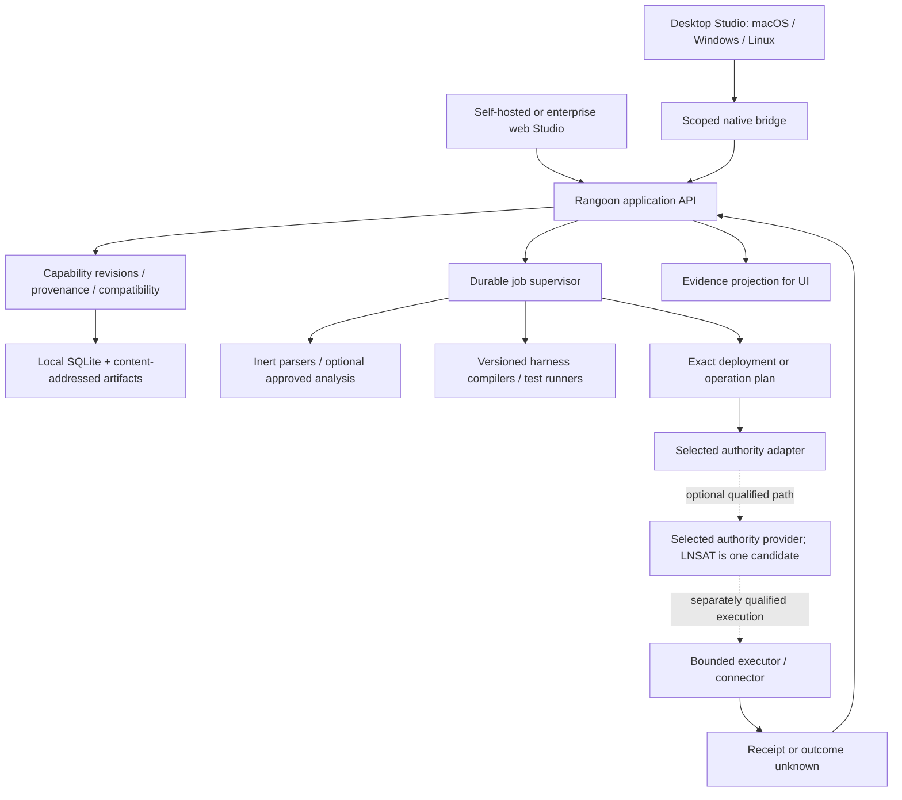

<!-- intent-driven-delivery:plan:v1 -->
# Plan: Rangoon from capability workbench to governed platform

Status: proposed
Authority: [intent.md](intent.md), including the accepted provider-independent continuation; detailed future stage proposals are not implementation or release acceptance
Owner: Jeff
Last updated: 2026-10-18

## Universal language design gate

Current accepted direction: RUSL is retired as an active contract. Preserve its old parser and fixtures as inert experimental history until a usable independently developed VUSL core is available and affected consumer tests are updated. Do not build or maintain RUSL readers, converters, aliases, dual-profile handling or a backward-compatibility program without demonstrated need. The [accepted retirement decision](intent.md#rusl-retirement-and-vusl-consumer-sequencing--october-19-2026) supersedes the historical D0a/D1 roadmap below.

Future VUSL adoption must select an exact usable upstream core/artifact, review native-semantic loss/refusal and authority boundaries, update and pass the affected Rangoon tests, and independently review the cutover before deleting old code. The existing spec/fixture provenance record is not that core pin. Until then keep the workspace buildable and existing tests passing. Native OpenShell/LNSAT adapters remain independent and useful local workflows do not acquire a language/core/provider prerequisite.

### Historical D0a/D1 sequence — retired research track

The paragraphs below retain the earlier design and acceptance history; they do not reopen RUSL implementation or define current VUSL behavior.

Jeff requested a design-only audit before expanding provider coverage. The proposed [VUSL v0.1 language](universal-systems-language.md), narrow [D0a observation profile](universal-systems-observation-profile.md), six [candidate canonical vectors](rusl-d0a-canonical-vectors.json), 11 groups of [candidate negative vectors](rusl-d0a-negative-vectors.json), six complete plus one derived [candidate O1/I1 host-source vectors](rusl-d0a-host-mapping-vectors.json) and [capability/implementation audit](universal-systems-audit.md) define a loss-aware semantic layer above I1/A1/W1/O1, not a replacement authority. Independent review of earlier proposal bytes passes; owner acceptance of a public profile and pinned schema identity remain open. Jeff separately authorized an **experimental pure offline D1 parser** under [intent](intent.md#d1-pure-offline-parser-authorization--october-16-2026). Its unmounted crate validates only candidate inert D0a documents. It cannot mount an adapter, assert compatibility or make candidate bytes a public wire contract. The offline D0a-H source probe now tests O1 reference/refusal shape against these envelopes and I1 H03 non-mapping; full D0a qualification still requires accepted profile/schema identity, complete independent cross-language conformance and a separately reviewed host integration. Jeff next accepted the exact [D0a-H offline O1/I1 source packet](intent.md#d0a-h-offline-host-source-conformance--october-17-2026), which probes validated reference shape and refusal only; it cannot emit D0a observations, assert compatibility or contact a provider. Jeff then accepted the exact internal D0a review snapshot for the [D2a offline OpenShell fixture adapter](intent.md#internal-d0a-profile-and-d2a-offline-adapter--october-17-2026). Public wire/schema acceptance and complete host/cross-language conformance remain open; D2a is typed inert metadata inspection only. D0b action/context commitment is a later separate gate before consequential semantics. Only a later separately consented, pinned read-only adapter may connect to a provider. Keep OpenShell and LNSAT independent and preserve the useful local three-OS workbench path.

The support goal uses the [cross-runtime operator-record target](operations-control-plane.md#cross-runtime-operator-record-acceptance-target): OpenShell remains the first goal-specific **read-only runtime connector**, with LNSAT evidence as a separate later gate. The proposed [D2 OpenShell specification](openshell-observation-connector.md) and [D3 LNSAT specification](lnsat-evidence-connector.md) each stage offline native-source fixtures before separately consented connected reads. D3 explicitly excludes LNSAT's POST reconciliation route from a read-only adapter. The [cross-system relation proof gate](operations-control-plane.md#cross-system-relation-proof-gate) leaves independent engine observations unlinked unless a later qualified mediator binds one exact attempt; matching names, trace strings or digests do not make a verified edge. Existing Cerbos-first wording elsewhere in this plan describes the lower-risk generic policy-adapter I2 candidate, not a dependency or a broader ordering claim. This design reconciliation itself opened no implementation or engine action; the later accepted D1, D0a-H and D2a source scopes are separately bounded.

Jeff separately accepted the [D3a offline LNSAT exact-evidence source packet](lnsat-evidence-connector.md#d3a-exact-offline-source-packet--accepted-for-internal-offline-source) against a pinned local `public/main` serializer. Its unmounted pure decoder and synthetic fixture now exercise authorization/attempt/receipt/reconciliation inspection without pretending its three GET surfaces supply denial/replay history or independent effect proof; [development](development.md#d3a-internal-offline-lnsat-evidence-decoder--october-17-2026) owns validation evidence. D3a consumes no D0a document and is not authorized by D0a's D2a-scoped acceptance or D1's offline tests; its own acceptance is recorded in [intent](intent.md#d3a-offline-lnsat-evidence-acceptance--october-17-2026). D2b-2 host consent/custody, D2b-3 real-gateway qualification and D3b connected read remain later independent gates; none is a release prerequisite for the useful provider-free local workbench.

The [accepted D2b-1 OpenShell native read-only source packet](openshell-observation-connector.md#d2b-1-native-connected-read-transport-packet--accepted-for-unmounted-source) now has an unmounted, OIDC-only v0.1.4 gRPC client tested against a synthetic TLS peer; its [development receipt](development.md#d2b-1-unmounted-openshell-read-client--october-17-2026) records validation and limits. This is source behavior, not connected support. D2b-2 host consent/custody and D2b-3 released-gateway plus three-OS qualification follow separately; default local mTLS, edge tunnels, connected UI and cross-engine relations remain outside this packet. D3b separately needs a fresh LNSAT artifact because D3a's frozen local `public/main` research ref is not an established current public artifact. Do not trade the provider-free local workbench release path for adapter coverage.

## Harness value and portability completion track

Authority: Jeff's October 18 transcript/research request adds the following completion requirements to the roadmap. The [dated primary-source assessment](harness-research-20261018.md) owns the research and current-code comparison; this section owns priority. These are proposed future implementation packets, not newly working features. Existing E1 adoption, native exit qualification and useful local release work retain priority. Broad runtime coverage is not a prerequisite for shipping the local workbench.

| Order / packet | Reuse and exact first deliverable | Acceptance and limits |
| --- | --- | --- |
| 0. Finish the useful local path | Existing E1 services, native close coordinator and source-to-export workbench. Next prepare NX-06 disposable event-loop qualification, then complete accepted setup/recovery/platform gates. | Actual native event prevention and callback drain, followed by isolated encrypted setup/import/save/lock/unlock/restart tasks and target-loader proof. Native harness operation and production activation remain separate gates; no new runtime to bypass them. |
| 1. HV-01 offline evaluation records | Reuse M1 pack/inspection identities, W1 revisions and existing test fixtures. Proposed files: `docs/capability-evaluation.md`, `fixtures/evaluation/*.json`, `scripts/validate-capability-evaluation.mjs`, `tests/capability-evaluation.test.mjs`. Root owns contract; one bounded worker owns fixtures/validator/tests after exact packet acceptance; fresh reviewer owns read-only review. | Versioned dataset and case IDs, exact source/revision/template/compiler/model/harness/adapter pins, baseline/candidate identity, evaluator identity/version and provenance, per-case outcomes, repetitions, errors/refusals, token/latency/cost measurement method and unknown values. Offline validator recomputes summaries and rejects mismatched cases, fabricated savings, missing denominators, unsupported versions, stale/mixed runs and aggregate gains that hide failed mandatory cases. No model calls, execution runner, persistence migration or new public wire contract. Run named Node fixture tests and review/document checks. |
| 2. HV-02 context fidelity and upgrade review | Extend the existing M1 conformance corpus; do not create another context packer. Add a reviewable behavioral-workaround register tied to capability revisions and evaluation cases. | Preserve exact protected spans, uncertainty, negative evidence, contradictions, citations and explicit omissions. Distinguish byte-preserving selection from a later semantic summary. Compare fixed cases before/after model, prompt or tool-set changes; deletion recommendations remain human-reviewed. Security/privacy controls cannot be auto-retired as model workarounds. No tokenizer estimate labeled billed usage. |
| 3. HV-03 portable change and recipe evidence | Extend existing R3/R4 compilation, target-loader qualification and R9 descriptors with source/target/version and unsupported-field reports; reuse immutable revisions. | Inspect/export/reimport retains supported identities and provenance; unsupported semantics are explicit. A runtime recipe pins tools, instruction revisions, budgets and verification requirements without claiming it grants permissions or reproduces private runtime state. Test changed dependencies and rollback references. No universal export promise or executable plugin loader. |
| 4. HV-04 external waiting and recovery inspection | Extend the planned O3/native evidence detail layer and provider-neutral mapping after one qualified source exists. Runtime remains owner of scheduling, subscriptions and task execution. | Distinguish task definition, instance, checkpoint, wait reason, wakeup, attempt and effect outcome. Inspect duplicate/out-of-order events, expired approvals, lost checkpoints and stale policy. Resume/stop controls remain unavailable until provider-specific semantics, consent and execution-time rechecks are qualified. Observation replay never triggers execution. |
| 5. HV-05 generated-capability lifecycle | Extend R9 and existing revision/coverage contracts with inert created-tool/image/plugin proposals and origin/evaluation references. | Show proposed, reviewed, installed, active, expired, revoked and removed as distinct provider-sourced states. Unknown dependency/identity or capability expansion blocks promotion; test replacement during use, partial cleanup and active references after removal. Provider installation and hot-loading remain separate protected scope. |

HV-01 is the next **new product capability** recommendation after current local/native gates. A later connected evaluation runner requires explicit endpoint/data consent, hard run/token/time/cost limits, cancellation, redaction and independent review. Start with optional import/export adapters for Phoenix/LangSmith-style evidence instead of a second observability backend. Preserve native schemas and report losses; product names here are candidates, not current integrations.

User-facing placement stays within existing menus: Compare changes in Skills/Compile, datasets and experiment comparisons in Test Lab, runtime wait/recovery evidence in Operations. Do not add top-level menus, more synthetic readiness panels or autonomous optimization to satisfy this plan. Pilot success measures are task completion, human correction burden, source/target fidelity, recovery and measured overhead on the same sanitized task set; no competitor superiority claim follows from feature count.

## Competitive proof and missing workflows

This is a proposed completion sequence, not a claim that Rangoon or LNSAT
outperforms another product today. Compare against a pinned release and the
same sanitized task, not screenshots or feature counts. NVIDIA OpenShell
already supplies sandbox policy, credential protection, observability and
extension surfaces; its current guide is
[versioned](https://docs.nvidia.com/openshell/home). NVIDIA NeMo
[Switchyard](https://github.com/NVIDIA-NeMo/Switchyard) optimizes model routing,
a different job. Neither should be recast as a Rangoon authority engine.

| Priority | Current evidence | Missing workflow and pass condition |
| --- | --- | --- |
| 1. Useful local workbench | Source-first import, revision, composition, compilation and export exist; desktop/platform and encrypted-default qualification remain incomplete | One disposable source-to-export/restart task passes on macOS, Windows and Linux, including refusal, recovery and no-provider use. Measure setup time and steps. |
| 2. Consequential action proof | Rangoon's operations records are inert. Local LNSAT `public/main` at `f669181a` reports Phase 10 source-conformance complete and an experimental Phase 11 fake-runtime served chain; a newer local branch adds a durable guard. Phase 11 real Docker/runtime proof, supported artifact and Rangoon integration remain open. See the dated [D3 source check](lnsat-evidence-connector.md#source-evidence-and-qualification). | In a separately authorized disposable LNSAT target, prove denial, exact changed action, replay, approval change, authorized effect, lost result and uncertain reconciliation. Verify host-side consequence and durable receipt; show any bypass. Preserve LNSAT's separate acceptance and authorization gates. |
| 3. Operator record | O1 source inspectors classify reported records without authentication; O2 has a local, read-only first slice on `codex/ops-local-window`, with native GUI qualification still open; O3–O4 remain unbuilt | Qualify the selected-file library, reported timeline/topology and inspector on populated native tasks. Then build authenticated, redacted, bounded event ingress and correlated search across request, evaluation, human/agent approval, authority consumption, actual outcome and evidence. Show unknown, stale, disconnected and advisory coverage; test missing, out-of-order and duplicate events. |
| 4. Independent runtime and authority interop | OpenShell O0 is an offline combined-path fixture; A1 LNSAT remains unavailable | Pin separate read-only OpenShell and LNSAT connector contracts. Preserve each engine's native identity, policy decision, policy-change review when present, approval when actually supported, and evidence. Test unavailable, denied, allowed, changed, stale, repeated and uncertain reports without translating one engine's decision or result into the other's authority. Keep absent-adapter workbench useful. |
| 5. Safe change review | Revisions and provenance exist; no qualified authority-impact preview | Diff capability/policy/connector changes by affected actions, resources, approval duties and adapter coverage. Replay sanitized fixtures and label untested paths. Do not claim formal verification or infer permission from preview. |
| 6. Integration developer path | Provider descriptors and offline conformance contracts exist; executable plugin SDK does not | Ship versioned adapter test kit with negative fixtures, explicit capability/coverage matrix, consent and secret-handling rules after one real adapter. Public plugin runtime and registry follow two independent qualified adapters. |

Benchmark evidence must report denied and permitted outcomes, bypass attempts,
duplicate/replay handling, uncertain-result recovery, operator trace
completeness, latency overhead, setup burden and tested operating systems.
Keep security, routing, authoring and UI scores separate. A win on one task
does not imply superior sandbox isolation, model routing or broad market fit.

### Verification protocol

For each sanitized task, pin product versions, host OS, policy, actor, action
bytes/digest, target and expected result. Run an independent target observer
outside the agent/runtime path: capture pre-state, decision and consumption
records, attempted command or API call, post-state and durable receipt. Inject
denial, changed arguments, replay, expired approval, missing provider, lost
response and crash/restart. A denial passes only if the target did not change;
a permitted action passes only if exact intended effect and corresponding
evidence agree. Unknown remains unknown until read-only reconciliation proves
the consequence. Repeat on all supported OSs and compare like-for-like tasks
against pinned alternatives where their responsibilities overlap.

Do not make model classification a prerequisite for LNSAT authorization.
Deterministic controls must bind the exact effect-time action, target, actor,
scope and policy revision, with cumulative budgets, protected-resource labels,
expiry, replay defense and human approval where specified. This catches many
slow or split destructive actions without inferring intent from prose. An
optional, locally evaluated semantic assessor may add risk evidence or request
escalation; it cannot issue a grant, erase a denial or establish that an effect
occurred. If the curator is absent, stale or uncertain, show that state and
continue LNSAT's independent deterministic policy and human duties; never
silently convert the missing advisory finding into a safe classification.
An optional advanced-model curator may inspect an explicitly reviewed,
minimized case after local session consent; a remote curator additionally
requires separate external-transfer consent. It can propose risk tags, missing
context and a human-readable explanation. A human must review
the exact action and evidence before any required approval. LNSAT still owns
the final scoped authorization and execution-time check. No model, local or
remote, becomes a human approver or an authority engine.
Future model-delegated approval is an open, separate authority-design question:
measured accuracy alone is insufficient. It would need explicit human-granted
bounded delegation, revocation, failure and adversarial qualification, exact
effect-time checks and a new accepted LNSAT contract before any such claim.
Track every policy, model, human, authorization and effect observation as a
separate event, including abstentions, refusals, expiry, unavailable inputs,
unknown outcomes and later corrections. The local O2 first slice provides
scoped offline reported-decision counts and drill-down over the current O1
vocabulary; O3 must qualify authenticated, redacted, retained live ingress.
A model-advice event
needs a new versioned advisory contract, never a disguised policy evaluation
or approval. The [decision analytics sequence](operations-control-plane.md#decision-ledger-and-analytics-sequence)
defines denominators and independent labels; a high model score is neither an
authorization grant nor an accuracy claim for unlabeled production traffic.

Separately, time first-time users through source import, skill discovery,
composition, policy review, refusal recovery and trace explanation. Score task
completion, errors, time and explanation accuracy with blinded human review.
An AI reviewer may flag confusing descriptions, missing context and likely
semantic mistakes, but its judgment is advisory and checked against source
bytes and human review; never use model approval as proof of enforcement or a
substitute for independent target observation. Preserve test artifacts and
failed cases in the development ledger before any comparative claim.

## OpenShell runtime sequence

Under the later [independent-connectors decision](intent.md#independent-openshell-and-lnsat-connectors--october-16-2026), keep OpenShell outside the frozen eight-entry I1 authority catalog while planning it as a separate optional connector. O0 is an offline combined-path fixture, not native OpenShell support. The old LNSAT-owned [O1 source-freeze candidate](provider-interoperability.md#openshell-o1-source-freeze-candidate) is historical research, not the active sequence. First freeze provider-neutral identity/state/provenance fields and separate provider-specific capability profiles. Then pin one OpenShell release and qualify a read-only native configuration/evidence path with explicit consent, least-privilege identity and negative transport cases. Independently qualify LNSAT's request-keyed action loop and a read-only Rangoon evidence path after LNSAT's own gates. Only later consider a separately accepted consequential operation for either engine, including direct-path/bypass disposition and independently verified effects. Do not make an OpenShell operation depend on an LNSAT grant or call an OpenShell policy/access-rule allow decision an action approval. No current OpenShell connection, LNSAT connection or live telemetry follows from O0 or this plan.

The accepted D2b-1 source supplies an unmounted, closed OpenShell v0.1.4 read client. Jeff accepted [D2b-2a](openshell-observation-connector.md#d2b-2-native-host-consent-and-observation-custody--proposed-packet) for exact native target, one-shot consent, dummy test lease, workspace generation and session-only bounded reads against synthetic peers; production Start remains unavailable. D2b-2b remains proposed and separately gates native-only production credential acquisition, encrypted Managed observation save, retention/deletion and native UI after Managed factory proof. D2b-3 then qualifies a disposable released gateway and macOS/Windows/Linux clients. Typed per-action OpenShell decisions need a separate structured-source/ingress packet; D2b-1 stream text cannot stand in. OpenShell observations enter O1/O2 only through a later trusted-ingress mapping review. LNSAT connected evidence keeps its own artifact, identity and consent gate.

Before mounting real-client dispatch, the [accepted test-only validation bridge](openshell-observation-connector.md#d2b-2a-validation-bridge--accepted-for-synthetic-source) now exposes pinned protocol-valid fake-peer fixtures from the client crate and drives the real read client through host consent with dummy leases. Synthetic tests cover exact target/pin, protected denial, bounded read, Stop, close and host exit-helper drain; the [bridge receipt](development.md#d2b-2a-synthetic-host-to-client-validation-bridge--october-18-2026) records results and the unrelated baseline all-targets lint failure. Jeff accepted this exact client-test and desktop-test ownership on October 18; the existing host fake alone cannot exercise transport. Actual Tauri ordinary-exit and restart paths need separate native qualification before production Start; absence of a current restart route or production Start is not proof that future active reads survive restart. This bridge enables no production credentials, provider contact, UI, save or execution.

The [O1b-2b3 lifecycle contract](operations-lifecycle.md) defines the last
inert reported-record inspector needed before read-only operator views. It
preserves authorization, attempt, suspension, metrics, evidence and coverage
as distinct observations with unknown authoritative outcome and coverage.
The source implementation and independent fixtures pass their local package
gate and fresh read-only review, as recorded in the [development ledger](development.md#reported-lifecycle-inspection-o1b-2b3--october-16-2026).
This does not satisfy authenticated ingestion or a live trace.

## Source-free protection UI checkpoint

E1c-2l connects existing native protection/status and setup/unlock commands to a closed, source-free renderer under [its contract](encrypted-workspace.md#source-free-renderer-protection-controls-e1c-2l). The [source/fixture receipt](development.md#source-free-renderer-protection-controls-e1c-2l--october-16-2026) records exact C0/C1 purge/acknowledgment, native-close observation and failure states. Next: qualify a Managed factory on disposable OS-local workspaces, including actual native sheet, failure wake/reload, durable recovery, process lifetime and all-three-OS GUI behavior. Legacy production, migration and encrypted archives remain separate; no default switch follows from a browser fixture.

## Completed last-window exit hold

E1c-2k now holds ordinary Managed `ExitRequested` through actual native drain, distinguishes proven clean from unproven recovery exit, and keeps weak lifetime and Legacy routing. [The receipt](development.md#last-window-native-exit-hold-e1c-2k--october-15-2026) owns source validation and independent review under [the exit contract](encrypted-workspace.md#last-window-native-exit-hold-e1c-2k). Renderer failure notice/reload, protection UI, encrypted factory and three-OS GUI qualification follow; no production default switch is implied.

## Completed native close progress

Complete [E1c-2j](intent.md#e1c-2j-native-close-progress-without-a-renderer) under [the native progress contract](encrypted-workspace.md#renderer-independent-native-close-progress-e1c-2j). Explicit close must wake actual callback drain and key release through the weak native supervisor while `App::run` survives; main-window destruction must fence/cancel synchronously, but last-window exit remains an unproven stop. No synthetic acknowledgment or Locked claim follows. [The receipt](development.md#renderer-independent-native-close-progress-e1c-2j--october-15-2026) owns validation and acceptance. A separate exit-hold gate, failure notice/subscription and protection controls follow before encrypted factory/default qualification.

## Completed native protection-state routing

Implement [E1c-2i](intent.md#e1c-2i-native-protection-state-routing) after the read-only layout prerequisite. The [routing contract](encrypted-workspace.md#native-protection-state-routing-e1c-2i) limits metadata access to the exact healthy Locked C0, retains current closed-cycle proof through the read, and discards stale results. The [receipt](development.md#native-protection-state-routing-e1c-2i--october-15-2026) owns acceptance. Renderer-independent native progress and failure notice follow before protection UI; factory/default activation, explicit plaintext import and encrypted archives remain separate qualified steps.

## Completed protection layout inspection

Complete the bounded source gate for [E1c-2h](intent.md#e1c-2h-read-only-encrypted-layout-inspection) using existing Owner metadata verification, after reviewed local checkpoint f99bc31. [The receipt](development.md#read-only-layout-inspection-e1c-2h--october-15-2026) owns acceptance. This closes the read-only absence/locked/recovery distinction before native status routing and source-free protection UI; factory/default activation and explicit plaintext import remain later qualified steps. No status call may prepare an attempt or consult a vault.

## Active closed-cycle commands

Complete the bounded source gate for [E1c-2g](intent.md#e1c-2g-closed-cycle-setup-and-unlock-commands) under [the native command contract](encrypted-workspace.md#closed-cycle-control-commands-e1c-2g), preserving routing checkpoint 7123800. Bind setup/unlock to exact closed cycles, fresh purge acknowledgment, actual OS consent and retained callback custody. The [ledger](development.md#closed-cycle-control-commands-e1c-2g--october-15-2026) owns acceptance. Pure layout classification, source-free protection UI, native failure wake/reload and qualified factory follow; do not call Owner prepare as a status check.

## Active native request routing

Preserve source-validated [E1c-2f](intent.md#e1c-2f-native-request-generation-routing) under the [request-generation contract](encrypted-workspace.md#native-request-generation-routing-e1c-2f), preserving atomic Gate checkpoint cc6cd1a. Bind every actual ordinary admission and bootstrap a fresh private renderer header; keep existing typed errors, capacity and private consent. The [ledger](development.md#native-request-generation-routing-e1c-2f--october-15-2026) owns acceptance. Failure-driven renderer wake/reload, explicit native setup/unlock and factory qualification follow; this routing packet alone does not activate encryption.

## Active caller-generation prerequisite

Preserve the source-validated [accepted E1c-2e packet](intent.md#e1c-2e-atomic-caller-generation-admission) under [atomic caller admission](encrypted-workspace.md#atomic-caller-generation-admission-e1c-2e), after local failure checkpoint `036fd9c`. Then wire the native-issued UI epoch and every bridge/ingress, renderer failure wake/reload and explicit setup/consent before factory qualification. The [ledger](development.md#atomic-caller-generation-admission-e1c-2e--october-15-2026) owns evidence; the primitive alone does not close queued IPC or activate encryption.

## Active failure-driven closure

The [accepted E1c-2d packet](intent.md#e1c-2d-failure-driven-native-closure) has completed its bounded native source implementation, validation and fresh review atop local `0bb616a`, under [one failure boundary](encrypted-workspace.md#failure-driven-native-closure-e1c-2d). Preserve source/key/callback custody and qualify native progress without a renderer before consent, fresh mounting and Legacy adoption. The [ledger](development.md#failure-driven-native-closure-e1c-2d--october-15-2026) owns acceptance. No production encrypted activation or publication follows from this internal prerequisite.

## Active native supervisor integration

The [accepted E1c-2c continuation](intent.md#e1c-2c-native-supervisor-control-ownership) integrates typed controls into [the existing native supervisor](encrypted-workspace.md#native-supervisor-control-ownership-e1c-2c), atop `4184aff`. Resolve pre-code race/ownership findings, implement exact twelve-path source scope, validate and obtain fresh independent review. Native commands/consent, protection UI, fresh mounting, Legacy adoption and three-OS qualification follow; no constructor/default switch is opened.

## Active close-cycle routing prerequisite

The [accepted E1c-2b continuation](intent.md#e1c-2b-typed-close-cycle-control-transitions) completes the source implementation and independent validation of the [private typed control seam](encrypted-workspace.md#typed-close-cycle-control-transitions-e1c-2b) after Gate checkpoint `0930111`; the [receipt](development.md#typed-close-cycle-transitions-e1c-2b--october-15-2026) owns evidence. Root owns protected source; one disjoint fixture writer owns only its new test file. The native coordinator/OS consent/renderer integration follows, reusing this seam and existing purge/ack behavior; no constructor/default switch is opened.

## Active closed-control prerequisite

The [accepted E1c-2a continuation](intent.md#e1c-2a-closed-native-control-custody) has completed the source implementation and independent validation of [closed-control Gate custody](encrypted-workspace.md#closed-native-control-custody-e1c-2a) atop `250fcf4`. Root owns protected source; a separate literal fixture writer owns one new test file; pre-code and final independent review plus all seven native gates pass, as recorded in the [receipt](development.md#closed-native-control-custody-e1c-2a--october-15-2026). Then integrate the supervisor's cancel/drain/reset/resume protocol before setup/unlock commands and the separately designed protection overlay. Preserve existing typed routing, Owner, durable recovery and renderer purge. Do not activate encryption by changing a constructor before native lifecycle and platform qualification.

## Active encrypted adoption completion

Authority: [accepted October 15 continuation](intent.md#encrypted-adoption-completion--october-15-2026). [E1c-1](encrypted-workspace.md#durable-operation-protocol-e1c-1) is implemented and independently source-qualified using the existing Owner/services and exact sixteen-path ownership; the [receipt](development.md#durable-encrypted-recovery-e1c-1--october-15-2026) owns validation and limits. Root produces protected source and documentation; independent review checks protocol before code and final behavior after named validators. Do not add a replacement encryption architecture. Then freeze explicit setup/unlock, failure-driven close/reload, Legacy import and native qualification in separate exact packets before mounting. Graph gestures wait behind the user's storage priority. The completed whole-system audit remains available as a historical source snapshot.

## October 15 audit completion sequence

Authority: [accepted whole-system audit](intent.md#whole-system-audit-with-glm--october-15-2026); assessment: [current system audit](system-audit.md#october-15-whole-system-audit-and-completion-map); evidence: [development receipt](development.md#whole-system-audit-with-glm--october-15-2026). This is proposed sequencing within the accepted architecture, not acceptance of every listed implementation. Earlier dated packet plans remain historical. Existing routing, callbacks, close/drain/purge, compact navigation and draft-recovery implementations must be reused.

### Five completion phases

| Phase | Complete or improve | Gate and dependency |
| --- | --- | --- |
| 1. Close the storage adoption gap | E1c durable uncertainty evidence and explicit reconciliation; then first-run empty setup/unlock, failure-driven native close/reload, encrypted recovery and safe Legacy handling | Source-only protocol review before code. Complete callback/purge and existing Owner services are prerequisites already implemented. No automatic normal-workspace migration or default switch. Preserve usable clean restart. |
| 2. Qualify the real local journey | Disposable source → save → derive/revise/review → compose → compile → export/inspect → restart; workflow save/history/reopen separately; all three OSs and actual vault/GUI | Keep isolated source fixtures, real platform primitives, native GUI and release evidence separate. Target-loader qualification is a distinct accepted/pinned test lane; lack of broad provider support never blocks core authoring. |
| 3. Finish the working UX and intake | Eligible connection targets/refused-attempt recovery, named keyboard canvas, compact selection/details travel; then explicit-root discovery and durable organization | Reuse the existing material-editor grammar and skill-library contract. Discovery/categorization cannot bypass encrypted custody or create another database. No new sample dashboards. |
| 4. Prove portability and one integration | Bounded SKILL/support-file/effective-layer profile; offline OpenRig inspector if selected; attributed model proposal save; one Cerbos read-only adapter after separate qualification | Separate formats, harness observations, models and authority providers. Keep canonical contracts; freeze one target/version and privacy/peer contract. Do not activate every candidate or executable plugin at once. |
| 5. Finalize distribution, then operational expansion | Signed installers, update/rollback/recovery, maintenance/security policy and documented support; later authenticated approval/telemetry/live-evidence ingress and confined extension SDK | The accepted first desktop release still covers macOS, Windows and Linux. A thin local milestone is not full V1. Live operations require a real source and per-operation coverage; enterprise tenancy/identity/hosted service remain separate. |

### Smallest next implementation packet

**E1c protocol freeze, followed by one reviewed source implementation.** The [existing recovery contract](encrypted-workspace.md#e1c-provisioning-recovery-and-outcome-reconciliation) controls behavior. First specify bounded record bytes, attempt/workspace identity, durable observation versus result delivery, terminal and uncertain states, read-only reconciliation, counter checks, clean restart and platform limits. Include bounded repeated interrupted attempts without discarding sole unresolved evidence. Do not promise perfect caller-result knowledge under arbitrary filesystem failure.

Root owns protected production code and architecture. Current candidate ownership is exactly `apps/desktop/src/workspace_session.rs`, `apps/desktop/src/workspace_session_tests.rs`, and `apps/desktop/src/workspace_empty_tests.rs`, plus canonical documentation named in the next packet. A private recovery module or new independent fixture requires an explicit path amendment before work. A native bounded fixture worker may own only that named new file; a fresh read-only reviewer must be independent of producer. This audit assigns no implementation worker and changes no production source.

Acceptance: source and empty setup; four existing provisioning fault points; dropped result and new Owner/process; malformed/mismatched/unknown recovery state; pre-/post-persistence and terminal-write ambiguity; explicit read-only reconciliation; successful clean restart. Refusal must not open/write vault or regenerate keys, change DB bytes, replay mutation or fall back to plaintext. Verify exact vault/key-generation counters. Fixing provisioning does not close later capability/workflow/composition/restore/deletion interruption cases.

Named validators: pinned Rust 1.98 native formatting, default/encrypted all-target tests, both Clippy modes with `-D warnings`, privacy doctests and encrypted build; authored references/whitespace and outside-owned identity preservation. Use disposable roots/fake vaults. Real process-kill/disk-full, real OS custody and three-OS durability remain explicit later evidence. Rollback is the exact owned incremental patch, never reset/stash of the preserved working tree.

### Other bounded follow-up packets

| Proposed packet | Exact initial ownership | Acceptance / validator |
| --- | --- | --- |
| Encrypted CI coverage | Root: `.github/workflows/source-checks.yml`; docs receipt separately | Exercise optional encrypted portable and native features on the declared OS matrix with pinned toolchains/locked dependencies. Distinguish build/test from GUI/vault/install qualification; maintain pinned actions and read permissions. Hosted checks must actually run before claiming their result. |
| Workflow connection guidance | One frontend writer: `preview/workflow-model.mjs`, `preview/workflow-view.mjs`, `preview/workflow.css`, `tests/workflow-model.test.mjs`, `tests/workflow-view.test.mjs`; amendment before any new shared helper/test | Same predicate/reasons as current graph rules; source retained after invalid destination; keyboard/touch/cancel/occupied/self/type cases, undo and pending-field guard preserved. Name the flat canvas without an unnecessary application role. Focused workflow tests, `npm run build:check`, actual 320/768/1440 both-theme/keyboard/reduced-motion review and fresh independent UI review. |
| Native lifecycle qualification | Root owns disposable environment and evidence; no source writer until a defect has exact paths | Current source-to-export/restart and workflow history; stale selection, cancel, collision, uncertain outcome, dependency refusal and recovery. Reuse existing instruction/workflow qualification records; no normal DB/vault or live provider. Do not count browser-only fixtures as native proof. |
| Target-loader qualification | Root owns exact profile/corpus/isolation acceptance under `docs/target-loader-qualification.md` and `docs/export-handoff.md`; freeze source/test files before any change | Pinned executable/version/digest/OS; independent network/credential/config/hook isolation; loaded/omitted/overridden/imported/truncated/rejected bytes. No model turn, account or active project install. Compare against manual authoring on sanitized tasks without claiming demand or savings in advance. |
| Skill discovery/organization | Root freezes exact native/fixture paths from `docs/skill-library.md`; none assigned by this audit | Explicit chosen root, limits and cancellation; revalidated exact candidates; no ambient network/home scan or script execution; partial results labeled. Persistent metadata includes schema, archive, retention/conflict/deletion review through existing services. |
| First adapter / SDK | Root first freezes Cerbos self-hosted PDP product/version/transport/peer/consent and evidence contract in `docs/provider-interoperability.md`; no adapter code assigned yet | Read-only decision evidence, no auto authority; absent/unsupported/disconnected/error/stale/timeout cases. Offline fixtures first; no ambient credentials or endpoint discovery. R9 descriptor/reference-worker comes before executable plugin runtime; public SDK/registry follows two real qualified adapters. |

### Decisions that remain open

Choose the exact E1c reconciliation protocol and platform primitives; encrypted archive recovery/rotation and Legacy adoption policy; disposable native OS runners; the first target-loader corpus and isolation mechanism; retained model-proposal save behavior; first skill package profile/support-file policy; and, later, exact Cerbos pin/peer and a real operations source. Root recommends these boundaries; Jeff retains product/release decisions. Preserve existing ISO/NIST/OpenSSF evidence requirements without claiming certification. No account, provider install/call, normal data/vault, execution, publication, deployment or release is opened by this audit plan.


## UI-U2 shared-navigation implementation

Authority: [accepted UI-U2 continuation](intent.md#ui-u2-shared-task-navigation-and-compact-shell--october-13-2026); [visual contract](visual-system.md#ui-u2-shared-task-navigation-and-compact-shell) owns behavior. Startup preimages freeze fifteen exact paths. One shared-shell writer owns five source and two test paths; root owns the relocated vision assertion and seven canonical documents. Preserve UI-U1 and inherited engineering.

Sequence: capture actual narrow header/heading positions; use the read-only design recommendation to consolidate existing links and compact state; implement the shared helper and three adopters; then validate keyboard/rerender/resize/draft preservation and 320/768/1440 light/dark. Run targeted behavioral tests, `npm run build:check`, proportional document/artifact checks, fresh independent source/rendered review, and exact reverse-patch/preservation verification. Record outcomes in the development ledger, not in a competing status file.

Later UI work should refine editor-level selection/details travel and measured real source-to-export tasks. The present shell packet does not redesign every pane or add another demonstration. E1 routing/purge/consent/durable recovery remains the separate technical priority. No native/provider/data, dependency, execution or publication gate is opened.

## UI-U1 audit repair sequence

The [accepted UI-U1 packet](intent.md#ui-u1-task-entry-and-edit-recovery--october-13-2026) implements task-entry and edit-recovery defects from the [October 13 audit](ui-ux-audit-2026-10-13.md). One frontend writer owns the exact six source and five test paths there; root owns integration, canonical documentation and the single composition CSS selected-view selector required by the semantic correction. Read-only design precedes implementation, then named state/rendered validation and a fresh independent source/UI review. Retain startup preimages for an exact incremental diff; never revert inherited mixed work.

After these repairs, refine unified task navigation and narrow-screen hierarchy within the existing shell. Freeze that slice's concrete behavior and paths before edits. Do not substitute a broad redesign, new examples or provider coverage for real local-workflow qualification or the existing E1 routing/purge/consent/recovery engineering. The development ledger records completed work; this sequence is not a release or publication claim.

## I1f-a module layout implementation

Jeff's [layout continuation](intent.md#compact-module-workspace--october-13-2026) opens the [compact module spec](visual-system.md#i1f-a-compact-module-workspace). Root owns seven canonical documents, integration and browser QA; one native worker owns only preview/{authority-view.mjs,authority.css} and tests/authority-view.test.mjs. Existing readiness helper already supplies exact counts. The bounded source slice also includes root's exact tests/authority-comparison.test.mjs ordering repair, required because its prior assertion contradicts the newly accepted DOM/keyboard hierarchy. Eleven startup-verified owned preimages preserve all 537 outside-owned identities; no model/helper test is relaxed.

Sequence: retain actual before measurements/screenshot, bring library/inspector into the initial viewport, add the neutral meter and recommendation, fold repeated technical text/planner/comparison, then verify real keyboard/filter/selection/planner/origin behavior at 320/768/1440 light/dark. Run focused authority model/view/catalog/comparison/planner tests, syntax, build:check and fresh independent source/rendered review, followed by proportional document/artifact/link/whitespace/reverse-patch/preservation checks. Rollback only the incremental eleven-path delta. The [receipt](development.md#i1f-a-compact-module-workspace--october-13-2026) owns implementation evidence. No helper/wire/schema/backend/runtime/provider/default-setting change or publication is opened; E1 routing/purge/consent/recovery remains the technical priority.

## Capability-meter and recommended-default sequence

Authority: [Jeff's accepted direction](intent.md#capability-meters-and-recommended-lnsat-default--october-13-2026); [interoperability](provider-interoperability.md#capability-meters-and-recommended-default-direction) owns semantics and [visual direction](visual-system.md#module-capability-meters-and-recommended-default) owns placement. This direction packet owns seven documents only and preserves completed I1e source. The [development receipt](development.md#capability-meter-and-default-direction--october-13-2026) owns validation. LNSAT's broadest-integration/default goal is product direction, not a current ranking or runtime change. E1 routing/purge/consent/durable recovery remains the engineering priority.

The original meter direction proposed a small I1f-a presentation packet. The accepted implementation above subsequently froze four source/test paths plus seven documents, retaining the existing helper/catalog/planner byte-for-byte. It adds only the neutral 0 of 5 meter, accessible segment explanations and a display-only LNSAT recommendation. The original proposal is superseded by that exact ownership and its receipt; it never opened a new provider registry, persisted default, workflow requirement schema or runtime score.

Proposed validators: focused readiness/catalog/comparison/view tests, syntax and build:check; literal closed lookup and immutable counts; zero-denominator/unknown/malformed/forged-state refusal; no positive count from research or filtering; exact disabled action and disclosure semantics; all-provider/no-provider parity; no network/native/settings dispatch; actual 320/768/1440 light/dark, keyboard/focus/no-overflow and fresh independent source/rendered review. An operation-ready or fully-mediated fixture must remain explicitly synthetic and cannot alter the real catalog. Document/artifact/link/whitespace/reverse-patch/preservation checks follow. Roll back only the isolated incremental packet, never inherited work.

Later requirement profiles and evidence-backed meters need separately accepted exact ownership over existing contracts, host admission, qualification/freshness and refusal paths. Do not implement a second schema/backend in this UI packet. The optional governed-setup draft and actual adapter connections remain separate from display recommendations. No real adapter, credential/provider use, installation, execution, encrypted default activation or publication is opened by this plan. Keep the existing Cerbos read-only engineering recommendation until a separately reconciled sequence change, while LNSAT remains the recommended governance product target.

## I1e readiness preparation packet

Jeff's [preparation continuation](intent.md#operation-readiness-preparation--october-13-2026) opened only the first source projection from the sequence below. The exact [I1e contract](provider-interoperability.md#i1e-operation-readiness-preparation) was frozen after independent review before source edits. Root owns architecture/QA/docs, one native worker owns the exact five source/test files, and a fresh independent reviewer checks final source/UI evidence. The [development receipt](development.md#i1e-operation-readiness-preparation--october-13-2026) records the completed local presentation and bounded validation. Cerbos transport, R9 descriptor/worker/SDK, native operation dispatch, plugin loading and standards register remain separate. Preserve E1 priority and the all-unavailable real catalog; completion of this projection does not automatically open a real adapter or publication.

## Scoped interoperability, coverage and plugin sequence

Authority: [October 13 accepted continuation](intent.md#scoped-interoperability-coverage-and-plugins--october-13-2026); [interoperability](provider-interoperability.md#scoped-support-commitments) owns support/qualification and plugin boundaries, [operations](operations-control-plane.md#coverage-and-control-assessment-presentation) owns coverage/control-assessment meanings. The original direction packet updated nine canonical documentation paths only. I1e above implements its bounded unavailable-state presentation; live integrations remain future work. Preserve the existing E1 routing/drain/purge/consent/durable-recovery engineering priority, local release path, I1/A1 schemas and unavailable inventory.

1. Freeze a small operation-readiness projection over existing catalog/I1 vocabulary and explicit qualification/coverage evidence. Before source changes, define exact bounded inputs, provenance/freshness, invalidation, accessible explanations and refusal semantics; no new provider registry, arbitrary status injection or automatic poll. Missing qualification stays unknown, and control assessments require their separately accepted evidence register.
2. Proposed first source ownership: one bounded native GPT worker owns preview/{authority-readiness.mjs,authority-view.mjs,authority.css} and tests/{authority-readiness.test.mjs,authority-view.test.mjs}; the two readiness files are proposed new paths. Root owns integration, source truth and canonical documents. Keep production catalog entries unavailable; mixed positive/negative states exist only in separately labeled synthetic conformance fixtures. Validate missing/unsupported/disconnected/error states, deny-versus-availability separation, stale/version invalidation, mandatory-control refusal, escaping, keyboard/touch Details and unchanged local actions/no network. No adapter, provider, credentials or executable plugin is enabled by this projection.
3. Qualify one real read-only adapter through the existing Cerbos recommendation and separate transport/consent/product-pin gates. Then qualify one governed execution path independently; Rangoon plus LNSAT is the common-ownership candidate, not a blanket guarantee or a prerequisite for local release. Preserve other providers' native semantics and test loss-aware replacements/combined paths.
4. Extend the existing R9 offline descriptor/reference-worker packet, rather than creating another SDK/envelope. Actual middleware admission and confined executable workers need separately accepted host, permission, update/revocation and OS tests. Public SDK/registry follows two real adapters; never infer safety or standards conformance from installation.

Projection validators after its pre-code review: focused readiness/view tests, npm run build:check, node scripts/validate-review.mjs, intent/spec/plan artifact validation, scoped whitespace and outside-owned identity checks, actual 320/768/1440 light/dark rendered keyboard/reduced-motion/forced-color checks and fresh independent source/UI review. Native/CLI action rejection and runtime plugin isolation require their own host packets, not browser fixtures. This docs packet runs proportional document/reference/artifact/preservation checks and fresh independent read-only review only; it opens no source edits or publication.

## Skill library and discovery sequence

The [accepted discovery/organization continuation](intent.md#skill-discovery-and-library-organization--october-13-2026) and [single skill-library specification](skill-library.md) own this direction. UI-C3 first adds search of loaded saved skill summaries and existing Review/Origin filters. One Terra-high implementation writer owns four preview paths and two tests named in intent; root owns six canonical docs plus README, integration and protected decisions. Native Terra-high design supplied the bounded library-control hierarchy. Preserve the completed UI-C2 source and every outside-owned identity.

Run `node --test tests/skills-model.test.mjs tests/skills-view.test.mjs tests/term-help.test.mjs`, syntax and `npm run build:check`; qualify actual unavailable/native-free and clearly synthetic loaded-state browser interaction at 320/768/1440 light/dark, including focus/caret, keyboard/select/Clear, pending/conflict/historical preservation, stale/no-match and no overflow. Source rules for reduced motion/forced colors remain separate from OS observation. Fresh independent UI/source review and document/artifact/link/whitespace/preservation checks follow. Rollback only UI-C3's exact incremental thirteen-path delta against retained preimages.

Next technical discovery packet is an explicit-root, inert native candidate inventory, initially source-only and fixture-qualified. Freeze traversal/custody/limits/cancellation/privacy first; production picker/import admission awaits complete native encrypted routing, stale-delivery fencing, purge and consent qualification. Reuse selected-source analysis and explicit snapshot/capability save. Durable categories/tags/collections follow through existing encrypted services after schema/backup/restore/deletion/concurrency review, without changing instruction revisions or authority. No parallel catalog database or fake connected UI is accepted. These later native packets have no exact source ownership yet and are not silently opened by this UI slice. Keep E1 as the protected engineering priority and keep providers optional.

The [development receipt](development.md#ui-c3-saved-skill-library-search--october-13-2026) owns results. No filesystem scan, imported file write, credentials/provider/model call, normal database/vault, encrypted mounting/migration/default switch, dependency or publication is part of UI-C3.

## UI-C2 compact workbench packet

The [accepted coherence continuation](intent.md#ui-c2-compact-workbench-chrome--october-13-2026) opens only the [compact core header/optional help specification](visual-system.md#ui-c2-compact-task-headers-and-optional-help). One native Terra implementation worker owns preview/{term-help.mjs,visual-system.css,workbench-shell.css} and tests/term-help.test.mjs. Root owns the seven canonical README/intent/visual/product/plan/continue/development files and integration. Freeze exact preimages before source edits; preserve all unrelated work.

Sequence: retain measured before screenshots, update canonical direction, replace the multi-card help interaction with one closed native panel and fixed definition list, compact only the six core route headers, then validate meaningful help lifecycle behavior and the unchanged workbench actions. Run the help/Skills/composition/compilation suite, syntax and build:check; compare 320/768/1440 dark/light rendered layouts and explicit keyboard/outside/rerender behavior. Named document/artifact/link/whitespace/preservation checks and fresh independent source/UI/evidence review follow. Revert only the exact incremental eleven-path patch to restore the previous help/header presentation, never the inherited mixed tree.

This UI-only packet adds no backend or native feature. E1b-2b9 capability-family routing, remaining command families, complete purge/consent and durable recovery remain the technical path before encrypted mounting. No provider installation/call, dependency, database/vault, migration/default, execution or publication gate is opened. The [development receipt](development.md#ui-c2-compact-workbench-chrome--october-13-2026) owns implementation status and validation results.

## Plain-language workbench packet

The [accepted terminology/help continuation](intent.md#plain-terminology-and-contextual-help--october-12-2026) opens only the first local-workbench presentation slice under the [visual contract](visual-system.md#plain-terminology-and-contextual-help). Root owns the seven canonical README/intent/visual/product/plan/continue/development documents and integration. One native worker owns six preview paths and three test paths named in intent. Add closed-catalog native topic disclosures to analysis, Skills, composition and compilation; preserve every control/record/authority boundary and the original shell. Broader workflow/authority wording remains later adoption work.

Validation: focused help/composition/compilation/skills tests, explicit syntax checks for new code, build:check, document/artifact/whitespace/link/preservation checks and fresh independent UI review. Actual browser QA covers 320/768/1440 in dark/light, native disclosure activation, scoped Escape/focus return, outside dismissal, rerender and no horizontal overflow; reduced-motion/forced-color source rules are distinct from observed OS behavior. Rollback uses exact owned startup preimages, never reset of the mixed tree. No dependencies, native/storage/provider behavior, external transfers or publication are opened. The [development receipt](development.md#plain-terminology-and-contextual-help--october-12-2026) owns results. Existing E1b-2b9 capability routing, purge, consent and durable recovery remains the next substantive engineering path.

## October 12 review repair sequence

UI-R1 is now the bounded accepted continuation under [platform resumption](intent.md#platform-resumption-shared-dock-correction--october-12-2026); its [current receipt](development.md#ui-r1-shared-dock-correction--october-12-2026) owns implementation and qualification. The remaining rows are proposals or existing contract-led engineering, not acceptance of a broad redesign. Next technical work remains E1b-2b9: freeze the capability-family dispatcher for list/open/create/revise/review, reuse the five existing typed Owner services and retain admission through delivery. Full remaining-family routing, native/renderer purge, explicit consent and durable recovery still precede encrypted mounting. No provider becomes a prerequisite for local workflows.

Authority: the [accepted full reassessment](intent.md#full-capability-workflow-ux-and-market-reassessment--october-12-2026). The [system audit](system-audit.md#october-12-capability-workflow-ux-and-market-reassessment) owns the assessment; [product experience](product-experience.md#october-12-ux-reassessment-and-repair-proposals) owns UA findings; [development.md](development.md#full-capability-workflow-ux-and-market-reassessment--october-12-2026) owns validation. These are proposed packets, not accepted redesigns or permission to implement adapters, mount encryption or publish. Existing E1, W1, I1, operations and compiler contracts remain controlling.

The first small implementation packet is deliberately independent from protected storage work. A controller must freeze its intent/acceptance, preserve exact preimages and assign one writer before code. Every source packet also updates README.md and the existing canonical intent/product/continue/development records; root owns those documents and integration. Do not let multiple writers overlap preview/analyze.mjs.

| Order / proposed packet | Exact candidate source/test ownership | Acceptance and named validators |
| --- | --- | --- |
| UI-R1: restore legal dock widths | One native Terra-high worker: `preview/editor-workspace-layout.mjs`, `tests/editor-workspace-layout.test.mjs`. Root owns integration; fresh Terra-xhigh read-only review. | After either collapsed dock reopens, open-center width remains at least 420px at the 934px workbench boundary. Test both sides, opposite keyboard/pointer resize, reset, cancellation and narrow fallback. Presentation state must not change graph coordinates, revisions or undo. `node --test tests/editor-workspace-layout.test.mjs tests/workflow-view.test.mjs tests/composition-view.test.mjs`, then `npm run build:check`; actual collapse/resize/restore checks in both editors at desktop boundary, wide and stacked layouts in both themes. |
| UI-R2: task entry and staged-edit recovery | One writer: `preview/app.mjs`, `preview/analyze.mjs`, `preview/workflow-model.mjs`, `preview/workflow-view.mjs`, `tests/preview.test.mjs`, `tests/workflow-model.test.mjs`, `tests/workflow-view.test.mjs`, `tests/authority-view.test.mjs`. Freeze whether the shared theme check needs an existing or new focused fixture before edits. | Persistent local-workbench destination across initial/sample/empty states; blocked selection explicitly names pending edit and Apply/Cancel, retains value and restores focus; authority theme label reflects next action. No auto-apply/discard, save contract change or new navigation controller. Focused named tests, build check, browser task reproduction, keyboard/focus and dark/light at 320/768/1440. |
| Existing E1 next typed routing slice | Root only for protected semantics/source. Candidate host files `apps/desktop/src/{main.rs,session.rs,capabilities.rs,compilation.rs}`; independent fixture worker only in specifically named existing/new test modules. Freeze the smallest family, exact methods/paths and callback/retained-state matrix under E1b-2b9 before implementation. | Reuse Owner/admission/generation semantics, preserve errors and DTOs, exact write outcomes and no plaintext fallback when a managed backend is selected. Native default/encrypted all-target tests, both warnings-denied Clippy modes and privacy doc tests; selected-family stale/lock/late-completion fixtures. Remaining families, renderer purge, consent, durable setup/migration/recovery and OS custody remain later gates; this slice must not claim mounting. |
| Q1: one real local lifecycle | Root owns isolated native qualification and error diagnosis; no source writer initially. Extend existing `docs/instruction-bundle-ui.md`, `docs/workflow-native-authoring.md` and dated development receipts only after exact scope is frozen. Any defect receives its own file list. | Selected disposable Markdown → inspect/save → derive/review → compose → compile/export → external inspect → restart/reopen; workflow save/history/reopen separately. Empty, stale, cancellation, collision, post-write uncertainty and dependency-aware deletion/restore. Use the existing default/encrypted native source gates and actual isolated GUI evidence. No normal database/vault/provider. Existing macOS receipts are a baseline, not current Windows/Linux proof. |
| F1: target fidelity and measured value | Root owns semantics and pilot decisions; initial read-only inventory uses `docs/target-loader-qualification.md` and `docs/export-handoff.md`. Freeze one pinned profile/corpus before compiler edits. | Exact byte/constraint coverage, effective layer precedence, unsupported meaning and resource/dependency loss; separate loader proof from bundle consistency. Existing compiler/CLI tests plus target vectors. Three public/sanitized representative tasks compared with manual editing/distribution; predeclare completion/constraint-loss/reviewer-understanding thresholds. No claim of customer demand or savings from source tests. |
| UI-R3: authority research disclosure | One writer: `preview/authority-view.mjs`, `preview/authority.css`, `tests/authority-view.test.mjs`. If planner markup/styles require changes, freeze `authority-planner-view.mjs`, `authority-planner.css` and its view test separately before expanding ownership. | Catalog/selected inspector first; explicit Compare and Plan in memory modes; retain eight exact targets, filters, empty/recovery/focus, finite roles and all unavailable language. Authority-focused tests and build check, actual narrow/wide keyboard and both-theme review. No adapter, live trace or authority action. |
| Later contract-led import/model/integration work | Root freezes one packet against existing source-analysis, model-proposal, W1/I1 and R9 records. Exact parser/adapter/test files are intentionally not assigned by this review. | Bounded effective-layer import, SKILL/support-file profiles, attributed proposal-save-reopen, declarative extension conformance and eventually one explicitly consented read-only source. Do not implement all integrations simultaneously or delay the independent local release for broad coverage. |

UI-R1 is the recommended first low-risk correction. E1 remains the substantive engineering priority and may proceed alongside a disjoint UI writer once its next packet is accepted. Do not combine a frontend convenience change with custody/schema/activation work into one unreviewable patch.

The next harness interoperability recommendation remains an **offline OpenRig RigSpec/AgentSpec inspector**, preserving product-specific startup/permission meanings rather than treating OpenRig as an authority engine. For an actual provider adapter, preserve the existing [I1 recommendation](provider-interoperability.md#first-real-adapter-recommendation): **Cerbos self-hosted PDP read-only decision inspection**. Its bounded decision API fits current immutable inspection without gateway interception, account provisioning or execution. Reassess the selected target/version and exact consent/privacy contract at packet start; this review creates no live adapter specification. No target-loader or provider is installed by the assessment.

Review quality gates: finite exact ownership; named behavior tests, not markup-only assertions; actual UI task evidence when interactions change; fresh reviewer independent from producer; standards/privacy/dependency impact and exact-source preservation; separate consent and release gates. Test counts, model reviews and green CI do not grant merge, deploy or release authority.

Encryption sequence: the keyed store and identity-bound native custody provide the shared foundation. Typed managed services, command-family routing and coordinated explicit-close source are now implemented. Production remains Legacy/plaintext; setup/unlock, durable recovery, encrypted archives and all-three-OS qualification remain activation gates. See [encrypted workspace](encrypted-workspace.md) for behavior and the canonical development ledger for evidence.

## Scope and protected lanes

**Build a useful, free, open-source capability workbench first, with macOS, Windows, and Linux in the same initial desktop release.** Make existing agent projects understandable, reusable, portable, and reviewable. Add trustworthy execution only where a tested authority path can mediate the actual consequence. Evolve that same product into an owner-hosted team service and eventually a managed enterprise platform.

The first customer is a developer or small platform team with fragmented `AGENTS.md`, `CLAUDE.md`, `SKILL.md`, rules, tools, hooks, and project context across several repositories. Their first outcome should be: "I know what my agent is configured to do, where those instructions came from, which targets preserve them, and exactly what will change before I export or deploy." This remains valuable before autonomous operations are available.

The long-term purpose is a portable, inspectable lifecycle for AI capability: a supply chain for instructions, skills, workflows, permissions, tests, and evidence. The differentiator must be demonstrable semantic preservation and consequence control, not another model chat interface or a large integration-logo catalog. The preview is a product discussion tool; it is not evidence that this architecture exists.

The accepted provider-independent direction keeps this local release independent from LNSAT or any provider installation/account. Optional integrations use the single [interoperability contract and I1 packet](provider-interoperability.md). Preserve existing content APIs and A1; evaluate one adapter at a time, offline conformance first. Provider allow does not become Rangoon approval or permission to execute.

### Shared module-editing direction

Jeff's accepted October 9 material/node-editor direction applies to the existing modules under the [product interaction contract](product-experience.md#material-editor-interaction-contract). Reuse current controllers and native contracts. First deliver local find/filter parity in workflow library/node cards and composition source/revision pickers, without changing records or introducing a graph framework. Root owns six canonical documents (README.md, intent.md, product-experience.md, visual-system.md, this plan and development.md); the bounded native GPT implementation worker owns only preview/workflow-view.mjs, workflow.css, composition-view.mjs, composition.css and their two view tests. Preserve mixed work; no native/model/schema/provider/dependency/CI changes are in this slice.

Validate syntax, focused view tests, build:check, original-reference/Markdown checks, intent/plan artifacts and exact scoped whitespace. Render dark/light at 320/768/1440, check focus/caret, keyboard, loading/unavailable/empty/no-match, reduced motion and forced colors, then obtain fresh independent read-only UI/implementation review. Rollback only this packet's exact delta against retained preimages. No user database/vault/provider or publication action is authorized by this slice. Later density/progressive-disclosure or snapping refinements require their own bounded evidence. This UX work preserves E1 as the controlling technical next phase and does not substitute for native or export qualification.

### P2 flexible workspace execution packet

Jeff accepted the next rigidity follow-through. Root owns README.md, docs/intent.md, docs/product-experience.md, docs/visual-system.md, this plan, docs/development.md and preview/app.mjs for explicit unsaved-editor launch links only. Native GPT implementation owns preview/editor-workspace-layout.mjs and tests/editor-workspace-layout.test.mjs (new), plus preview/workflow-view.mjs, preview/workflow.css, tests/workflow-view.test.mjs, preview/composition-view.mjs, preview/composition.css and tests/composition-view.test.mjs. The [product contract](product-experience.md#p2-flexible-docked-workspace) freezes dock geometry, cancellation, focus, fallback and explicit Fit behavior. No model, native command, schema, dependency/lock, HTML, CI or parent marketing path is owned. Retain preimages and isolate this delta from prior mixed work.

Run focused helper/view tests, syntax, build:check, original-reference/Markdown checks, intent/plan/spec artifact checks and exact fifteen-path whitespace. Browser QA covers dark/light at 320/768/1440, collapse/restore/reset, keyboard and pointer resizing/cancellation, staged/query focus, explicit Fit bounds, drag/connect/context actions and undo. Review reduced-motion/forced-color rules and record any unrendered preference limit. Fresh independent read-only source/UI review and receipt closure are required. Revert only this packet's exact delta. Keep E1 as the next technical phase; this presentation packet grants no persistence/encryption/authority/provider/runtime/publication qualification.

### Delivery priority: demonstrate product value before expanding infrastructure

The accepted October 7 [product-value continuation](intent.md#product-value-priority-continuation--october-7-2026) changes sequencing, not the long-term product scope. The local workbench has real content/storage/composition/export paths; unconnected source inspectors do not yet deliver an operational console. Existing instruction distribution, workflow runtimes and observability products create meaningful overlap. A node editor or integration catalog alone is not evidence of differentiation.

Prioritize an unaided local loop: selected instruction source → inspect/reorganize with visible provenance and coverage → review exact changes → export useful target files → verify destination behavior. Preserve the original shell, grouped routes and inspectors; technical identity details belong in drill-down rather than replacing primary actions.

October 7 storage steering prioritizes the [E1 encryption sequence](encrypted-workspace.md) before durable model-derived storage: keyed portable backend, then separate native database-key custody, verified legacy migration/recovery and encrypted archives. E1b-1 builds native key-custody primitives and fake-vault conformance; E1b-2a first supplies exclusive host binding, prepared-action custody and a managed source-session lifecycle; E1b-2b1 supplies shared native admission/drain leases and tested shared-state/read-dispatch helpers; follow with typed managed operation routing and complete retained-data invalidation before explicit create/unlock/lock controls. No admission-only packet establishes native adoption. Keep session-only model inspection on the local-value path. A source-qualified optional backend must not be described as encrypted desktop storage, and no existing workspace is converted implicitly.

October 8 setup direction adds [encrypted first-run provisioning, Simple/Advanced and eventual CLI management](encrypted-workspace.md#installation-first-run-setup-and-management-surfaces) to that E1 sequence. Finish managed data controls and complete routing/purge, then add explicit empty encrypted initialization and native consent. Freeze durable interrupted-setup recovery before production adoption; qualify the packaged backend, OS custody and GUI on macOS, Windows and Linux. Advanced breadth, broker transport and optional provider coverage do not block the useful local release. Workspace CLI remains a separate service-parity packet, not direct SQLite access. Exact steps and validators stay in the single encrypted-workspace contract; implementation acceptance stays in the ledger.

October 9 direction review reconciles this sequence with source already delivered: typed managed E1 inspections, capability mutations, workflow authoring, composition and data controls exist; they do not yet replace production plaintext routing. The next implementation packet must freeze the smallest remaining production-routing/callback-drain/retained-state-purge boundary before code, with exact ownership and stale-result/cancellation tests. Preserve existing controllers and typed services instead of duplicating them. Empty setup, consent and durable recovery follow only after complete coverage. This is a continuation of the accepted E1 priority, not a new adapter, identity, runtime or release authorization. Keep the existing authority catalog/comparison/planner; defer more generic catalogs, provider breadth and 2FA implementation while the local user loop remains unqualified. Source/evidence gaps are mapped in [product experience](product-experience.md#feature-gap-matrix-current-source-truth); the canonical receipt remains [development.md](development.md).

1. Preserve the source-implemented export handoff in the small [stdin/stdout bundle packet](export-handoff.md), reusing the strict compiler/verifier. Then qualify generated files against two explicitly pinned real target loaders under a separate offline test authorization. Static filename/byte tests do not qualify a loader. The [target-loader investigation](target-loader-qualification.md) records installed identities, documentary evidence and remaining isolation gates; an unavailable safe inspection path must remain an honest unresolved result rather than stall independent local work or become a fabricated conformance pass.
2. Finish advisory model proposal → inspected change → attributed draft → explicit save → restart recovery. Retain model/task/context/response/citation attribution; never use an ordinary skill save to discard it. Existing deterministic workflows remain usable without a model.
3. Extend explicit bounded project import where a representative task needs it; no ambient scanning or automatic uploads. Add SKILL.md/support-file export through the relevant standard and conformance packet rather than inventing another format.
4. Compare three owner-selected, public or deliberately sanitized representative projects against manual editing and a suitable instruction-distribution baseline. Record starting/ending artifacts, completion time, omitted or changed constraints, usable exports and willingness to repeat the workflow. Do not infer token savings, semantic safety, unique value or demand from test counts or code volume.
5. Connect accepted approval/telemetry/live visualization work to one useful end-to-end operations slice and one qualified optional provider when its own consent/identity/enforcement gates are ready. Reuse suitable external capabilities. Broad integration support is not a prerequisite for the local release.

Pause new generic inspector/catalog scaffolding while these user outcomes are unproven. Preserve current operations and I1 implementations and their evidence; this is not abandonment or permission to remove active work. Release gates and the all-three-desktop target remain unchanged; Apache-2.0 adoption follows the dated license continuation. Actual delivery and review receipts remain solely in [development.md](development.md).

### Product boundaries

| Layer | Owns | Does not establish |
| --- | --- | --- |
| Rangoon Studio | Discovery, structured assets, provenance, editing, decomposition, composition, test plans, compatibility, compilation, review | Authority to act because content says an action is allowed |
| Rangoon application services | Workspaces, immutable revisions, jobs, adapters, deployment plans, operation and evidence views | A replacement implementation of LNSAT authority semantics |
| Optional providers, including LNSAT | Their own product/version-specific authorization, enforcement, identity and operations; LNSAT is a separate authority/evidence product | A mandatory Rangoon backend or an interchangeable approval/execution model |
| Harness/runtime | Model loop and tool selection within its own capabilities | Guaranteed enforcement when it can bypass the managed path |
| Connector/executor | Bounded external operation and evidence collection | Permission merely through credentials or network access |
| Enterprise control service | Collaboration, tenancy, identity integration, fleet coordination, retention and operations | Privileged exemption from core security or entitlement-as-authority |

Imported files are untrusted data. Scripts, hooks, package installation, macros, and arbitrary commands do not run during discovery. No real provider, deployment, production, or government-application operation is opened by this plan.

### A concrete first workflow

1. Open a local project using an explicit folder selection. A bounded scanner inventories instruction files without following links outside the allowed root or executing their contents.
2. Review source spans and unsupported files. Deterministic parsers run first. Optional local or approved cloud analysis proposes modules; it does not silently upload the project.
3. Accept a skill proposal with its original bytes, content digest, source revision, line/byte spans, extracted constraints, and review history. Unassigned source stays visible.
4. Split an overgrown deployment instruction into test, build, and release capabilities. A coverage ledger shows kept, moved, duplicated, and unresolved fragments. Merge two review capabilities with explicit policy and dependency conflict handling.
5. Compose a coding-agent bundle. Pick a pinned target adapter. See which concepts survive, require adaptation, or cannot be represented. A safety-sensitive loss blocks the output; no silent omission.
6. Run static tests and fixture simulations. Real harness tests require a separate configured test executor and explicit limits. Keep the three evidence classes distinct.
7. Export the exact reviewed target files and lock manifest to a new directory. Before later activation, inspect the diff and target configuration drift. Compilation does not install or activate.
8. For a qualified managed action, bind the exact request to the selected authority provider, record its decision, consume authorization through the trusted path, and show the resulting receipt or unresolved outcome. If the harness retains an unmanaged write path, label that route advisory/unmanaged.

## Files and ownership

The initial R0 packet was a small dependency-free preview, separate from the proposed product stack. Current packet ownership follows the accepted priority and its linked contract above. Root owns this document, evidence, grant research, source/reference registers, asset provenance, integration, validation, and review judgment. Native Terra owns `preview/index.html`, `preview/app.css`, `preview/app.mjs`, `preview/model.mjs`, `tests/preview.test.mjs`, `package.json`, and `scripts/serve.mjs` for the initial implementation; ownership then returned to Sol for a substantial UI rewrite, server confinement, and integration fixes. One writer per file. Independent reviewers remain read-only.

Proposed production modules, after acceptance:

```text
apps/studio/                 React + TypeScript UI shared by desktop and web
apps/desktop/                Tauri shell; scoped native bridge only
apps/server/                 Rust API/service composition and job supervisor
crates/rangoon-domain/       capability revisions, provenance, compatibility
crates/rangoon-store/        SQLite repository implementation, migrations
crates/rangoon-import/       bounded inert discovery and parser isolation
crates/rangoon-jobs/         durable jobs, leases, cancellations, recovery
packages/contracts/         generated TS types and versioned schemas
packages/adapter-kit/       importer/compiler/runner conformance fixtures
adapters/harnesses/          independently versioned format adapters
adapters/authority/lnsat/    published LNSAT contract binding, not a fork
adapters/connectors/         explicit operations and reconciliation
fixtures/                   secret-free source corpus and hostile inputs
docs/                       decisions, support matrix, evidence, runbooks
```

These paths and technology choices are proposals. They are not package availability claims or permission to scaffold the full tree now. Do not copy the LNSAT implementation into Rangoon. Reference its qualified interfaces and test corpus with pinned versions and license notices.

### Architecture recommendation

Use a modular monolith initially: React/TypeScript for interaction; Rust for the app service, import boundaries, native bridge, and durable local state; Tauri for desktop delivery. The browser UI talks to application contracts, not directly to the filesystem or privileged executors. This aligns with the existing Rust/TypeScript skills and LNSAT boundary while avoiding a distributed system before it is needed. [Tauri's official overview](https://v2.tauri.app/start/) confirms shared web frontends with a Rust-capable native layer and system WebViews; its platform support does not establish Rangoon support.

Tauri is a candidate, not a free security boundary. A prototype qualification spike must test WebView rendering, accessibility, filesystem permission scope, IPC validation, process lifecycle, signing, and update behavior on every selected OS. Choose Electron only if measured WebView incompatibility or required native functionality justifies its additional runtime cost. Do not maintain two desktop shells.



**Two planes, one explicit boundary.** Management remains available when execution is unavailable. Credentialed actions must cross the selected authority and enforcement path; a UI "allow" field cannot unlock a tool. A model route, catalog install, test pass, or subscription entitlement cannot unlock it either.

### Canonical data model

Use relational metadata plus content-addressed blobs, not a graph database in v0. A typed edge table supports the graph view. The graph is a view of records, not a second source of truth.

| Record | Essential identity and rules |
| --- | --- |
| Workspace / project | Stable ID, owner, root binding, data/egress policy; server tenancy applied from authenticated context |
| Source snapshot | Source URI, revision if known, original-byte digest, observed time, scanner version, file limits; local paths redacted in exports |
| Asset / revision | Stable asset ID plus immutable revision digest; kind, schema, normalized content, retained raw source, author and review state |
| Provenance edge | Source digest and exact span, derivation/merge/split relation, tool/model version if used, accepted/rejected proposal and reviewer |
| Capability requirement | Data class, operation, environment, constraint, approval duty; never an executable grant |
| Adapter / support result | Publisher, artifact digest, semantic version, contract range, target version, OS/architecture, tested capability subset and evidence |
| Bundle / lock | Exact asset revisions, inherited constraints, adapter versions, target, transform report, tests, digest; reproducible immutable build input |
| Job / attempt | State, stable operation key, input digest, bounded lease, cancellation, result references; duplicate delivery never implies duplicate effect |
| Deployment / assignment | Plan digest, explicit target, previous and desired revision, drift check, acceptance, activation and rollback record |
| Authority reference | Provider identity/version, request/decision/consumption/receipt IDs and digests; original evidence retained with verification result |
| Evidence / observation | Source, observed time, freshness, integrity/verification state, missing reason; telemetry never relabeled as an authoritative receipt |

Define canonical serialization before signing or hashing normalized records. Preserve raw-byte hashes separately from semantic hashes. Do not use incidental JSON key ordering as a security contract. Inherited prohibitions accumulate; an override that weakens one becomes a visible policy-change proposal rather than an automatic resolution.

Local first: SQLite with migrations and content-addressed files, transactional metadata changes, background jobs persisted before work, and an outbox for event delivery. Recovery tests cover abrupt process death, disk full, corrupt/missing blob, partial migration, and replay. The local store and LNSAT's store remain separate; never write the engine database from the UI or Rangoon ORM.

### Services, APIs, and state

Specify typed operation contracts before choosing route names. Minimum groups: source inventory, analysis proposals, revisions/lineage, graph changes, compiler results, tests, deployment plans, authority requests, and evidence queries. Mutations require expected revision and operation ID. List APIs need bounded pages; job progress needs explicit denominators or indeterminate state. An event stream is a projection that can reconnect from a cursor; it is not the durable job log.

Do not claim exactly-once distributed execution. Persist an operation claim and exact request before consequence, use provider idempotency only where its semantics are verified, and reconcile uncertain effects. A failed response can mean the external effect succeeded. `outcome_unknown` blocks automatic retries and incompatible new work. Cancellation acknowledges a request to stop; it is not proof that an action never happened. Remote pause/revocation cannot be promised to stop already-running disconnected work; define lease expiry and bounded scope.

Keep asset lifecycle, compatibility, test status, deployment state, and execution outcome as separate dimensions. Published does not mean tested; tested does not mean compatible everywhere; deployed does not mean authorized; a request awaiting approval is not an outcome-unknown action.

### Trust, privacy, and extensions

The local bridge is a narrow IPC surface: selected folders, bounded reads/writes, approved output directories, and registered executables only. Do not expose a generic shell or raw file API. Local network services require binding/peer/origin controls and authentication; numeric loopback alone does not authenticate a caller. Use native secret stores where available and require an explicit fallback when Linux secret storage is unavailable. Key material stays outside assets, model prompts, logs, and exports.

Imported Markdown renders with a restricted sanitizer, no active HTML, and no automatic remote image/link fetch. Archives require traversal, symlink, decompression ratio, nesting, file count, and byte limits. Scanning must distinguish exclusions and unreadable files from an empty project. Prompt-injection content remains data; analysis outputs must validate against a schema and cannot call tools. Remote analysis requires a visible payload preview, data policy, selected provider, retention disclosure, cost cap, and permission. Local-only operation remains useful with deterministic parsers and manual edits.

Start extensions with declarative manifests and out-of-process workers. Do not load arbitrary third-party code inside the desktop UI, server, or authority process. A manifest declares publisher, version/digest, contract range, operation set, inputs/outputs, data classes, egress, credentials by reference, side effects, limits, idempotency, receipt/reconciliation behavior, license, and upgrade/revocation policy. Native third-party executors need a qualified OS-specific containment boundary; a subprocess is not a sandbox. WASI can be investigated for pure transforms after compatibility tests. UI extensions start with schema-rendered panels; remote executable UI is deferred.

Six extension families stay distinct: importers, harness compilers, analysis providers, test/execution runners, business connectors, and authority adapters. A seventh deployment adapter deals with exact installation/activation plans. An inference provider is not a harness; a policy evaluator is not an authority provider. Another authority provider must prove scope/digest binding, expiry, replay behavior, consumption, unknown outcomes, evidence, and reconciliation. If it cannot, it is advisory and cannot drive governed writes. No silent fallback between authorities.

## Sequence

### Release scope and support matrix

Jeff selected **all three desktop OSs first**. That means one initial desktop product release with the same management workflow, not an unsupported claim of identical host enforcement.

| First-release target | Proposed artifact | Required qualification |
| --- | --- | --- |
| macOS, Apple silicon | Signed/notarized app and DMG | Native WebView, Keychain, folder grants, clean install/update/uninstall, crash and migration recovery |
| Windows 11, x64 | Signed installer | WebView2 dependency, Credential Manager, long/Unicode/case paths, reparse points, Defender behavior, update and rollback |
| Linux, x64 Ubuntu LTS baseline | AppImage and/or deb; choose one primary | WebKitGTK/system dependency matrix, secret-service absence, Wayland/X11, permissions, package install and recovery |
| Linux owner-hosted web/CLI | Versioned binary/service recipe after service qualification | Auth/TLS, service account, durable storage, backup/restore, upgrade, browser support, no exposed raw executor |

Exact minimum OS versions and packaging choices freeze in R1 after clean-machine evidence. Intel macOS, Windows ARM64, Linux ARM64, Fedora/RHEL derivatives, additional package formats, Homebrew/winget, and offline signed installers enter subsequent matrix rows. No row inherits support from CPU architecture or framework marketing. A buildable artifact is not a supported row.

On macOS and Windows, initial management, inert import, review, static testing, and deterministic export can work without a governed native executor. The UI must say which action paths are unavailable. A reviewed Linux authority endpoint can later serve a desktop client; that requires a real remote identity, transport, authorization, and target contract. Do not route an unsafe operation through SSH or a Docker socket merely to claim parity. WSL2 is a distinct future support row. Mobile begins as responsive inspection/approval companion only after server identity and human-approval contracts; edge execution remains a separate research lane.

### Ordered build packets

Each row is a proposed reviewable PR scope, with dependencies and measurable exit evidence. No elapsed-time completion percentage is substituted for acceptance.

| Packet | User result / exact scope | Depends on | Exit evidence |
| --- | --- | --- | --- |
| R0 | This vision, source/claim audit, nine-view prototype, dark/light direction | Current request | Named tests, review, explicit fixture labels, human visual/architecture review |
| R1 | Apache-2.0 selected; finalize contributor/notices policy, freeze contracts and Tauri spike on macOS/Windows/Linux | R0 review | Reproducible build and clean-machine shell launch on each OS, accessibility/IPC spike, architecture ADR; no engine-support inference |
| R2 | Persistent local workspace and safe import | R1 | Bounded hostile-input corpus; zero imported execution/network; permission errors, link escapes, long paths, disk-full and crash recovery verified on all OSs |
| R3 | Capability IR, editor, Decompose, Merge/Split, lineage | R2 | Original snapshots immutable; every retained source span accounted for; policy weakening blocked; undo/version history and provenance tests |
| R4 | Two real format adapters: Codex-style AGENTS.md and Claude-style instructions/skills; third Gemini target after evidence | R3 | Pinned target versions, golden outputs, round-trip/change report, unsupported fields visible; all three OSs compile identical normalized fixtures |
| R5 | Static test lab, fixture simulation, reviewed bundle/export | R4 | Deterministic bundle digests, meaningful negative tests, export diff, target-drift protection; no install or execution implied |
| M1 | Local and cloud model assistance, optional to use but both required for V1; pure M1a packing and proposal validation implemented under [model-context-core.md](model-context-core.md), with evidence in the development ledger | R2/R3 saved identities; independent advisory port | Remaining M1b–M1e: qualified transport and secret custody, explicit exact-payload selection, native proposal inspection/application, measured token/quality evidence, all-three-OS GUI; no model authority |
| R6 | Free desktop alpha release on all three OSs | R1–R5, M1 | Signing/update/rollback, backup/restore, docs, SBOM/dependency/license review, real fresh-host installs; product release owner accepts support rows |
| R7 | One end-to-end governed disposable Git operation through LNSAT | R5 and LNSAT accepted runtime/release prerequisites | Exact request/approval/consumption/adapter/receipt chain; replay, changed digest, revoke/expiry, crash-before/after effect, unknown-outcome reconciliation; no public/prod writes |
| R8 | Linux single-node self-hosted team service | R6 and server auth/storage qualification | Workspace isolation, role checks, concurrency, job recovery, backup restore and upgrade, API compatibility, bounded remote worker identity; R7 required for governed writes |
| R9 | Open extension SDK and small community registry | R4–R8 as relevant | Third-party reference adapter passes conformance; signed provenance/update rollback; disabled/revoked version behavior; no arbitrary in-process plugin execution |
| R10 | Enterprise private-cloud / single-tenant managed pilot | R8–R9 and real user demand | SSO/SCIM choice, organization roles/separation of duties, customer keys/retention, data residency, audit exports, support process, measured recovery/load budgets |
| R11 | Multi-tenant hosted service and hybrid fleet | R10 isolation/threat-model evidence | Cross-tenant negative tests, quotas/abuse controls, regional failover/restore, secure outbound worker identity, lease/revocation behavior, metering separate from authority |
| R12 | Specialized verticals, mobile/edge, new authorities and standards | Qualified contracts and demonstrated use case | Per-platform/adapter conformance plus an actual operator purpose; no blanket autonomous-agent or hardware support promise |

R2–R6 deliver the useful local workbench without an external integration. R7 is an optional LNSAT-specific governed demonstration, not a dependency of R6; broad provider coverage is also not a release gate. R7 cannot be accelerated by redefining missing engine proof as a Rangoon feature. The first governed demonstration uses disposable fixtures and explicit failure injection, not a production deployment.

### R9 next: bounded SDK and reference-adapter packet

R9 remains future work. First step is offline developer path built on W1's six closed operation kinds and `text`/`json`/`boolean` ports, R4a compiler schemas/canonical identities, and I1 offline inventory/fixture inspection with private `Inspection`. This proposes a declarative descriptor; it does not change I1 wire contract or create plugin runtime.

| Area | Existing truth | NEXT proposal | Hard stop |
| --- | --- | --- | --- |
| Descriptor | No shipped descriptor or loader | Versioned fields for publisher, artifact/version/digest, contract range, operations/kinds, schemas, data/egress, credential refs, side effects, limits, idempotency, evidence/reconciliation, license, update/revoke | No dynamic discovery, registry or executable descriptor fields |
| Reference worker | No third-party worker/adapter | One synthetic importer/compiler worker, out of process, bounded typed diagnostics and schema-valid inert output | No provider binary, account, socket, credential, native command or authority result |
| Host validation | W1/I1/compiler validators reject malformed/unsupported data | Conformance harness composes validators; unknown kind/port/type, stale revision, corrupt output, digest drift and limit overflow fail before dispatch | No implicit coercion, retry, fallback or partial acceptance |
| UI | Existing schema-rendered panels and unavailable states | Fixed schema-rendered inspection panel, if later accepted separately | No arbitrary HTML, remote executable UI or in-process third-party code |
| Support | No SDK/registry claim | Starter package/registry only after two real adapters and fixture/conformance evidence | No shipped SDK, plugin support or provider equivalence from this packet |

Exact NEXT ownership: one controller owns `packages/contracts/` descriptor/schema definitions and `packages/adapter-kit/` conformance helpers; one bounded worker owns `adapters/harnesses/reference-fixture/`; fixture owner owns `fixtures/extension-descriptors/` and `fixtures/adapter-conformance/`; docs owner owns only this plan plus linked architecture/interoperability wording. Proposed paths; no scaffold authorization in this docs packet. No writer owns `crates/rangoon-integrations`, W1, compiler, native, provider or release files in R9 NEXT; I1/current source contracts remain frozen.

NEXT validators: exact descriptor schema/canonical-byte fixtures; W1 validation for all six kinds and three data types; compiler golden/unsupported-schema fixtures; unchanged I1 `cargo test -p rangoon-integrations --locked` and warnings-denied Clippy; worker boundary/malformed-output tests; `node scripts/check-source-rust.mjs`, `npm run build:check`, `node scripts/validate-review.mjs`, intent artifact validation and scoped `git diff --check`. Fresh independent source/contract review follows. No provider, network, credential, execution, registry, native GUI, packaging or release proof may be claimed.

Planned edge outcomes stay visible/inert: unknown or unsupported schema/version, unavailable/disabled/revoked worker, disconnected worker, malformed/corrupt/oversized output, stale revision or port/type mismatch produces a bounded diagnostic without partial acceptance. Untrusted text remains escaped data. Dense scenes use complete flat inspection; incomplete or structurally invalid workflows remain inspectable drafts and native validation owns cycles/reachability. Future effect-possible uncertainty must block automatic consequential retry. Core local workflows continue without a worker. Provider decisions never grant Rangoon approval or execution; any later authority integration requires its own qualified provider-specific contract.

### Core operations build track

The October 7 accepted [operations control-plane contract](operations-control-plane.md) adds O1–O5 alongside the content/workflow stages: inert shared records and deterministic projections; local operations views; bounded read-only ingestion and retention; one qualified approval/authorization/consumption/evidence path; then cross-system adapters and hosted live operations. Approval inbox, gateway/rule editor, human and explicitly delegated-agent chains, agent/authority inventory, redacted telemetry explorer, live topology/timelines/replay, alerts and audit exports are core product scope.

Do not mark a universal governed release from UI or adapter discovery. Publish operation-specific unavailable/advisory/partial/full mediation evidence. Mandatory human duties, no self-expanded delegation, expiry/revoke/emergency suspension and execution-time checks are acceptance gates. Initial desktop release scope must state which O stages passed and which engine-dependent paths remain unavailable; the original all-three-desktop target is unchanged. No engine activation, live private ingestion, provider call or release authorization follows from this planning track. Preserve O1–O5 as accepted product work without making qualified external execution or broad integration coverage prerequisites for the useful local desktop release. The released scope must label disconnected, unsupported and unavailable operations honestly. I1 is the small offline provider-neutral packet; a later single read-only Cerbos adapter is recommended, not implemented.

### Cloud evolution without a rewrite

Keep the domain/service API independent of desktop IPC. In local mode the shell starts an owner-controlled application service; in server mode the same domain is composed behind an authenticated service endpoint. Isolate filesystem import behind a source adapter: remote web cannot arbitrarily browse a user's disk. Remote operations run on scoped workers in the target trust zone, not inside the public web process.

Begin with a single writer and SQLite locally. Introduce a PostgreSQL repository implementation when multi-user concurrency warrants it, with the same contract suite and explicit migration/export tests. Use object storage for artifacts only when required; content identity must not depend on an object-store key. A lease-based durable job queue and transactional outbox precede distributed workers. Avoid distributed active-active writes and CRDT capability merges in the first team release; use expected-revision conflicts and explicit review.

For hosted enterprise, define tenant isolation at authentication, queries, object names, jobs, workers, caches, logs, and exports. A desktop cache is not automatically synchronized. Sync immutable revisions and conflict records; remote access does not transfer local execution permission. Local workers initiate authenticated outbound sessions with bounded leases. Offline authoring works; offline execution is denied unless an explicit bounded offline authority design has separately passed review. Encrypt transport and backups; prove restore and retention/deletion, not just backup creation.

### Capacity and fleet deployment qualification

The [application architecture](application-architecture.md#capacity-model-for-a-5001000-person-organization) owns proposed desktop, single-site, multi-node and large-fleet workload classes. For a 500–1,000-person organization, use a **design target** of 1 million observed actions/day, 10 million minimized evidence events/day and 60-second bursts at 1,000 actions/second or 10,000 events/second per large tenant. These are not measured Rangoon results. Keep authority-engine request latency and capacity separate: Rangoon must not sit inline on every engine decision. Today's O1 native selected-file path accepts at most 2 MiB and 1,024 events, computes a whole-window view and returns one bounded IPC result. That protects local inspection and cannot be called fleet ingestion. Do not raise those caps as a substitute for paged, partitioned storage.

| Proposed packet | Result and ownership | Exit evidence before support claim |
| --- | --- | --- |
| S0 workload corpus | Freeze small/medium/large event-size distributions, action-to-event fan-out, 100k/1m/10m actions/day classes, 60-second bursts and shorter microbursts, tenant mix, reads, retention and fault cases. Keep source-native and semantic evidence labels separate. | Reproducible fixture generator with pinned corpus ID/digest, action-to-event ratio, complete expected accepted/rejected/duplicate/conflict/gap counts and denominators; measured current O1 and local parser baseline without calling it server capacity. |
| S1 single-site ingest | Add authenticated producer admission, redaction, durable append, scoped event IDs/cursors, bounded batches, idempotent replay and paged read projection. Use same domain contracts; no raw Tauri-command HTTP wrapper. | Crash/disk-full/duplicate/conflict/out-of-order tests, backup/restore, tenant/scope negatives, and the pinned S0 corpus at 100k actions/day plus a 60-second concurrent burst of 100 actions/second and 1k events/second at the frozen 10:1 fan-out. Report accepted/rejected/duplicate/conflict/gap counts against the corpus and p50/p95/p99 ingest/query/lag measurements. |
| S2 multi-node service | Distribute stateless API/ingest behind a load balancer; add logically shared tenant-scoped management metadata with leases, expected revisions and an outbox; partition durable event streams by tenant and producer; scale projection/query workers independently; enforce quotas/backpressure. This is Rangoon storage, not a shared LNSAT authority database. | The pinned S0 corpus at 1m actions/day plus a 60-second concurrent burst of 1k actions/second and 10k events/second at the frozen 10:1 fan-out, with a 72-hour soak; p50/p95/p99, queue depth, graph lag, storage amplification, recovery, slow client and hot-tenant isolation; report accepted/rejected/duplicate/conflict/gap counts and every injected gap with its scope. |
| S3 staged target/fleet management | Versioned target registry and exact artifact plans, target-specific validation, required review, canary/waves, durable per-target jobs, installed/effective readback, partial/unknown reconciliation and explicit rollback. Treat each LNSAT instance or other engine as independent unless its own cluster contract is qualified. | Disposable target tests for policy/config drift, ACK without effective load, stale target, partial wave, lost response after write, duplicate command, rollback failure and no cross-instance authority fallback. |
| S4 regional/large fleet | Region- and residency-aware placement plus dedicated shard and recovery design; no automatic cross-region authority failover. | Separately measured 10m-action/day and 100m-event/day class with a 60-second burst at 10k actions/second and 100k events/second, plus p50/p95/p99, queue/lag, hot-shard isolation, regional partition/restore and data-residency fault evidence; owner accepts support row. |

S0–S4 are staged proposals, not a new prerequisite for R6 local desktop. First source packet should be S0's offline corpus and baseline measurement with exact fixture ownership and no provider, network, credential or engine activity. Choose database/log technology only after workload and durability evidence; PostgreSQL for team metadata does not by itself solve event throughput, and a new broker is not automatically required for the first team tier. Any live ingress or deployment writer needs its own accepted trust, storage, privacy and failure contract before implementation. A service ACK, load-balancer health check or deployment command result never proves engine authorization, effective target load or external effect.
S3's first disposable, single-site target can proceed after S1 and its own trust/deployment contract; S2 multi-node hosting is not a prerequisite for useful staged deployment management. Multi-node rollout and larger fleets require the later distribution proof.

### Open source and business model

Jeff selected Apache-2.0 on October 7, 2026 for Rangoon's original community source and documentation, permitting modification and commercial use. The root [LICENSE](../LICENSE) supplies the unchanged official terms and [NOTICE](../NOTICE) supplies original-work attribution; this does not relicense dependencies, separately identified third-party materials or LNSAT. Establish contributor/DCO policy and complete distribution notices before downloadable app release. A Hypler consulting business may supply implementation, integration, workflow design, deployment assistance, training, custom development and paid support around the free app; service commitments and future enterprise packaging require separate accurate terms.

Free community scope should include all three desktop apps, local workspaces, core import/decompose/merge/split, skills/workflows, static tests, deterministic compile/export, basic self-hosting, reference adapters, essential security controls, evidence verification/export, and no mandatory cloud account. Model inference or third-party services may cost money when selected; free software does not mean unlimited free inference. Keep deterministic/manual operation usable without paid inference.

Enterprise value should come from managed hosting, organizational administration, SSO/lifecycle provisioning, collaboration, fleet operations, advanced retention/export, private registries, regulated deployment assistance, supported connector packs, SLAs, and incident support. Never make basic safety, local evidence access, or vulnerability fixes a paid-only feature. Entitlement affects product convenience, never whether an unauthorized operation is allowed.

Earlier LNSAT ADR-0003 allowed commercial visual management. Jeff's present instruction makes the initial Rangoon app free/open source. Reconcile this in a reviewed follow-up ADR; do not silently rewrite old upstream acceptance or presume every future enterprise module is open or closed. LNSAT remains independently useful; Rangoon can offer composition without an engine connection.

### Expansion and standards

Keep an interoperability registry with exact standard/version, implementation version, supported subset, tests, license, deprecation date, and evidence URL. Only promote a target to supported after conformance. Standards and products have distinct roles:

| Interface | Proposed purpose / adoption point | Boundary and evidence |
| --- | --- | --- |
| Agent Skills + harness instruction formats | R2–R4 import/export | Preserve source extensions; unknown constructs remain visible. [Agent Skills specification](https://agentskills.io/specification) |
| MCP | Tool/resource discovery and bounded client/server adapters | Pin a released revision (2026-07-28 inspected). Transport authorization is not action authorization; STDIO and HTTP have different security contexts. [MCP authorization](https://modelcontextprotocol.io/specification/2026-07-28/basic/authorization) |
| A2A | Later remote agent task interoperability | Negotiate explicit version/capabilities; task identity/cancellation does not replace authority. Do not track a moving dev URL as a support pin. [A2A specification](https://a2a-protocol.org/latest/specification/) |
| OIDC / OAuth / SPIFFE | Human identity, delegated resource access, workload identity | Separate subjects, audience, expiry and scope; none grants consequence by itself. [SPIFFE overview](https://spiffe.io/docs/latest/spiffe-about/overview/) |
| OPA / Cedar / OpenFGA | Policy/relationship input adapters when demanded | Products, not interchangeable authority standards. Preserve unknown/deny behavior and exact evaluation context. [OPA](https://www.openpolicyagent.org/docs), [Cedar](https://docs.cedarpolicy.com/) |
| OpenTelemetry / CloudEvents | Correlated observations and exports | Minimize data; no prompt/tool-argument bodies by default. Pin GenAI conventions independently; the former docs page has moved. [OpenTelemetry notice](https://opentelemetry.io/docs/specs/semconv/gen-ai/) |
| OpenAPI / JSON Schema | App and connector operation descriptions | Validate schema dialect and size limits; do not infer safe execution from a schema |
| OCI / SBOM / signing / SLSA-style provenance | Later release and artifact verification | Standards adoption and verified levels need real artifacts and evidence; no certification by naming them |
| NIST AI RMF and accessibility standards | Evaluation/control mapping | Map controls to evidence and gaps; do not imply certification, FedRAMP, ATO, or government endorsement. [NIST AI RMF](https://www.nist.gov/itl/ai-risk-management-framework) |

Provider/model routing keeps company origin, hosting region, processing region, model provenance, retention, training terms, subprocessors, and configured endpoint separate. A U.S. company alone does not prove domestic processing or authorize data transfer. Missing facts remain unknown. Select model versions and capability ranges per task; no silent provider fallback. Specialized robotics, industrial, financial, or healthcare adapters require domain safety review beyond this generic platform plan.

## Validators

Current preview: `npm test`, `node --check preview/app.mjs`, `node --check preview/model.mjs`, `git diff --check`, intent/plan schema validators, local server HTTP/path tests, and rendered inspection if permitted. Test at desktop 1440/1680, tablet 1024/768, narrow 390 and 320; dark/light; standard/dense/focus; keyboard; reduced motion; empty/partial/blocked/unknown scenarios. Record unrun checks rather than inferring a pass.

Production packet gates are the table above. Proposed quantitative research targets, not achieved results: zero silent safety-critical constraint drops across a curated versioned compiler corpus; every derived module links to source or an explicitly authored addition; all designated replay/digest-substitution cases denied; unknown external effects never automatically retried; clean-machine qualification of every advertised platform row. Measure p50/p95 parsing/compile and memory on stated fixture sizes before setting public performance promises. Track time-to-first-useful-export, correction rate, unsupported-field rate, and operator comprehension with a real pilot baseline.

## Independent review

Use a fresh native reviewer for architecture/claim correctness and a different-provider review of only secret-free synthetic UI evidence where allowed. Reviewers receive this intent, exact files, constraints, and named validation receipts. UI review covers behavior, keyboard, contrast, responsive layout, visual hierarchy and honest states. Primary controller resolves findings and owns validation; independent PASS is not merge, release, or grant authority.

## Rollback and recovery

The current preview has no product database or external action. Stop its local server to remove runtime effects; only theme preference may persist in the browser. Keep original image references unchanged. Changes exist in an isolated app checkout and can be reviewed or discarded there without modifying the marketing site or LNSAT. Production rollback must distinguish UI/app rollback, schema compatibility, activation rollback, and irreversible external effects; an old binary cannot blindly reopen a migrated store or undo an already-completed connector operation.

## Deviations

- Jeff rejected the initial suggested macOS/Linux-first sequence and explicitly selected all three desktop OSs first. The plan now gates the initial desktop release on all three.
- Existing checkout is the marketing site. An isolated clone of the actual application repository prevents website source/history from entering the app review.
- A bold graph-oriented dark design supersedes literal light screenshot parity. Original page functions and orange mascot remain; generated statistics/testimonials are removed.
- The initial packet implements a static interactive prototype, not the proposed production stack. Production architecture remains reviewable before code investment.

## Evidence ledger

Use [validation.md](validation.md) for current command results and review findings, [claims-and-evidence.md](claims-and-evidence.md) for LNSAT maturity, [sources-and-features.md](sources-and-features.md) for recovered intent, and [government-funding.md](government-funding.md) for funding preparation. These support this plan; only [intent.md](intent.md) records current task acceptance. Source/architecture audit coverage is targeted, not a line-by-line security audit or proof of complete historical retrieval.

### M1c credential custody implementation boundary

The first cloud slice implements explicit native credential inspect/add/replace/remove under [model-cloud-custody.md](model-cloud-custody.md). It uses OS-specific stores and an isolated new-key input window with final native consent, without granting source-transfer permission through credential storage. The portable fixed-origin cloud request adapter is implemented under [model-cloud-adapter.md](model-cloud-adapter.md), with exact body/revision binding and bounded TLS/response validation. Portable cloud request custody is implemented under [model-cloud-session.md](model-cloud-session.md), including saved-input resolution, credential-revision binding, one-shot handles and freshness helpers. Native full-envelope custody integration, exact-payload review, final OS consent, source-free credential-transfer checking and freshness are now implemented under [model-cloud-native.md](model-cloud-native.md). Provider compatibility and all-three-OS custody/GUI qualification remain open. Secret custody is not SQLite encryption, source-transfer authorization or security certification. See the canonical [development ledger](development.md) for current evidence rather than treating dependency availability as runtime support.


## Security and standards readiness

Authority: Jeff's October 8 ISO-readiness question and explicit OpenSSF steering in intent.md. This is a proposed readiness track, not certification, a completed control assessment, a badge application or authorization to change hosted security settings. Preserve the useful local workbench release path and separate organizational management systems, repository controls, packaged artifacts and application runtime behavior. Database page authentication, instruction-provenance IDs and agent review do not establish any of those broader qualifications.

| Target / pinned reference | Scope and current evidence | Required next proof / owner |
| --- | --- | --- |
| [NIST SP 800-207, final August 2020](https://csrc.nist.gov/pubs/sp/800/207/final) | Zero-trust architecture guidance for user/device/resource trust boundaries; the provider-independent port and consent rules are design evidence only | Security/architecture owner maps applicable guidance to identity, scoped resource access, trust assumptions and actual enforcement/bypass/outage tests; no implicit trust from ownership or network location, and no NIST certification claim |
| [NIST SP 800-207A, final September 2023](https://csrc.nist.gov/pubs/sp/800/207/a/final) | Application/workload identity and gateway/proxy policy-enforcement guidance for later remote/middleware deployment | Host/integration owner qualifies selected identities and per-resource enforcement points under exact deployment/version pins; no implemented service mesh, identity infrastructure or fleet coverage inferred |
| [NIST SP 800-218 SSDF v1.1, final February 2022](https://csrc.nist.gov/pubs/sp/800/218/final) | Secure-development practice mapping; review, bounded tests and dated change receipts supply candidate evidence | Development/security owner assesses applicable practices, secure build/change processes and vulnerability-response evidence; tests/agent reviews alone do not establish full SSDF adoption |
| [ISO/IEC 27001:2022](https://www.iso.org/standard/27001) with [27002:2022 guidance](https://www.iso.org/standard/75652.html) | Proposed Hypler security-management scope supporting Rangoon development/operations; typed custody, bounded source validation and reviewed change records are product evidence only | Jeff/security owner defines scope, risk register, treatment plan, Statement of Applicability, organizational access/incident/supplier controls, internal audits and management reviews; full authorized standard text and qualified assessor mapping required |
| [ISO/IEC 42001:2023](https://committee.iso.org/cms/live/live/en/sites/isoorg/contents/data/standard/08/12/81230.html) | Proposed AI-management scope; advisory model/provider boundaries and provenance support evidence collection | Product/security owner documents AI roles, risks/impacts, intended use, oversight, evaluation, incidents and continual improvement; no model-quality or governance certification from source tests |
| [ISO/IEC 27701:2025](https://www.iso.org/standard/27701) | Privacy-management candidate for personal data handled in support, optional telemetry or hosting; local-first consent is not a privacy-program assessment | Privacy owner identifies controller/processor roles, actual data flows, minimization/retention/deletion, transfers and organizational accountability before hosted adoption |
| [OpenSSF OSPS Baseline v2026.08.28](https://baseline.openssf.org/versions/2026-08-28) | Initial assessment target: Level 1, followed by applicability-based Level 2/3; source/license/docs/test evidence exists, full checklist not assessed | Repository/security owner maps every applicable control against this exact revision; verify account MFA, permissions and hosted enforcement separately; close security contact/contribution-process gaps rather than assuming AGENTS.md is public contributor guidance |
| [OpenSSF Best Practices passing criteria](https://www.bestpractices.dev/en/criteria) | Proposed initial badge target; public source, Apache-2.0, test documentation and warnings-denied checks are candidate evidence | Maintainer completes honest criterion-by-criterion assessment with proof, response history and justified applicability; voluntary self-certification is not independent ISO certification; no badge claimed/applied for |
| [OpenSSF Scorecard](https://github.com/ossf/scorecard) | Assessment tool, not a normative certification; inspected source-check workflow has read-only contents permissions, full-SHA actions and checkout credential persistence disabled | Maintainer obtains a dated tool/version/commit-bound assessment and inspects individual findings; current score unknown. Check branch protections, workflow privilege, dependency/update policy, SAST and real fuzzing without equating a high score with absence of vulnerabilities |
| [SLSA v1.2](https://slsa.dev/spec/v1.2/) | Proposed build-provenance track for actual distributed artifacts; source CI and content bundle checksums are not signed build attestations | Release owner qualifies builder identity/isolation, generated provenance, signing/verification and exact artifact/source/dependency links; choose and prove a build level per artifact before claiming it |

Create one control-to-evidence register in a separately owned readiness packet: reference/version/control ID, scope/applicability and rationale, human owner, implementation/policy path, immutable evidence/commit, check date, gap, remediation packet and independent verification. Keep “planned,” “source implemented,” “runtime qualified,” “assessed” and “certified” separate; no automatic green status from test counts. This section records candidate evidence and next work, not full clause-level conformance. Standards alignment statements must name their scope and unresolved gaps. [Independent certification](https://www.iso.org/certification.html) is a separate organizational process.

Immediate readiness backlog, with applicability checked against the pinned framework: verified security contact and coordinated/private vulnerability reporting; contributor process and roles; hosted MFA/least privilege/branch enforcement; dependency inventory and vulnerability/secret scanning policy; qualified threat assessment; build/release provenance, SBOM and distribution notices; and measured recovery evidence. A repository file is not proof that a contact is monitored or a hosted setting enforced. Current synthetic deterministic malformed-input/property tests supplement exact acceptance; they are not coverage-guided fuzzing or an OSS-Fuzz integration. Those need a separately scoped parser/decoder fuzzing packet.

OpenSSF Level 3's non-author human-review requirement must be assessed as a human control. Native/GLM agent reviews remain valuable engineering evidence but do not substitute for that required human approval. Rangoon and LNSAT keep separate product scopes; evidence for one cannot silently certify the other. Organizational/hosted enforcement, account setup, badge submissions, CI scanner installation and release/signing changes remain separate concrete packets with named validation and authorization. This database publication adds the roadmap only.

## Proposed stabilization cycle from the October 8 audit

Authority remains accepted intent.md and the existing local-value/encryption sequence. The [follow-up claim reconciliation](claims-and-evidence.md#october-8-follow-up-reconciliation) adds evidence and this proposed scheduling recommendation; the pasted audit does not accept a new global freeze, activate execution or authorize cross-repository changes. Product ownership and current source acceptance do not change.

1. Finish the existing E1 native routing, generation-bound confirmation and retained-state/callback purge packet before adopting encrypted defaults. Keep empty initialization, explicit native consent and durable recovery in their ordered packets. Prove one fresh encrypted setup/import/save/lock/unlock/restart lifecycle and refusal/recovery cases on each advertised target; optional backend tests are prerequisites, not that GUI proof.
2. Add a narrow provider-free interaction regression packet, then genuine bounded fuzz campaigns against selected parsers/decoders. Test preparation followed by source/revision/profile/credential changes, late consent, cancellation after transmission, stale response inspection and absence of automatic review/save/approval/execution. Existing isolated tests are a baseline; new tests must combine production custody transitions and demonstrate the missing interaction rather than repeat implementation assertions. Coverage-guided harnesses, corpus retention and campaign/tool budgets require their own reviewed scope; deterministic seeds alone are not fuzz qualification.
3. Qualify the local workflow persistence and export lifecycle: edit/validate/save/history/restart, failed/stale writes and exact pinned references; then export/inspect exact bytes and separately test selected real target loaders. Freeze an exact source/target evidence baseline after these outcomes pass. Do not add an execution scheduler or broader provider catalog to satisfy authoring acceptance.
4. Keep optional providers behind their existing contracts. LNSAT owns its real-runtime proof and live identity gates; a later compatible evidence-read adapter/demo cannot replace them. The Cerbos read-only decision-inspection recommendation remains a recommendation, not current support. Neither provider coverage nor the combined demo blocks standalone Rangoon content workflows.
5. Open a separate website-claims repair packet with its actual source/deployment owner: label current experimental source, planned packages/hosting and qualified releases distinctly. A future versioned capability manifest must require artifact/runtime evidence before a shipped label; source CI cannot set it automatically. This plan neither changes nor deploys the site.

Small first test packet to freeze after the current E1 slice: controller owns the exact native custody behavior and `apps/desktop/src/models_tests.rs` / `apps/desktop/src/cloud_models_tests.rs`; one native fixture worker owns only `crates/rangoon-model-session/tests/cloud_lifecycle.rs`. Reuse synthetic stores, injected adapters and fake credentials. Require a composed prepare → mutate exact source/revision/profile/credential state → attempt consent/dispatch sequence with zero unauthorized adapter calls, plus cancellation/late-result fencing and no automatic domain writes or authority promotion. Do not start until the controller identifies the production helpers needed to avoid a test-only substitute; any new helper/source file requires a separately frozen scope amendment. No providers, credentials, model install, paid calls, user vault/data, sockets or execution are part of this proposed packet.

Named proposed validators: pinned Rust 1.98 native default/encrypted all-target tests and warnings-denied Clippy, native formatting/privacy checks; pinned Rust 1.85 targeted model-session lifecycle tests and portable format/Clippy; unchanged-workflow/export regression checks proportional to the actual interaction; docs/intent/whitespace; fresh independent review. Record exact source/target/fixture hashes, positive and refusal outcomes, uncertainty and remaining gaps. A red new interaction test becomes a separately reviewed fix, not permission to widen authority or weaken validation. This is a proposal, not a claim that these tests or the stabilization cycle have run.

## Capability-family routing qualification — October 13, 2026

The accepted continuation routes the five capability commands through the existing shared dispatcher and Owner services; exact behavior belongs to [E1b-2b9](encrypted-workspace.md#capability-family-host-routing-and-qualification), and evidence belongs to [development.md](development.md#capability-family-routing-and-native-host-qualification--october-13-2026). Keep compilation/models and other families in separate packets. This advances the useful encrypted authoring path without adding another persistence implementation, provider dependency or UI redesign. Native host fixtures must qualify a saved-source-to-reviewed-skill task in disposable encrypted storage, including reopened historical content and closed/stale/uncertain outcomes. The next bounded routing proposal is workflow list/open/data and prepared-save over the existing Owner, with exact native consent and head guards frozen before code. Packaged GUI, real vault custody and all-three-OS qualification remain separate; do not treat a source fixture as complete desktop encryption.

## Workflow-family routing qualification — October 13, 2026

The accepted continuation routes six workflow commands and workflow-aware inventory through the established shared Backend and existing Owner, with the sole WorkflowSession held by SourceAccess. [E1b-2b9](encrypted-workspace.md#workflow-family-host-routing-and-qualification) owns exact generation/claim/delivery behavior; [development.md](development.md#workflow-family-routing-and-native-host-qualification--october-13-2026) owns evidence. The opaque non-owning witness closes retained-preview generation revival without exposing integers to JavaScript or creating a second persistence layer. Cooperative native cleanup remains distinct from renderer purge and secure erasure. Next freeze composition routing over the existing retained confirmation service; keep data-control mutation, compilation and models in separate packets. No package/GUI, real vault, durable recovery, encryption mounting or release gate is satisfied by this source packet.

## Encryption completion program — October 14, 2026

Jeff accepted continued implementation to finish encrypted application storage before moving on. [encrypted-workspace.md](encrypted-workspace.md#encryption-completion-program) owns dependency order and mounting requirements; development.md owns per-packet evidence. Reuse existing services and qualify each route rather than repeatedly rebuilding encryption foundations. Completed routing covers composition, compilation, instruction files, data controls and typed local/cloud model inputs with discarded-stage cleanup; credential/prompt admission is implemented; next scope is coordinated native/renderer cleanup. Continue afterward through credential custody, global native/renderer cleanup, first-run consent, durable recovery and isolated OS/adoption qualification. Normal plaintext data is preserved until explicit verified migration; exported readable instructions are outside database confidentiality. No technical progress or source pass becomes release/OS certification, and missing testing platforms remain honest blockers.


Composition/compilation routing passed local source acceptance on October 14. Instruction-file and data-control routing then passed source/fixture/evidence review under encrypted-workspace.md, using existing store/Owner services and selected-file callbacks. Managed plaintext recovery export remains unavailable. Typed local/cloud model-input routing has passed source/fixture validation with exact record binding and discarded-stage cleanup; continue global cleanup, consent, durable recovery and platform gates afterward. Local acceptance is not activation or release evidence.


Typed local/cloud model-input routing is now frozen under encrypted-workspace.md#typed-model-input-host-routing after independent pre-code review. Exact record-ID binding and retained preparation/drop cleanup are required alongside backward-compatible Workspace APIs. This advances the completion program without opening activation, providers, keys or existing data. The October 14 model-input receipt records completed source/fixture validation and fresh independent review. Credential/prompt admission now has its own source receipt. Next freeze coordinated native/renderer cleanup, preserving the remaining consent/recovery/platform gates.


## Coordinated lock continuation

The [renderer purge prerequisite](encrypted-workspace.md#renderer-retained-data-purge-prerequisite) adds eight unmounted synchronous controller hooks after native credential/prompt admission. The [current receipt](development.md#renderer-retained-data-purge-prerequisite--october-14-2026) owns validation/review evidence. Next freeze exact native close-ticket ownership and the bridge/DOM acknowledgment protocol before implementation: one shared Gate closes first; callbacks keep real leases; purge retained authoring, model, credential, renderer history and overlays; reject stale results and acknowledgments; release Owner/key only after native drain/cleanup; report completed lock only after required cleanup evidence. Use Closing while callbacks or renderer cleanup are pending. A renderer acknowledgment is cooperative UI evidence, not authenticated custody or secure erasure. Missing acknowledgment, poisoned cleanup or an existing workspace Owner recovery/uncertain database-write fence must stay closed with truthful recovery guidance, never reopen on timeout. Preserve independent local workflows and existing plaintext data until separately confirmed conversion. Setup/unlock, durable provisioning/write recovery and isolated platform qualification remain mandatory before native encrypted activation.

The next native close packet follows [Native explicit-close coordination](encrypted-workspace.md#native-explicit-close-coordination). Preserve one Gate/Owner and real callback custody; do not create a second storage lifecycle. Finish native source qualification, then wire the global renderer bridge/DOM protocol, followed by setup/unlock, durable recovery and isolated target qualification.

Native explicit-close coordination is source-qualified under [the completed receipt](development.md#native-explicit-close-coordination--october-14-2026), with real callback drain, all-family purge, recovery fencing and exact UI acknowledgment metadata. Continue the renderer bridge/DOM/view-cache integration next. This is not native encrypted activation, platform qualification or a publication gate.

Global renderer workspace-close integration is frozen next under [the canonical contract](encrypted-workspace.md#global-renderer-workspace-close-integration). It mounts the reviewed native seam with controller/view/DOM cleanup and generic-bridge fencing, while leaving Managed activation, setup/unlock, failure-driven native close, reload/idempotence, durable recovery and isolated OS qualification as separate required gates.


## Renderer integration qualification and next adoption gates — October 15, 2026

The integrated renderer mounts the reviewed native close seam in the real workbench: strict metadata-first bootstrap, a guarded ordinary bridge, all-family purge, view-cache/DOM cleanup, exact Raw acknowledgment, truthful Closing/Locked/recovery and pagehide fencing. [The October 15 receipt](development.md#global-renderer-workspace-close-integration--october-15-2026) owns validation/review status; [encrypted-workspace.md](encrypted-workspace.md#global-renderer-workspace-close-integration) remains the sole behavior contract. Preserve local authoring without providers and verified Legacy compatibility. This does not mount Managed construction or migrate plaintext storage.

Next freeze the smallest explicit empty-create/unlock packet using the existing Owner/key primitives, with no seed source, key exposure or normal user-vault access. Durable interrupted provisioning and uncertain database-write recovery, failure-driven global native close, repeated/reloaded acknowledgment behavior and progress after renderer disappearance remain required before activation. Qualify isolated platform vault and GUI flows on macOS, Windows and Linux; source fixtures are not substitutes. Keep encrypted recovery archives separate from deliberately readable instruction exports. Do not repeat completed routing foundations or expand provider breadth to avoid these gates.
