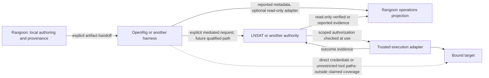

# Rangoon system audit: architecture, usefulness and interoperability

## October 16 architecture and usability drift checkpoint

Authority: Jeff's October 16 request to compare current workbench with the accepted architecture and original reference screens. The [accepted intent](intent.md), [product experience contract](product-experience.md) and [application architecture](application-architecture.md) remain controlling; this checkpoint updates the October 15 assessment below rather than accepting a new product scope. The [O2 local-window contract](operations-local-window.md) defines the new route; the [development ledger](development.md#local-operations-window-o2-first-slice--october-16-2026) owns validation and publication evidence.

**Verdict:** no confirmed architecture/authority bypass. The modular local content workbench still starts without LNSAT or another provider. O2 reads one explicitly selected local file, produces a minimized view and cannot authorize, approve, execute or authenticate a report. Model advice is not an authority record. The desktop still mounts Legacy plaintext storage; Managed encryption remains test-only. LNSAT, OpenShell and other provider paths stay optional and unqualified. A future hosted service can expose the same typed domain/application services only after identity, tenancy, custody and API contracts are separately designed; raw Tauri commands are not that service boundary.

| Original screen pattern | Current coherence | Remaining proof or adjustment |
| --- | --- | --- |
| Command Center and Import: grouped navigation, compact branded task entry | Shared real-workbench shell and explicit local/browser state preserve the task boundary; sample preview remains separate | Keep brand/home links inside the real workbench; test installed Import → saved source → Skills path. Do not substitute fixture counts for actual workspace data. |
| Skills, Decompose and Merge/Split: source/library → central transformation → inspector | Native-backed content, revision, composition and export services exist; editors retain provenance and loss/coverage semantics | Qualify complete native restart, failure and target-loader journeys; review rendered density and artwork against the reference at all required widths. |
| Workflows: library → graph/outline/definition → properties | Typed graph editing remains local authoring; browser without native bridge honestly disables save and reports no records | Test packaged desktop drag, keyboard connection refusal/recovery, saved revision reopen and focus. A drawn edge is not a running operation. |
| Connectors/authority and operations: compare abilities and inspect evidence | Eight optional targets show per-function unavailable states; O1 reports are distinct from authorization. O2 adds a local, read-only reported timeline/topology/inspector | Keep comparison/planning secondary; complete O2 populated responsive/accessibility proof, then qualify one consented, authenticated read-only adapter before any live or compliance claim. |

The browser check of the current dark Operations page at a narrow viewport showed a disabled local picker, clear desktop-only guidance and a distinct no-window state. The Workflows page exposed its library/canvas/inspector structure and honest unavailable native actions, but its task header occupies much of the initial short viewport. The references have stronger route-specific identity and denser, clearer working panels than these empty browser states. Refine header height, icon scale, contrast, spacing and restrained route artwork after measuring populated tasks; keep mascot/art decorative and never replace missing records with fake counts. These checks cannot judge a populated native workspace, physical pointer/touch gestures, screen reader behavior, OS vault custody or Windows/Linux GUI support. The October 15 audit retains the broader eight-reference comparison and market analysis; this pass directly rechecked Command Center, Import, Skills and Connector reference images plus the current Operations/Workflows browser states.

The fresh UX review identified four P2 presentation defects in the O2/new shared routes: brand navigation could enter the synthetic preview, a valid empty window was described as a filter miss, closed native error codes were shown instead of their safe recovery text, and four decision breakdowns appeared before the working panels. One P3 touch issue used 38px filters. These are presentation and recovery defects, not proof of trusted telemetry or an authority bypass. The bounded repair and independent review status belong in the development ledger. Keep compact counts visible and full reported-value analytics in an optional disclosure so the primary library/timeline/inspector can lead.

**Next evidence, in order:** finish O2 rendered 320/768/1440 dark/light, keyboard, forced-colors, reduced-motion, empty/invalid/stale and lock-purge checks with a populated synthetic fixture; qualify one installed local lifecycle on disposable data; then test a disposable Managed factory and OS-specific vault/GUI/recovery paths. Only after these should a consented read-only provider adapter or real live ingress become a user-facing support claim. Preserve model-curation analytics as advisory records with measured error rates; no model or human approval alone bypasses execution-time enforcement.

## October 15 whole-system audit and completion map

Authority: [Jeff's accepted audit request](intent.md#whole-system-audit-with-glm--october-15-2026). This section owns the current assessment; the [development receipt](development.md#whole-system-audit-with-glm--october-15-2026) owns validation, review and Git state. Earlier dated assessments below are historical. They must not reopen routing, purge, navigation or draft-recovery work completed since October 12. Recommendations here are proposals, not implementation acceptance, provider activation or release approval.

### Judgment and product value

**Continue, but finish the local product before expanding its operational surface.** Rangoon already has meaningful source, revision, composition, workflow, compiler, bundle and consent engineering. Its largest weakness is the distance between those implementations and a qualified, understandable installed user journey. Additional catalogs, simulations or framework replacements will not close that distance.

The credible differentiator is a reviewable transformation: **find the relevant instructions, show their origin and effective target meaning, reorganize them, explain losses, and export exact revisions that a selected target can actually load.** Whether users prefer this to an editor and distribution tool is still an experiment. No customer-demand, time-saving or safety guarantee follows from test counts. Test three sanitized representative projects against manual editing/distribution with declared measures: task completion, missed constraints, reviewer comprehension and time. Record failures as well as improvements before broadening scope.

Retain the accepted modular boundaries. Rangoon owns content authoring, provenance, revisions, composition, compilation, export and inspection. Harnesses own their runtime/session behavior. Authority providers own their qualified enforcement and identity responsibilities. A reported allow, local content review, human approval, execution authorization and actual consequence are different facts. Core authoring must start without LNSAT or any provider. The accepted approval, telemetry and live-operations scope remains; a thin local milestone is not a silent redefinition of full V1 or the three-OS first desktop release.

### Reconciled capability inventory

| Surface | Existing implementation to preserve | What must be completed or qualified |
| --- | --- | --- |
| Intake and parsing | Selected native Markdown file and stdin analysis; bounded exact bytes, digests, spans and inert diagnostics | Explicit-root discovery/batch intake; effective instruction layering; bounded frontmatter and support-file profiles. The scanner is not full CommonMark or semantic equivalence. |
| Skills | Saved source derivation, immutable revisions, history, local review, loaded-summary search and Review/Origin filters | Native task/restart/failure evidence; explicit folder discovery; durable categories/tags/collections through existing storage. Search does not currently search disk or full content. |
| Composition | Decompose/Merge/Split, direct editing, exact recipes/coverage, retained previews, atomic new/append writes | Advanced native gesture/append/failure qualification and understandable loss review. Similarity can suggest; it must never replace exact identity or authorization. |
| Workflows | Typed control/data definitions, structural validation, durable revisions, six native authoring commands, Canvas/Outline/Definition | Native save/history/restart and dense-graph usability evidence. No scheduler, executor or live ingress exists. A graph edge edits a definition. |
| Compile/export | Two text-format profiles, exact revision selection, deterministic candidate and bundle verification, native file and stdin CLI handoff | Pinned target-loader proof, effective precedence, SKILL/support-file closure and broader GUI failure cases. Internal checksums establish consistency, not origin authenticity or instruction adherence. |
| Encrypted storage | Optional SQLCipher backend, empty initializer, Owner/key custody, typed command-family routing, callback/Gate generation custody, native close/drain and global renderer purge/ack | Production still selects Legacy plaintext. Resolve durable provisioning/write uncertainty, mount explicit setup/unlock, qualify failure-driven close/reload, encrypted recovery and platform custody before adoption. Managed construction remains test-only. Do not rebuild the implemented foundation. |
| Local/cloud model assistance | Exact bounded context packs, selected loopback and fixed cloud transport, native consent, single-use retained identity/freshness, validated advisory output | Attributed proposal inspection/save/reopen, compatible provider evidence and accounting. Compression is inspectable byte selection/deduplication with protected ranges, not proven optimal token compression. |
| Authority integrations | Existing A1/I1 contracts, eight-target comparison, unavailable states, role arrangement and readiness projection | No live adapters. Cerbos PDP remains the first real read-only engineering recommendation; LNSAT remains the optional recommended Hypler governance target. Neither blocks local release. |
| Approval/telemetry/visualization | Offline bounded observations, relationships, delegation and approval-chain projections | Authenticated ingress, native/provider dispatch, retention/redaction, trace continuity, trusted receipts, alerting and replay. Offline reports cannot authorize actions or prove runtime activity. |
| Extensions/SDK | Separate importer/compiler/model/harness/authority ports and R9 direction | Offline descriptor/reference-worker conformance first; executable plugin confinement/update/revocation later. No plugin loader or public stable SDK is claimed. |
| Desktop/distribution | Apache-2.0 source, pinned source CI, selected historical isolated macOS native receipts | Optional encryption CI, Windows/Linux GUI and vault evidence, installers, signing/notarization, update/rollback/recovery and release artifacts. Green source CI is not desktop support. |
| Cloud/team/enterprise | Accepted evolution path and separate responsibility contracts | Identity, tenancy, collaboration, service operations, lifecycle and deployment. Do not add these to the initial local implementation path. |

### Ranked findings and missing edge cases

| ID / priority | Evidence and user effect | Smallest response |
| --- | --- | --- |
| SA15-01 / P2 confidentiality | `main.rs:186–189` selects Legacy; `workspace_source_access.rs:658–673` keeps Managed test-only; `rangoon-store/src/lib.rs:243–261,324–388` stores unkeyed source bytes. A reader of copied app data can recover content. This is the already-disclosed plaintext gap, not broken SQLCipher, remote code execution or a newly discovered secret. Explicit plaintext exports are deliberate outputs. | Finish E1 adoption and encrypted recovery without a plaintext fallback; keep current state clear until qualified. File permissions help local custody but do not encrypt copied files. |
| SA15-02 / P2 recovery correctness | Existing Owner fault fixtures can return `WriteUncertain` after persisting Ready; process-local recovery state does not survive a new Owner. The [E1c contract](encrypted-workspace.md#e1c-provisioning-recovery-and-outcome-reconciliation) records the exact problem and rejected shortcuts. | Freeze bounded durable evidence and explicit read-only reconciliation first. Preserve clean successful restart; do not solve uncertainty with a permanent unusable fence or deletion of the sole marker. |
| SA15-03 / P2 delivery evidence | Default CI does not exercise the optional native encrypted feature. Non-Unix same-file comparison and Unix-only directory synchronization cannot qualify Windows durability. No new native GUI/vault evidence was produced in this audit. | Add explicit encrypted feature gates in their own CI packet, then disposable platform/vault/GUI journeys. Report each primitive and OS separately. |
| SA15-04 / P2 product completion | Local services exist, but the full current composition/workflow/failure/restart journey and target-loader semantics are not comprehensively qualified. | Complete one real local lifecycle using disposable data; retain historical macOS evidence as a baseline, not a new all-platform result. Run loader qualification separately without model/provider calls. |
| SA15-05 / P2 interaction | In the existing workflow playground, keyboard-selecting Input's text output asks for a compatible input but does not distinguish eligible, occupied or incompatible destinations. Selecting Branch's boolean input reports a type error and clears connection mode. Source: `workflow-view.mjs:126–139,648–657`; controller refuses mismatches. | Share a pure eligibility projection between visual guidance and existing validation. Explain type/occupancy, retain the source on refused attempts, preserve Escape/cancel/undo and keyboard alternatives. Never weaken graph validation. |
| SA15-06 / P3 accessibility | The flat `.workflow-canvas` has `tabindex=0` without role/name (`workflow-view.mjs:208`); root confirmed these DOM attributes. | Give the focus stop a useful name/group role, or remove it only after preserving the keyboard context-menu path. Test actual screen-reader announcements, not only markup. |
| SA15-07 / P2 status coherence | Older audit/README/continuation paragraphs still describe completed routing/purge/navigation fixes as future work. One independent reader initially repeated them despite current source. | Front-load this current matrix, retire duplicated README chronology and route continuation to one evidence ledger. Historical receipts keep their original date and scope. |
| SA15-08 / P2 expansion restraint | No live system is established for operations. Provider meters currently report 0/5, not a compliance score. More synthetic activity would obscure missing implementation. | Keep optional references collapsed; bind one genuine, consented read-only source only after local gates. Preserve unavailable, unsupported, disconnected, error, stale and unknown-outcome distinctions. |

Additional acceptance cases: repeated interrupted setups must have a bounded inspection/retention policy without deleting sole recovery evidence; OS key deletion/rotation, copied/rolled-back databases and old archives need distinct outcomes; stale retained callbacks and crash-after-write must never cause automatic replay. Discovery must handle symlinks/reparse points, case/Unicode collisions, devices, unreadable/changed files, quotas and partial cancellation. Referenced support files need closure and path custody; an unknown extension cannot silently disappear during export. Model suggestions need explicit attribution and expected-head conflict checks before a saved revision. Live observations need epochs, bounded cursors, gaps, redaction and stale/disconnect states; reconnect is not proof of continuous coverage. Actual execution later requires material-action binding and per-path bypass coverage, not just a connected engine logo.

Existing bounded/adversarial fixtures and exact vectors are valuable; they do not establish continuous coverage-guided fuzzing or a current dependency-advisory assessment. Add reproducible parser/archive/compiler fuzz targets and state-machine interruption testing as separately bounded qualification work, and record corpus, tool/version, resource limits and failures. This audit ran regression suites, not a dynamic fuzzer or penetration test.

### UX and original design reconciliation

Keep the original grouped sidebar, orange identity, task-specific source/library, central editor and right properties/provenance inspector. The current shared navigation, compact headers, optional help, draft recovery and dock repairs implement useful parts of that direction. Do not replace them with another shell. A mascot or light/dark banner can add identity without occupying the working area; artwork must not encode operational state.

Use progressive disclosure: a useful task and one primary next action first; selected-module controls second; Advanced for compatibility, raw contracts and diagnostics. Keep errors, plaintext/export effects and material consent visible at the action. Use flat semantic icons at consistent sizes, brief labels and keyboard/touch context actions. Motion should explain selection, travel or progress and honor reduced motion; simulated packet motion is not telemetry. A restrained 3D view can remain an alternate inspection surface after the flat editor is useful, with section focus, semantic status and complete 2D/outline fallback.

Fresh DOM/keyboard evidence confirms the authority library/inspector precede closed Plan/Compare disclosures, a selected LNSAT shows five unavailable operations, theme labels change correctly, and the measured 320px authority page has no document horizontal overflow. Workflow mismatch/refusal was reproduced. This is not pixel or complete accessibility qualification: in-app browser screenshot capture failed, mouse input failed in that backend, and native GUI was not run. Keyboard Enter worked. These tool limitations are not Rangoon defects. The design reviewer inspected the eight supplied reference images; current contrast, artwork fidelity, real motion, 3D rendering and screen-reader behavior still need fresh rendered review.

### GLM guidance and controller reconciliation

GLM-5.3 supplied a bounded architecture review and a separate serialized-UI critique through the hardened text-only runner. Requested and returned model matched; no tools, images, normal user files or credentials were supplied. The initial larger request returned HTTP 200 but no accepted review and is not evidence. Root checked the useful smaller responses against source; neither model output nor canary is acceptance or security qualification.

Retained recommendations: recovery/reconciliation first; target-loader proof as a separately accepted lane; all-three-OS qualification; defer broad plugin/runtime/provider activation; bound repeated interrupted setup evidence; expose compatible port choices and name the canvas. GLM's proposed keyboard-only control-edge blocker was an inference from excerpts, not an established P1: root activated Branch's control outlet and Output's header through Enter, reaching the existing occupied-outlet refusal. Native buttons produce delegated click activation through keyboard; a pointer-only blocker was not reproduced. Likewise, a renderer-only citation-range hypothesis is not a model-boundary bypass: the native local client validates exact input identity, selected range and UTF-8 boundaries before constructing its private Completion. Additional renderer validation may be defense in depth, not a substitute for that existing control.

### Ecosystem comparison and standards

Current research is scoped primary-document evidence, not a market survey or installed compatibility test. [OpenRig v0.6.10](https://github.com/mvschwarz/openrig/releases/tag/v0.6.10) targets runtime/team coordination. Its [AgentSpec](https://openrig.dev/specs/agentspec) distinguishes resource selection, imports, startup layers and runtime projection. Rangoon should inspect and explain such artifacts before attempting to launch, replace or flatten the harness. Its [finite telemetry](https://openrig.dev/docs/telemetry) suggests explicit epochs/windows/gaps for a later observer; none is implemented here. Overlap in skills, policy words and graphs is real. Rangoon must demonstrate provenance/loss-aware editing value rather than duplicate the daemon or claim universal governance.

The public [LNSAT README pinned at 5cad4719e89395d4a0c90b7b06aacfe1f83555f5](https://github.com/hypler-dev/LNSAT/blob/5cad4719e89395d4a0c90b7b06aacfe1f83555f5/README.md), fetched October 15, describes exact action/configuration binding, durable consumption/attempts and uncertainty/reconciliation, while retaining pre-release/runtime-proof limits. Rangoon should preserve those distinct facts in evidence views; it must not manufacture authority or assume that a matching digest proves current enforcement. This is a public-contract comparison, not a new cross-repository code audit or proof of a live LNSAT deployment.

Preserve the existing [Cerbos first-adapter recommendation](provider-interoperability.md#first-real-adapter-recommendation): explicit read-only decision inspection through its bounded [CheckResources API](https://docs.cerbos.dev/cerbos/latest/api/index.html), after product/version, peer, consent, redaction and provenance gates. This is smaller than gateway interception or execution. Permit authorization, FastMCP middleware and commercial MCP Gateway remain distinct; Invariant local/remote modes retain separate code/egress/privacy treatment. No current research refresh qualifies any adapter.

Use JSON/canonical exact identities for existing domain contracts. Add YAML only at explicit format boundaries with bounded safe parsing, duplicate/tag/alias policy, unknown-field preservation or refusal, and path/version conformance. The [Agent Skills specification](https://agentskills.io/specification) requires frontmatter plus Markdown and permits referenced resources: reading `SKILL.md` alone is not complete package support. MCP is a protocol surface, not an authority engine; A2A is not a local plugin API; telemetry conventions do not authenticate receipts. Preserve the existing [security/standards readiness register](plan.md#security-and-standards-readiness) and named qualification evidence; ISO/NIST/OpenSSF alignment is not certification.

The [current proposed completion sequence](plan.md#october-15-audit-completion-sequence) assigns bounded packets and validators. Resolve protocol and qualification decisions there before source changes. Do not convert this audit into simultaneous adapters, cloud implementation or a broad redesign.

## Historical assessments

Initial assessment: October 11, 2026; reassessed October 12. Authority: [accepted full reassessment](intent.md#full-capability-workflow-ux-and-market-reassessment--october-12-2026), continuing the [initial audit](intent.md#full-system-audit-and-harness-comparison). Owner: Jeff; controller: root configured Sol. Status: assessment and proposed repair planning, not redesign acceptance or release qualification. The [current receipt](development.md#full-capability-workflow-ux-and-market-reassessment--october-12-2026) owns validation and Git state; the [initial receipt](development.md#full-system-architecture-design-and-harness-audit--october-11-2026) remains historical evidence. Existing [application architecture](application-architecture.md), [provider contracts](provider-interoperability.md), [encryption sequence](encrypted-workspace.md) and [product experience](product-experience.md) retain their implementation boundaries.

## October 12 capability, workflow, UX and market reassessment

### Product judgment

Rangoon has useful implemented engineering, but its presentation currently suggests a broader operational product than its qualified user outcomes support. The strongest first product is a standalone local workbench for instruction provenance, revision review, decomposition/composition and inspectable export. Its useful differentiator must be demonstrated preservation of constraints and understandable changes across targets. A node canvas, integration catalog or simulation alone cannot establish that value.

The immediate problem is completion and coherence, not lack of another framework. Preserve the existing Rust services, immutable records, compiler, native consent boundaries and material-editor grammar. Finish storage adoption and one coherent local task, then measure whether users prefer it to editing and distributing instructions manually. Keep approval management, telemetry and live visualization as accepted later scope, with their real ingress, identity and enforcement gates intact. LNSAT remains optional; neither it nor another provider is a dependency of ordinary Rangoon authoring.

### Evidence scope

Five native read-only lanes covered content/persistence/compiler/CLI, workflow logic, architecture/security lifecycle, UX design, and models/operations/providers. Root integrated their findings, reproduced the dock sequence with the existing pure model, inspected actual browser tasks, and checked primary public project documentation. A separate fresh reviewer assessed this consolidated packet after validation and returned PASS. This remains a system assessment with targeted source evidence, not an exhaustive line-by-line vulnerability scan, penetration test or market survey.

Evidence tiers stay separate: source implementation; passing offline fixture/controller tests; actual inspected browser behavior; dated isolated macOS native receipts; and absent provider/deployed-runtime evidence. This reassessment does not rerun native GUI, Windows/Linux GUI, real vault custody, a live model or a runtime adapter. The browser lacks the native bridge and honestly refuses those operations. Those refusals do not disprove the native source implementation. Historical source/test evidence below is retained with its original date.

### Capability inventory at the current mixed working tree

| Product surface | Implemented and useful now in source | In development or unqualified | Absent today |
| --- | --- | --- | --- |
| Import and inspection | Bounded selected-file/stdin Markdown inventory, exact bytes, SHA-256 identities and source spans | New private source dispatcher covers four commands plus picker/clear; managed backend construction remains test-only | Project/folder/repository import, complete CommonMark/frontmatter interpretation and effective harness-layer discovery |
| Skills and revision management | Derive from saved sections, append immutable revisions, inspect history and record local content review | Complete native failure/restart and three-OS task qualification; stronger library/onboarding cohesion | Shared team identity/collaboration and authenticated authorship supplied by an external identity system |
| Decompose, Merge and Split | Pure recipes/coverage, retained exact previews, expected-state checks, explicit acknowledgement and atomic commits | Advanced gesture/failure/append GUI qualification; production Owner routing and retained-state purge | Automatic semantic equivalence or guaranteed preservation of every natural-language constraint |
| Workflow editor | Typed control/data graph, structural checks, stable records/revisions, draft/validated save paths, flat canvas, Outline, Definition and undo | Native save/restart/history GUI; pending-field guidance, dock restoration and dense-graph interaction | Runtime scheduler, agent runner or execution caused by connecting nodes |
| Compile, export and inspect | Two immutable text profiles; exact saved-revision selection; deterministic candidate/bundle verification; native export/inspection and stdin CLI artifact extraction | Composition export GUI cases, collision/write uncertainty, pinned target-loader fidelity and support files | Universal harness compatibility, installation into active projects or proof that a model follows exported instructions |
| Database and recovery | Legacy SQLite persistence/deletion/backup; optional keyed backend; tested Owner, custody, admission/drain and typed managed services | Remaining command routing, native/renderer purge, consent, interrupted-setup recovery and packaged OS custody | Encrypted production desktop storage and encrypted portable backups in the mounted application path |
| Model assistance | Protected bounded packing, attributed advisory response inspection, explicit local/cloud preparation and consent/custody paths | Real model compatibility, uncertain-send retention decision, complete GUI qualification | Inspected proposal → attributed persisted capability → restart bridge; an ordinary save is not evidence of retained model attribution |
| Authority integrations | A1 unavailable LNSAT boundary; I1 pure offline operations/conformance; eight distinct research targets with comparison/planning | Provider version/capability and operation-specific coverage qualification | Installed-provider discovery, connected adapters or enforcement through the current catalog |
| Approvals, telemetry and operations | Bounded records and pure reported relationship/chain/graph/timeline projections | Lifecycle/outcome/coverage inspection and qualified redacted ingress | Authenticated approval service, live operational feed, alerts, execution or trusted historical runtime replay |
| SDK, CLI, cloud and delivery | Narrow stdin analysis/bundle/inert-engine CLI; existing W1/I1 extension seams; three-OS source/build direction | Shared service parity, declarative descriptors/conformance, installers/signing/update recovery | Executable plugin sandbox/SDK, workspace-management CLI, hosted multi-user service or released three-OS support |

Current anchors: `apps/desktop/src/main.rs:161–165, 241–279, 307–314`; `workspace_source_access.rs:74–137`; `capabilities.rs:44–68, 128–160`; `composition.rs:201–265`; `workflows.rs:171–337`; `instruction_bundles.rs:142–215, 262–315`; `crates/rangoon-store/src/capabilities_v1.rs:43–210`; `crates/rangoon-compile/src/lib.rs:246–324`; `crates/rangoon-cli/src/main.rs:14–112`; `crates/rangoon-integrations/src/lib.rs:22–28`; `crates/rangoon-ops/src/approvals.rs:1126–1138`. Model attribution is inspected in `crates/rangoon-model-assistance/src/{response,inspection}.rs`; no proposal-to-capability persistence bridge was found in the reviewed paths.

### Logic findings and safeguards

No P1 was confirmed in the reviewed paths. Existing SA-01/02/03/05/06 and UA-01/02/03 remain open. Unfinished and disclosed functionality is classified as a delivery/qualification gap, not automatically as a vulnerability.

| Finding | Evidence and practical effect | Repair and proof |
| --- | --- | --- |
| UA-04 / P2, new source-reproduced dock defect | At viewport/workbench 1200/934, collapse left, set right to End, expand left. Tracks are left 208, right 440 and gaps 26: center is 260px despite the declared 420px minimum. `preview/editor-workspace-layout.mjs:18–38, 80–83`; workflow/composition grids use fixed side tracks and `minmax(0,1fr)`. Root reproduced this with the existing pure model; the rendered gesture was not qualified. | Normalize/clamp after visibility changes and test collapse → opposite resize → expand on both sides. Preserve narrow stacked fallback and presentation-only state. Canonical UX evidence is in the [October 12 review](product-experience.md#october-12-ux-reassessment-and-repair-proposals). |
| UA-01/02/03 / P2, reconfirmed browser usability | Loading the sample hides the local analysis entry. Authority planning and comparison precede the catalog. A valid pending Check title blocks selecting Input while the status remains generic; Cancel makes selection work again. These repeat the prior IDs, not three new findings. | Persistent real-workbench entry, explicit Apply/Cancel recovery, and catalog-first disclosure. Keep pending edits and exact native/save/refusal contracts. |
| UA-05 / P3, new theme-control feedback | Authority theme changes in the DOM, but its button continues to say “Dark mode” in both themes. `preview/analyze.mjs:429–450, 626–632`: the existing authority render path does not refresh the shared label. Browser confirmed both themes and the stale label. | Refresh shared theme-control presentation on every route; retain focus and theme choice. No new theme state or controller. |
| Model application / delivery gap | Validated proposals retain model/profile/context/response/citation attribution, but the reviewed native paths stop at advisory inspection. The view explicitly withholds application. | Complete the existing model-proposal contract after encrypted adoption. Preserve attribution through an explicit reviewed draft/save/reopen sequence; do not silently use an ordinary skill save to discard it. |
| SA-07 / architecture recommendation | Capability, workflow, composition, compile and model modules still resolve legacy workspace access independently. Source-family routing is a first slice, not complete adoption. | Extend the existing typed Owner/application seam family by family. Reuse services for later CLI/hosted transports; avoid a second persistence or workflow implementation. |

Reviewed safeguards worth preserving: workflow commit binds exact retained candidate, expected state and acknowledgement; composition rechecks expected state and preview before its transaction; uncertain post-save refresh never pretends an already completed write was undone; stale/cross-session gestures are refused; model responses remain advisory; provider evidence and reported approvals never become Rangoon execution permission. No new source-proven persistence corruption or authority bypass was found in these paths. Passing tests do not close the GUI, custody or target-semantic gaps.

### Market fit and reuse

Primary public references checked October 12:

| Existing project | Overlap and useful lesson | Rangoon implication |
| --- | --- | --- |
| [Ruler](https://github.com/intellectronica/ruler) | Centralizes coding-agent rules and distributes them across targets, including nested rules and MCP configuration. | Instruction distribution already has a focused solution. Rangoon must add understandable provenance, revision comparison, explicit transformation coverage and qualified export rather than compete on generated filenames. |
| [OpenRig architecture](https://openrig.dev/docs/architecture), [v0.6.10 release](https://github.com/mvschwarz/openrig/releases/tag/v0.6.10) | Separates thin transport from domain services; operates durable agent teams. The release describes state/recovery corrections and remaining onboarding/permission friction. Release build `3001cc43` is distinct from mutable documentation still labeled 0.6.6. | Reuse runtime ownership instead of building another team daemon. Borrow explicit attention/recovery states and shared services. A future bounded RigSpec/AgentSpec inspector precedes any live connection. No installed compatibility is inferred. |
| [LangSmith Studio](https://docs.langchain.com/langsmith/studio) | Provides agent graphs, interaction, inspection and debugging against compatible Agent Server APIs. | Graph visualization alone is crowded. Rangoon's near-term job is cross-target capability authoring and artifact review; operational debugging needs an actual qualified source. |
| [Agent Skills specification](https://agentskills.io/specification) | Uses a SKILL.md directory with YAML frontmatter and optional supporting resources/scripts. | Treat an existing format as an import/export profile, with bounded declarative parsing, preserved unsupported content and no script execution. Filename detection alone does not implement this contract. |
| [LNSAT public status](https://github.com/hypler-dev/LNSAT/blob/main/docs/PROJECT_STATUS.md) | Separately distinguishes source contracts and deployment qualification. | Optional authority/evidence integration remains separate from authoring. The public page was inspected; current Git HEAD and deployed runtime were not verified in this reassessment. The October 11 pinned comparison below remains dated evidence. |

Product conclusion is an inference from documented overlap, not validated demand or willingness to pay. Best first audience: developers/platform reviewers managing instruction changes across repositories or harnesses. Do not lead with a government operations console, universal enforcement or SI capability claims before corresponding proof. Consulting can support adoption and configuration without changing Apache licensing or making unsupported security promises.

Proposed value test: three owner-selected public or deliberately sanitized projects, compared with manual editing and an appropriate distribution baseline. Record task completion without coaching, time to inspected export, unacknowledged omitted/changed constraints, reviewer understanding of provenance, and whether the user would repeat the workflow. Define success thresholds before the pilot. No private project upload or external model is necessary. Defer token-saving, safety and market-demand claims until measured.

### Proposed response sequence

The [October 12 repair packets](plan.md#october-12-review-repair-sequence) own proposed exact files, roles and validators. First implement a small shared-dock correction; pair task-entry/edit-feedback correction with it only as a separately scoped UI packet. In parallel, keep the existing E1 remaining-family routing/drain/purge path as the controlling technical work. Consent/recovery and encrypted mounting follow complete coverage, never an admission-only pass. Then qualify one native source-to-export/restart loop and native workflow save/reopen, validate one target loader, and run the three-project value test. Authority disclosure can improve existing research UI without implementing an adapter. Broader import/model attribution and one real read-only integration follow demonstrated need and their own contracts.

Missing features deserving explicit future packets: effective instruction-layer/precedence diagnostics; SKILL/support-file dependency closure; target semantic loss/coverage reporting; preview-to-save provenance continuity; cross-process and interrupted-write recovery; recoverable storage/custody states; keyboard/assistive-technology equivalence; large-graph search/Outline; versioned declarative plugin contracts; and real telemetry ingress with redaction, gaps, clock skew, duplicates and unknown-outcome handling. These extend existing architecture rather than replace it. No new provider, SDK runtime, execution or release is accepted by this review.

## Judgment

The project is not wasted effort. The useful product is a local capability workbench: identify instructions, preserve their source, derive reusable capabilities, compare changes, compose them and produce inspectable artifacts for a chosen target. The Rust boundaries, immutable revisions, typed workflow records, explicit model consent and honest unavailable-provider states are substantial foundations.

The breadth of presentation has outpaced end-to-end product qualification. The current interface contains fixture dashboards, a native content workbench, an unsaved node editor and synthetic flow companions. These do not yet feel like one task lifecycle. More 3D rendering, universal-provider catalogs or agent fleet management would add complexity before proving the local value. Recommend completing one useful real workflow and its recovery states before expanding the product surface.

Rangoon, OpenRig and LNSAT can earn separate roles. Requiring all three for ordinary local authoring would be overkill. Rebuilding OpenRig's agent lifecycle inside Rangoon would also be overkill. Optional composition is justified only when a user needs both managed teams and independently controlled consequential actions. That is a proposed product focus, not evidence that the combined stack works today.

## Method and scope

Four native read-only lanes reviewed architecture, data/security lifecycle, product design and OpenRig public format/API evidence. Root reconciled findings, inspected contentious command paths, reviewed the public LNSAT status and current standards, and ran existing source suites. The preceding [hands-on UI audit](product-experience.md#october-11-hands-on-ui-audit-task-clarity-before-more-polish) supplies 24 inspected browser scenarios, two incomplete attempts and six authority layouts.

This is a system-wide architecture assessment with targeted source inspection across the main module families. It is not a claim that every line was independently reviewed, a formal exhaustive vulnerability scan, penetration test, real-provider benchmark, native release certification or deployed runtime audit. Rangoon evidence concerns the current mixed local working tree, not only published main. LNSAT evidence is public source/status inspection, not a full second codebase security audit. No third-party software was installed or run, and no normal database or credential store was accessed.

October 12 follow-up: Jeff resumed storage diagnosis and the precise routing/lock-drain contract. [E1b-2b9](encrypted-workspace.md#e1b-2b9-routing-and-lock-drain-coverage-contract) owns that work; its [development receipt](development.md#storage-adoption-restart-and-fixture-diagnosis--october-12-2026) records fresh bounded reruns and fixture evidence. SA-06 remains unresolved because the original failure was not reproduced or explained. This follow-up does not retroactively change the audit's initial results or close the other release/UI gaps.

## Current functionality versus missing qualification

| Module family | What exists | Missing capability or qualification |
| --- | --- | --- |
| Source import | Bounded Markdown section scanner, exact bytes/digests/spans, stdin CLI and selected-file native host | General project/folder/archive import, complete Markdown/frontmatter semantics, instruction discovery precedence and broader format parsing. Filename recognition is not harness compatibility. |
| Capabilities and composition | Saved source/revision/review contracts, decomposition/merge/split services, coverage and immutable lineage | A consistently discoverable real UI lifecycle; complete native recovery and all-three-OS GUI evidence. Local content review remains separate from execution approval. |
| Workflow authoring | W1 typed control/data ports, structural checks and canonical identities; W2 durable records; native authoring commands; W3 library/canvas/inspector | Complete native save/restart/failure GUI qualification, large-graph usability and rendered connection/drag/delete recovery. These graphs are authoring records, not a runtime scheduler. |
| Compilation and export | Two pinned text profiles, exact-byte instruction artifacts and strict bundle verification/inspection | A pinned real target-loader qualification, effective instruction-layer diagnostics, explicit unsupported-meaning/loss reporting and richer skill/resource export. Existing profile v1 identities must remain immutable. |
| Workspace protection | Optional keyed store, fake-vault/OS-custody interfaces, owner/session/admission and managed service foundations | Mounted encrypted command routing, consent/create/unlock/lock, complete retained-state drain, migration/cutover recovery, encrypted portable archives and three-OS packaged custody proof. Mounted desktop storage and backups remain plaintext. |
| Model assistance | Bounded advisory packing/response validation, local/cloud transport and explicit native consent/custody/session paths | Real model compatibility and complete GUI/custody qualification; an explicit retention/recovery decision for uncertain sends before durable jobs. A loopback model can forward data; cancellation cannot recall sent bytes. |
| Operations and approvals | Closed observation/relationship/approval-chain decoding and projections in `rangoon-ops` | Trusted ingress, authenticated routing/approval service, persistence and live UI. Current inspection fixes authority to none and authenticity to unverified. |
| Authority candidates | A1 unavailable LNSAT port; I1 offline provider fixtures; eight exact catalog targets and comparison/planning UI | Any qualified provider adapter or combined enforcement coverage. LNSAT, Permit targets and Invariant local/remote retain distinct semantics. |
| Extensions and hosted use | Existing W1/I1 seams and planned R9 guidance | Executable plugin isolation/SDK, version negotiation and conformance; shared application-service parity before a hosted transport. No generic plugin loader or cloud backend is currently shipped. |
| Command Center | Fixture design inventory and activity | Actual local record-derived inventory and next actions; disconnected runtime data must not become successful empty telemetry. |

Source anchors: [source analysis](source-analysis.md), [compilation](compilation.md), [target-loader qualification](target-loader-qualification.md), [workflow definitions](workflow-definitions.md), [native authoring](workflow-native-authoring.md), [operations](operations-control-plane.md), and the existing architecture component matrix.

## Ranked findings and release gaps

No P1 vulnerability was confirmed. The following table distinguishes actual inspected usability failures, an observed test failure, unfinished accepted engineering and proposed architecture improvements. An unfinished, disclosed feature is not automatically a security defect.

| ID / class | Evidence | Consequence and proposed response |
| --- | --- | --- |
| SA-01 / P2 release gap | `apps/desktop/src/main.rs:170–174` creates unkeyed `Workspace::new`; its registered commands do not mount Owner/create/unlock/lock. Default desktop features exclude encrypted-workspace. `data_controls.rs:175–205` discloses plaintext export. | Encryption primitives are not encrypted application storage. Complete the existing E1 owner/routing sequence; require every workspace command to use the same transition owner before claiming adoption. Do not replace the accepted sequence with a new crypto architecture. |
| SA-02 / P2 release gap | `workspace_lifecycle.rs:1–2` limits Gate to admission; `workspace_session.rs:1153–1158` clears owner-held state. Other retained model, picker, backup, draft and renderer data is identified in the [architecture inventory](application-architecture.md). | Lock must close admission, invalidate generations, drain late callbacks and release retained references across all admitted families before key release. Reference cleanup is not secure memory erasure; exports, OS caches and backups remain separate. |
| SA-03 / P2 release gap | [Data controls](workspace-data-controls.md) implement logical deletion; [encryption](encrypted-workspace.md) leaves encrypted archives, migration and durable interrupted-setup recovery staged. | Define portable recovery and key-loss behavior before default adoption. Qualify disk-full, kill/restart, concurrent process, vault denial, migration rollback and restore. Never turn unreadable data into a new empty workspace. |
| SA-04 / P2 observed usability | Canonical UA-01..03: real-workbench entry disappears after sample loading; authority catalog follows repeated planning/comparison surfaces; pending valid field edits silently block selection. | Correct persistent task entry, disclose planning progressively and explain Apply/Cancel guards. Keep source and authority semantics unchanged. Do not duplicate these as new design findings. |
| SA-05 / P2 qualification gap | `rangoon-compile/src/lib.rs:56` explicitly reports semantic equivalence unverified; bundle verification proves internal consistency. | Qualify one target-loader configuration with a corpus of hierarchy, includes, frontmatter, dependencies and collisions. Exact bytes do not prove discovery, instruction obedience or semantic equivalence. |
| SA-06 / P2 observed validation instability | Encrypted-feature desktop all-target run failed `cloud_models::tests::invalid_profile_preserves_pair_but_new_selection_and_cancel_remove_it` at `cloud_models_tests.rs:45`, `InputUnavailable`. It passed alone and in a later complete binary run. | Cause remains unresolved. Preserve failure evidence; investigate underlying store/session error and test isolation before treating native checks as reproducibly green. No product exploit or root cause is asserted. |
| SA-07 / architecture recommendation | Capabilities, workflows, composition, compilation and model command modules independently resolve the workspace. Existing architecture already proposes shared use cases. | Finish a narrow typed application-service boundary around the existing Owner and use cases. Keep Tauri as transport. CLI and future hosted APIs should reuse services rather than directly read SQLite or reproduce command semantics. Avoid a framework rewrite. |
| SA-08 / architecture recommendation | Model transport/session code has explicit consent but session-only retained state; actual sends can outlive the visible request. | Decide whether encrypted metadata-only attempt records are needed: prepared, consented, dispatch begun, completed, cancelled locally, outcome unknown. Never replay an uncertain send automatically or store raw prompts by default. This is a future contract decision, not a violation of the current session-only scope. |
| SA-09 / P3 design improvement | Different shells vary navigation labels/order; command artwork and broad menus precede first useful task. The CLI remains analyze/bundle/inert-engine inspection. | Use a common navigation/mode contract and compact task header. Simple exposes local tasks; Advanced exposes exact IDs, source, compatibility and supported recovery; Operations appears when relevant; CLI examples describe only implemented commands. |

Context-menu removal stalled in browser automation, and a later connection attempt was inconclusive. Neither establishes a product defect. An accessible in-app confirmation with affected-edge counts, Cancel/Escape/focus restoration and existing Undo is a proposed improvement and testability aid, not a proven fix for that automation stall.

## OpenRig, Rangoon and LNSAT comparison

The OpenRig comparison concerns [`mvschwarz/openrig`](https://github.com/mvschwarz/openrig), the multi-agent harness, not another project sharing that name. The inspected official release is [v0.6.9](https://github.com/mvschwarz/openrig/releases/tag/v0.6.9), build `4b48ca21`. Its [documentation overview](https://openrig.dev/docs) still states 0.6.6, while individual references have newer release links. Treat every interface as separately pinned; do not infer installed compatibility from mutable website documentation.

OpenRig coordinates actual coding-agent teams with a daemon, CLI/TUI/MCP surfaces, durable state and runtime/session adapters. It also packages agent resources and context, describes permission policies and provides workflows, observations and recovery. Its overlap with Rangoon is real; Rangoon cannot differentiate merely by saying it has reusable instructions, YAML, policies or a graph. [OpenRig architecture](https://openrig.dev/docs/architecture), [release-pinned README](https://github.com/mvschwarz/openrig/blob/v0.6.9/README.md).

Public LNSAT main was rechecked at [`5cad4719e89395d4a0c90b7b06aacfe1f83555f5`](https://github.com/hypler-dev/LNSAT/tree/5cad4719e89395d4a0c90b7b06aacfe1f83555f5), committed October 11 at 04:43:09 UTC. Its [README](https://github.com/hypler-dev/LNSAT/blob/5cad4719e89395d4a0c90b7b06aacfe1f83555f5/README.md) and [Project Status](https://github.com/hypler-dev/LNSAT/blob/5cad4719e89395d4a0c90b7b06aacfe1f83555f5/docs/PROJECT_STATUS.md) describe separate source contracts and remaining runtime gates. Config apply, complete initial headless installation/activation, watch and real Docker consequence proof remain incomplete. Do not present its intended enforcement role as a supported deployed product.

| Concern | OpenRig | Rangoon | LNSAT |
| --- | --- | --- | --- |
| Primary job | Run and coordinate persistent agent teams | Author, refactor, compare and inspect capabilities | Authorize bounded consequences and preserve authority/outcome evidence |
| Content overlap | Agent resources, startup layering, bundles/context packs | Exact source spans, saved revisions, local reviews, composition and compilation | Versioned action/authority packets, not a capability library |
| Workflow meaning | Durable team work/ownership transitions | Typed authoring definition and revisions; no scheduler | Bound request/approval/authorization/attempt/consequence chain |
| Policy/approval | Harness permission selection and coordination decisions | Configuration and reported evidence; local content review | Selected policy and authenticated approval/consumption semantics |
| Current Rangoon relation | No adapter | Independent local core | A1 remains unavailable; no transport |
| Appropriate reuse | Keep team lifecycle and runtime ownership here | Keep artifact lineage and task-first authoring here | Keep enforcement outside the workbench, on a qualified mediated path |

These are different workflows, not three interchangeable meanings of “approved” or “complete.” OpenRig's coordination closure is not LNSAT execution authorization; Rangoon's local review is neither. Hashes in any content package establish consistency unless a separately verified authenticity contract says otherwise.

For personal local instruction editing, Rangoon should work alone. For someone who only needs coordinated Claude/Codex teams, OpenRig already targets that job; Rangoon must demonstrate additional artifact-management value. For high-consequence actions, optional LNSAT integration can add value only after the selected runtime path and coverage are qualified. Do not make enterprise aspirations a requirement for the first local release.

This is a proposed relationship diagram, not implemented transport. OpenRig can launch harnesses whose native tools reach the host directly. Adding LNSAT to one connector cannot protect those other routes. Full-coverage claims require credential, substrate and bypass-path control; report advisory, partial, unknown or enforced coverage per operation.

## Harness integration and standards

### What Rangoon uses now

The source scanner handles a bounded Markdown subset and filename classes. It does not interpret frontmatter or implement a generic YAML importer. Workflow definitions are strict versioned JSON with exact types, unknown/duplicate-field refusal and canonical identity rules. Compiler profiles currently output AGENTS.md or CLAUDE.md; profile version is not an observed installed harness version. The CLI has source and bundle inspection, not workspace management parity.

### Proposed standards posture

| Format / standard | Useful role | Boundary |
| --- | --- | --- |
| [YAML 1.2.2](https://yaml.org/spec/1.2/) | Human-authored configuration and selected external import profiles | Serialization syntax does not supply common policy semantics. Use a bounded supported subset; reject duplicate keys, custom tags, alias/merge expansion and implicit environment/template evaluation. Keep unsupported content and raw bytes visible. |
| [JSON Schema 2020-12](https://json-schema.org/draft/2020-12) | Publish machine-readable descriptors and configuration contracts from existing typed models | Existing Rust validators remain authoritative. Resolve only pinned local schema references; never fetch schemas implicitly. Cross-language golden vectors must prove equivalent refusal and interpretation. |
| OpenRig [RigSpec](https://openrig.dev/specs/rigspec) / [AgentSpec](https://openrig.dev/specs/agentspec) | Explicit external topology/resource inspection | RigSpec format 0.2 and AgentSpec format 1.0 are product-specific, distinct from OpenRig package version. Preserve startup/policy layering and unsupported fields; do not flatten them into Rangoon workflow or authority semantics. |
| [MCP 2026-07-28](https://modelcontextprotocol.io/specification/2026-07-28) | Future explicitly scoped tool/resource transport | Select and negotiate the version implemented by each peer; latest specification is not current adapter support. A tool call or “read-only” hint cannot grant authority. Importing a config must not start an MCP server. |
| [A2A](https://a2a-protocol.org/latest/specification/) | Future agent/task exchange when a real use case needs it | Task messages are not content review, human approval, authorization or proof of effect. Defer until there is a qualified adapter requirement. |
| [CloudEvents 1.0.2](https://cloudevents.io/) | Optional external event envelope around existing observations | Retain provider-native payload, source identity, coverage, cursor and provenance. Do not replace O1 semantics or turn an event ID into authenticated authority. |
| [OpenTelemetry](https://opentelemetry.io/) and [GenAI conventions](https://github.com/open-telemetry/semantic-conventions-genai) | Future correlation, latency, errors, cost/usage and redacted metrics | GenAI conventions moved to a separate repository; pin the adopted schema/revision. Default to metadata, not prompt/transcript capture. Telemetry is not the authoritative receipt. |

YAML should be an optional authoring/import surface over the existing typed representation, not a replacement database or a new universal policy language. Retain original bytes/digest separately from normalized interpretation. Unknown syntax must produce unsupported diagnostics rather than silent loss; refuse unsafe/ambiguous input before creating any candidate. Exporting valid YAML does not prove an external harness consumes it correctly.

### First OpenRig packet recommendation

Start with one **offline RigSpec inspection profile**, using caller-supplied bytes and a frozen supported field subset. Preserve raw source, annotate pods/members/resource references and permission/startup declarations, and report unsupported semantics. Do not start with simultaneous AgentSpec, bundle extraction, export, daemon launch and live telemetry. A later AgentSpec or bundle profile can reuse the proved parser and provenance seams after its separate archive/path/layering contract.

Reuse existing importer/provenance and descriptor/availability ideas. Do not insert OpenRig into the authority-engine catalog or force harness operations into I1's authorization-operation enum. A format adapter, a harness observer and an authority provider are separate roles. Share metadata only where semantics match; do not replace the existing A1/I1/W1 contracts.

Then consider an optional read-only harness observation adapter. OpenRig documents bounded [telemetry pages](https://openrig.dev/docs/telemetry), separate stream sequences, coverage gaps and restart-sensitive cursors; those are a better target than its private SQLite files or unrestricted MCP tool set. Preserve decimal-string IDs, source epochs, finite windows, overlap and unknown history. A daemon restart does not justify silently resetting a cursor or presenting continuity. No such live adapter was implemented or tested here.

Avoid OpenRig export initially: startup layering, referenced files, managed instruction blocks, permission selection, services and runtime overrides require loss-aware mapping and loader qualification. Preview first; export does not install or activate.

## Missing features and edge cases worth prioritizing

These recommendations refine existing intent rather than add a second roadmap.

- **One coherent project/task identity:** stable association among source snapshot, capability revision, composition, compilation, target profile and exported bundle. Every screen should reveal current source and unsaved/saved state. Later multi-project inventory must use explicit bounded import, not automatic .env, hook or credential scanning.
- **Effective-instruction inspection:** distinguish global/workspace/path-scoped guidance, includes and referenced skill resources; show precedence and conflicts for a pinned harness. Preserve original source spans. Fuzzy similarity can suggest duplicates; it cannot merge authority, identity or instructions automatically.
- **Compatibility and loss matrix:** supported, unsupported, untested and unknown by target/version/operation. Keep configured, observed and qualified versions distinct. Show what an export omits or cannot prove before the user proceeds.
- **Recovery center:** pending operation, stale state, interrupted write, unavailable key, missing backup, quota, disk full and unknown external outcome need different next actions. Retry only an explicitly safe operation; uncertain writes/sends require inspection or reconciliation.
- **Module categories and health:** formats, harnesses, authority providers, guardrails, models and resources should not share one ambiguous “Connected” badge. Show exact operation availability, disabled/quarantined state, last observed evidence and tested coverage.
- **Connection and destructive-action clarity:** selected-port types, occupied input, invalid direction and self-loop refusals should explain repair. Show affected edges before deletion, preserve Cancel/Escape/focus and Undo. Maintain Outline/list editing when a graph is too dense or graphics are unavailable.
- **Observation integrity and privacy:** redaction before persistence/export; explicit retention; duplicates, late events, missing ranges, source replacement and clock skew; decimal IDs beyond JavaScript's safe integer range; partial cost/resource coverage. Reported approval, verified authority and actual effect remain separate.
- **Safe extension lifecycle:** declarative descriptors first, finite permissions/operations, per-instance version pins, operation timeouts/cancellation, quarantined faults and supervised isolation for future executable adapters. Test unknown fields/ports, incompatible versions and malicious packages. Do not load arbitrary workspace code into the UI or expose a generic privileged shell SDK.
- **Simple/Advanced/CLI parity:** Simple completes local source-to-export tasks. Advanced exposes identity/provenance, compatibility and recovery. CLI eventually calls the same services with machine errors and explicit workspace selection; no direct SQL bypass. A hosted mode needs multi-user identity/tenant isolation and key/backup ownership decisions before transport work, not merely a web wrapper.
- **Release and assurance evidence:** reproducible exact-source gates, per-OS native/key-custody/installer qualification, SBOM/dependency and disclosure process, signed artifact provenance where adopted, and requirements-to-evidence mapping. None establishes ISO, government or OpenSSF certification automatically. Do not expand compliance claims from source tests.

## Recommended implementation sequence

| Packet | Exact responsibility / ownership class | Acceptance and named validators |
| --- | --- | --- |
| 1. Existing E1 adoption and recovery | Root owns security/schema/custody decisions. Continue the currently accepted native Owner/routing/drain packet; freeze exact per-packet paths before source edits. | Every mounted workspace operation uses the same generation/owner boundary; no plaintext fallback; consent, lock, stale/late completion and interrupted setup behavior. Default/encrypted desktop all-target tests, keyed-store tests, command-map fixtures, both pinned Clippy variants, then separately isolated real OS-vault and native GUI qualification. |
| 2. Real local task loop plus small UI correction | Native task qualification remains root-owned; a bounded UI writer may own persistent workbench entry and pending-field feedback only. Reuse current routes/controllers/services. | Selected file → save → derive/review → compose → compile/export → inspect → restart. No lost entry after sample/empty state; explicit modes, Apply/Cancel feedback, keyboard focus and error recovery. Named current source suites plus actual isolated native task evidence and original-reference UI checks. |
| 3. One pinned target-loader fidelity packet | Root owns target meaning; a pure profile/corpus worker can own explicit frozen compiler files/tests. No active-project installation. | Golden hierarchy/include/frontmatter/dependency/collision corpus; byte preservation; exact unsupported-meaning report; separate observed loader proof. Existing compile/bundle/CLI tests, target-specific vectors and independent contract review. |
| 4. Offline OpenRig RigSpec inspector | One bounded worker owns pure parser/profile/fixtures; root owns semantic mapping and dependency/parser choice. No runtime/provider permissions. | Exact source provenance; bounded YAML subset; duplicate/tag/alias/path/unknown/version refusals; no process/network/environment/credential access; authority none and no activation. Profile-specific golden/property/adversarial tests, existing importer/integration conformance where reused, source gates and independent review. |
| 5. One read-only operations source | Root owns consent/transport/provenance and retention; writer owns an exact adapter after contract acceptance. | Fixed peer/version, endpoint/size/rate bounds, cursor/source replacement, restart/gap/duplicate/backpressure/cancel cases, redaction and unknown history. Reuse O1 projection semantics; no authorization promotion. Fixture conformance first, separately consented runtime evidence later. |

This order is recommended, not newly accepted implementation scope. The first provider recommendation in [provider-interoperability.md](provider-interoperability.md#first-real-adapter-recommendation) remains a separate authorization-provider lane; OpenRig is a harness/format lane. Do not start multiple live adapters or an SDK rewrite simultaneously. The useful local release remains independent of LNSAT and all providers.

## Unresolved decisions

1. Which exact local end-to-end task and target loader constitute the first useful release, and what later operations/enterprise features are explicitly deferred?
2. After the existing owner/routing packet, what native create/unlock/migration/recovery UX is accepted, and which packaged backend/OS custody paths pass all three OSs?
3. Should model requests retain encrypted metadata-only attempts, and which privacy/retention contract governs uncertain sends?
4. Which RigSpec subset/version is valuable enough for the first offline harness profile? No parser dependency or compatibility claim is selected by this audit.
5. Which eventual running source provides real observations? None is established. Exact-object LNSAT readback, future watch and OpenRig finite telemetry are different interfaces.
6. What selected execution paths can an authority engine fully mediate? Harness direct filesystem/shell/provider paths cannot be assumed covered.

Answer these within the existing canonical contracts when their bounded packet opens; do not turn this assessment into parallel competing specifications.
